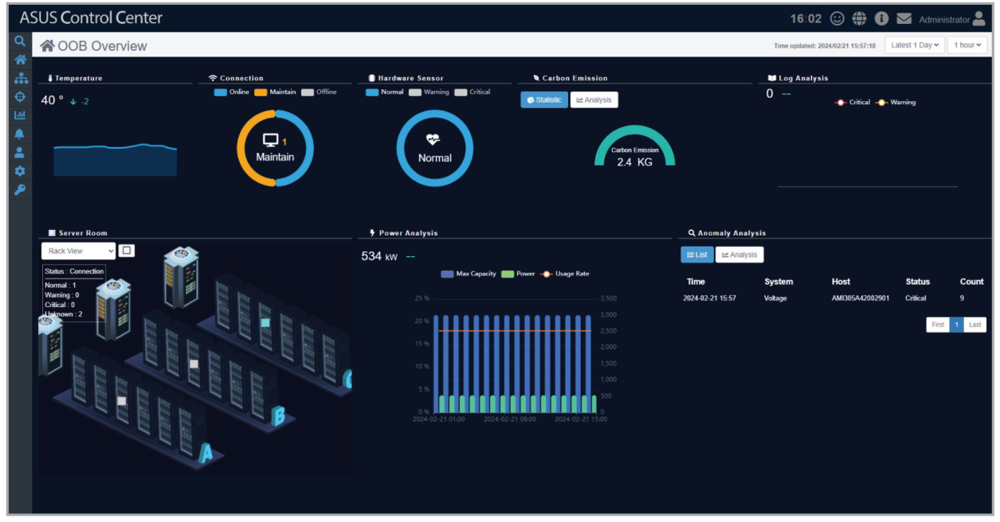
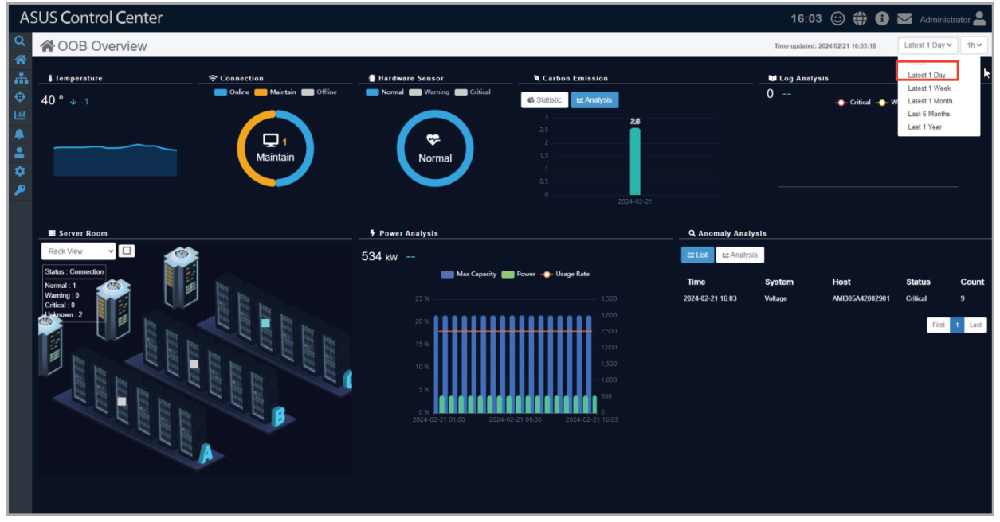
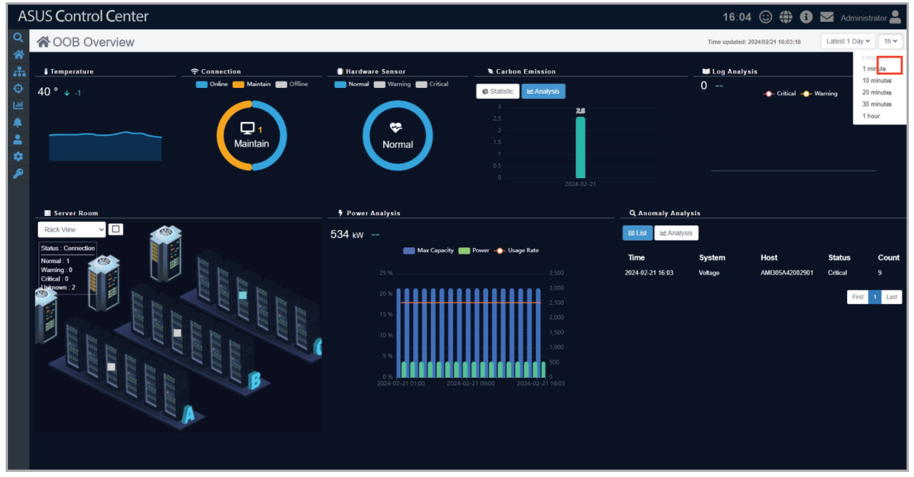
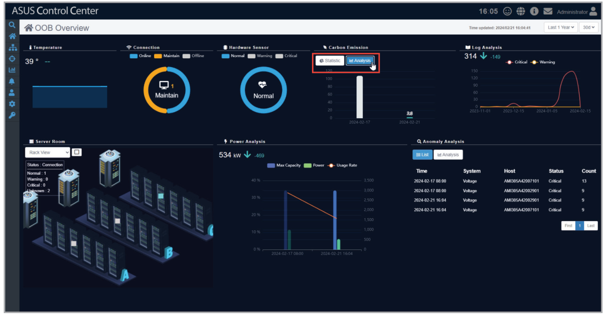

# OOB Overview

The OOB overview screen allows you to view information collected from sensors on all managed Redfish devices.

To access the **OOB Overview**, click  > **OOB Overview** from the left menu.

## Filtering the displayed information by time period

Select a time period from the **Period** drop down menu to only show records within the specified time period.

## Adjusting the frequency of displayed information

Select a frequency from the **Frequency** drop down menu to group the displayed information by the selected frequency.

## Switching between views for displayed information

In supported information blocks, select **Statistic**, **List**, or **Analysis** to switch between different views.

