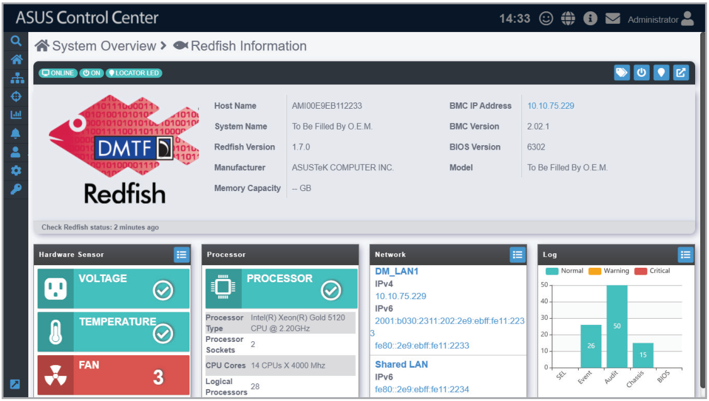
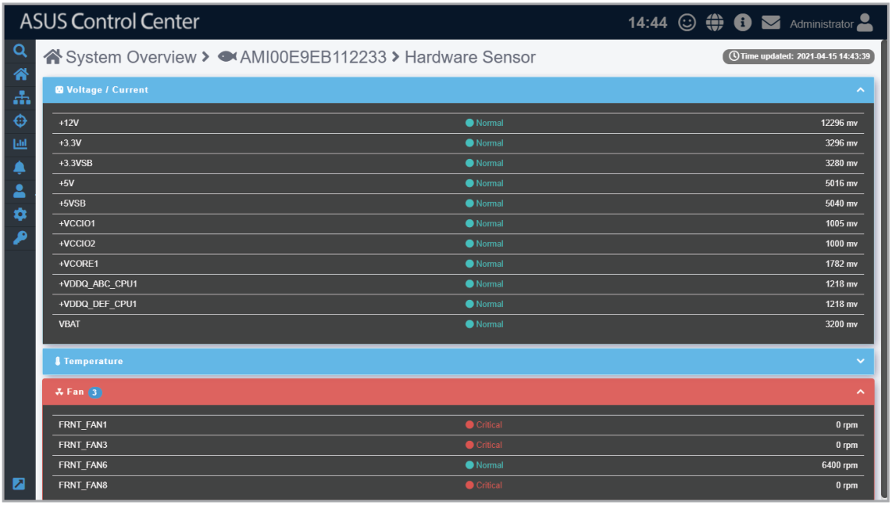
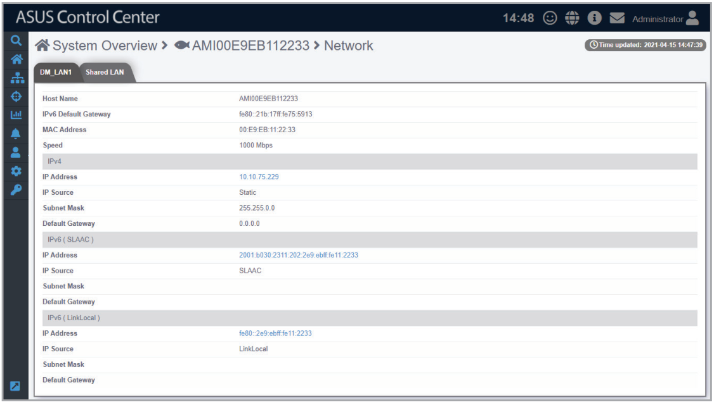
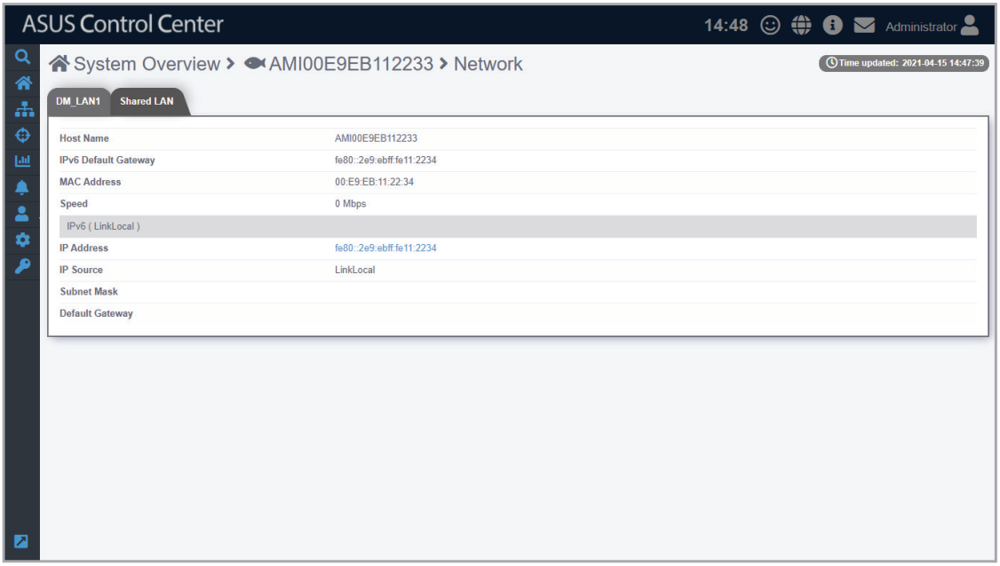

# Redfish Information

The **Redfish Information** screen gives you various functions to view detailed information and manage the selected Redfish device.

To access the **Redfish Information** of a managed device, click on the Redfish device you wish to view in the **Devices list**.

The **Redfish Information** screen will display the **Host Name**, **System Name**, **Redfish Version**, **Manufacturer**, **Memory Capacity**, **BMC IP Address**, **BMC Version**, **BIOS Version** and **Model** of the device. In the blocks located at the bottom of the screen, the **Processor** block also displays information on the processor of the Redfish device.

**Using the search bar and search options**

Refer to the **Search Options** and **Search and Filter Devices** sections of the **Monitor** chapter for more information.

## Redfish device Statuses and Quick Buttons

| Icon | Item | Description |
| --- | --- | --- |
|  | **Connection status** | This item displays the connection status of the selected Redfish device. |
|  | **Power Status** | This item displays the power status of the selected Redfish device. |
|  | **Locator status** | This item will turn green if the locator LED is enabled through the ACC Web UI. The locator LED allows you quickly locate the physical location of the device in a server rack. |
|  | **Metadata Editor** | This item allows you to edit the metadata of the Redfish device by double clicking in the **Value** field. |
|  | **Power Control** | This item allows you to power off or restart a Redfish device. |
|  | **Locator LED** | This item allows you to turn on/off the Locator LED. |
|  | **BMC** | This item will link to the BMC website. |
|  | **Detail** | This item will redirect you to the selected block’s (**Hardware Sensor**, **Network**, **Log**) details screen. |

## Hardware Sensor

This item allows you to view the details and values for the Voltage/Current, Temperature, and Fan items.

### Quick Buttons

| Icon | Description |
| --- | --- |
|  | Click to expand this block. |
|  | Click to minimize this block. |

## Network

This item displays the BMC network information of the Redfish device, you may also set the BMC using ASMB through the **DM_LAN1** and **Shared LAN** tabs.

> **NOTE:** The information entered in this section is for reference only.

### DM_LAN

This item is the communication port specifically for BMC, clicking on the BMC IP in the **IP Address** field for **IPv4**, **IPv6 (SLAAC)**, or **IPv6 (LinkLocal)** will redirect you to the ASMB page, allowing you to view the hardware sensor values of the device.

### Shared LAN

This item is the communication port for BMC and OS, clicking on the BMC IP in the **IP Address** field of **IPv6 (LinkLocal)** will redirect you to the ASMB page, allowing you to view the hardware sensor values of the device.

### Edit BMC using ASMB

To edit BMC settings using ASMB on the device:

1. Select **DM_LAN1** or **Shared LAN**, then click on any of the IP Addresses.

    

2. Log into ASMB.

    
