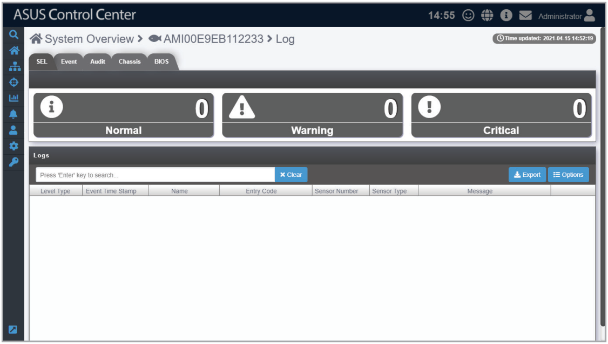
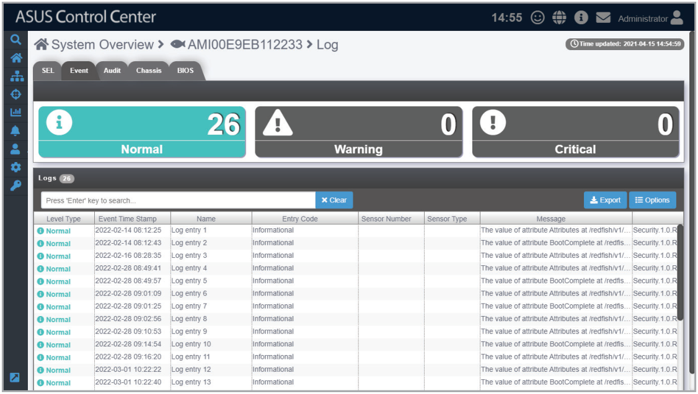
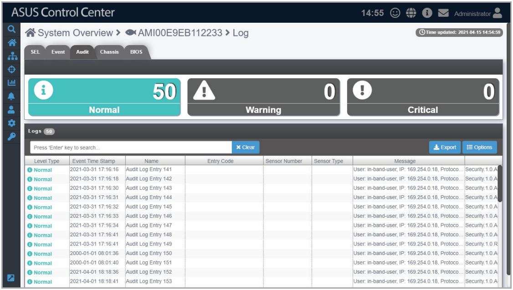
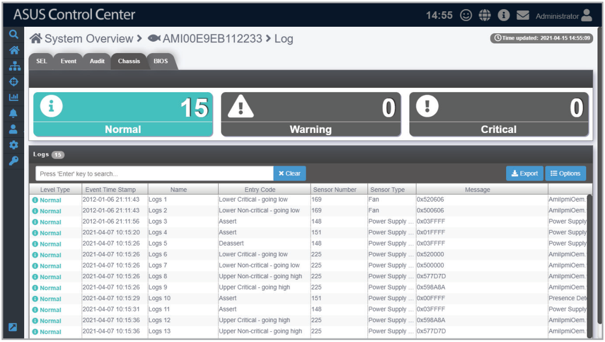

# Event Log

This item displays the logs for the Redfish device’s **SEL**, **Event**, **Audit**, **Chassis**, and **BIOS**. You may view each event log by clicking on the tabs. Click on an event to view more details about the event.

> **NOTE:** To export the Event Log click the **Export** button, enter a filename, then click **OK**.

## SEL tab

## Event tab

## Audit tab

## Chassis tab

## BIOS tab

