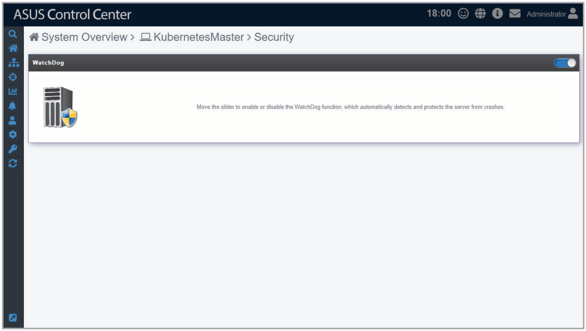
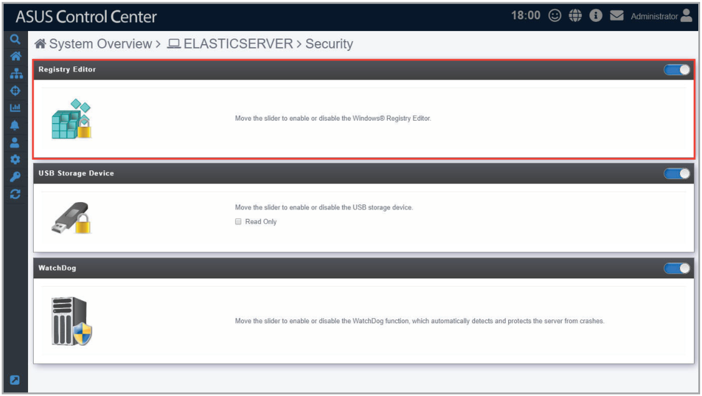
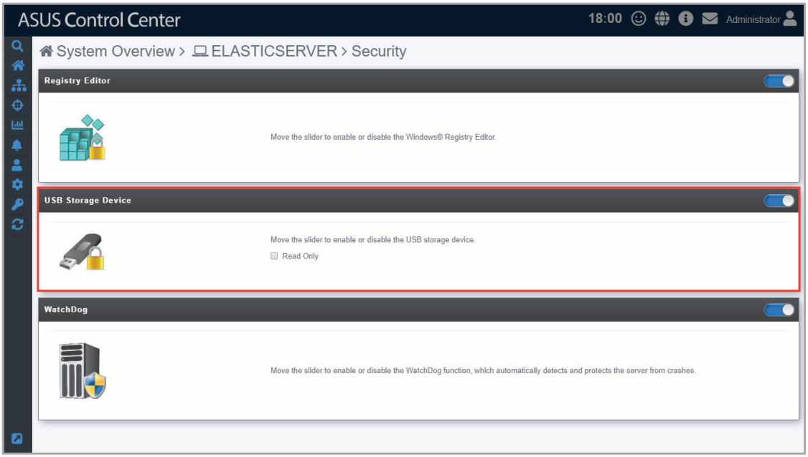
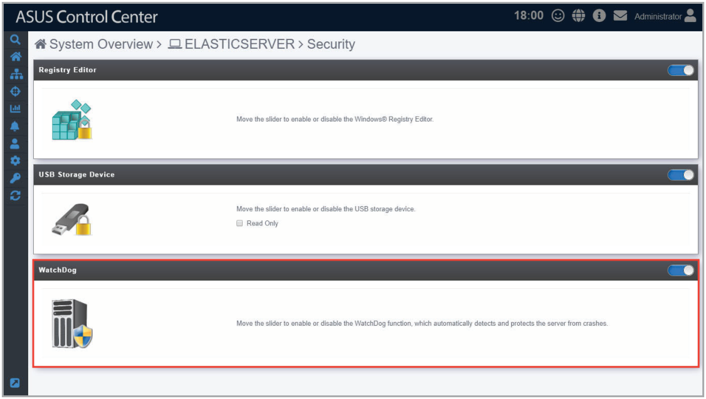

# Security

This item allows you to set permissions on the device for the **Registry Editor**, **USB Storage Device**, and **Watchdog**. For centralized permission settings on multiple devices, refer to the **Security Management** section.

> **NOTE:** Linux systems only support **Watchdog**.

**For Windows ® system:**

**For Linux system:**

## Registry Editor (Windows only)

The **Registry Editor** allows you to enable or disable access to Regedit Tool in Windows ® by the managed device’s user. Click the slider to enable or disable the **Registry Editor**.

## USB Storage Device (Windows only)

**USB Storage Device** allows you to enable or disable access of a USB storage device connected to a USB port on the managed device. You can also set USB storage devices to read-only permissions by checking the **Read Only** checkbox. Click the slider to enable or disable **USB Storage Device**.

## Watchdog

**Watchdog** allows you to enable or disable the Watchdog timer. When the watchdog timer in unresponsive due to hardware fault or program error, it will reboot the device. Click the slider to enable or disable **Watchdog**.

> **NOTE:** Auto Restart needs to be disabled on Windows ® Server 2016 or later versions for **Watchdog** to successfully reboot the device when required. To disable **Auto Restart**, search for **Control Center** in the Windows Search Box, then navigate to **System** > **Advanced System Settings** > **Startup and Recovery**.

