# Software

This item displays details on the software and applications with the **Application**, **Services**, **Processes**, **Environment Variables**, **Hotfix Info**, and **Application Usage Analysis** tab. You may also install applications from the **Software Market** tab.

> **NOTE:**
>
> - To export the table click the **Export** button, enter a filename, then click **OK**.
> - The tabs may differ between Linux and Windows ® systems.

**For Windows ® system:**

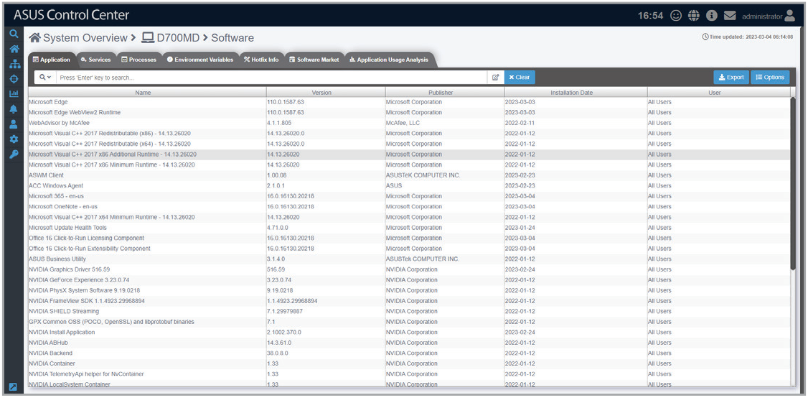

**For Linux system:**

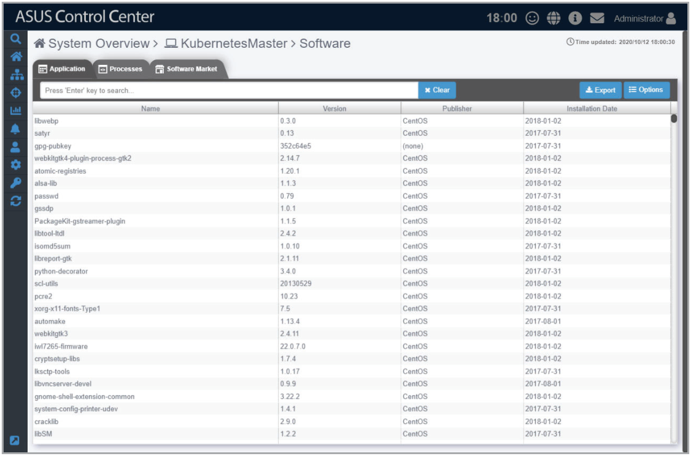

## Application

This tab shows all the applications installed on the managed device. On Windows ® devices, this is equivalent to the Programs and Feature list in most cases.

**For Windows ® system:**

**For Linux system:**

You may also click on an application then select **Uninstall** to uninstall the application.

> **NOTE:**
>
> - Uninstalling applications using the **Application** tab is disabled on Linux systems.
> - The **Uninstall** button will be grayed out if the uninstall option is unavailable for the selected application.

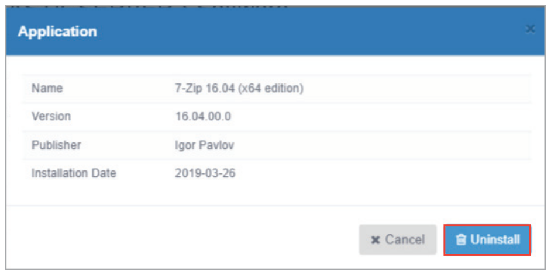

## Services (Windows only)

This tab shows all the services available on the managed device. On Windows ® devices, this is equivalent to the Task Manager’s services list in most cases.

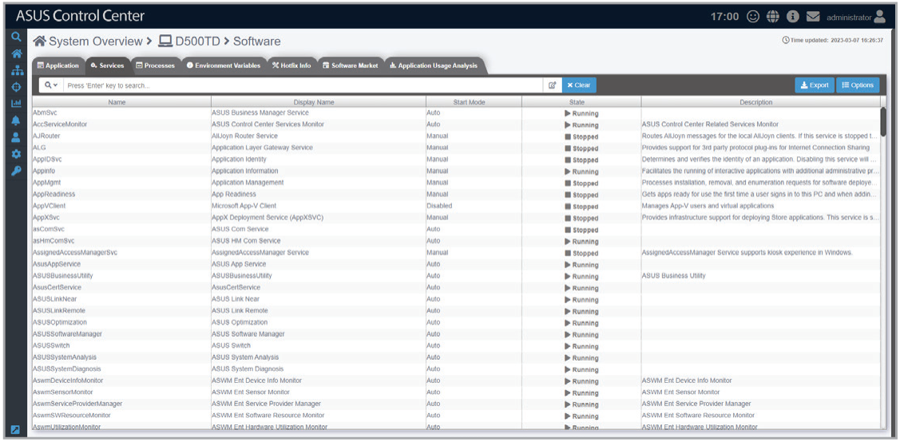

You may click on a service then choose to start the service by clicking on **Start**, stop a running process by clicking on **Stop**, or restart the service by clicking on **Restart**.

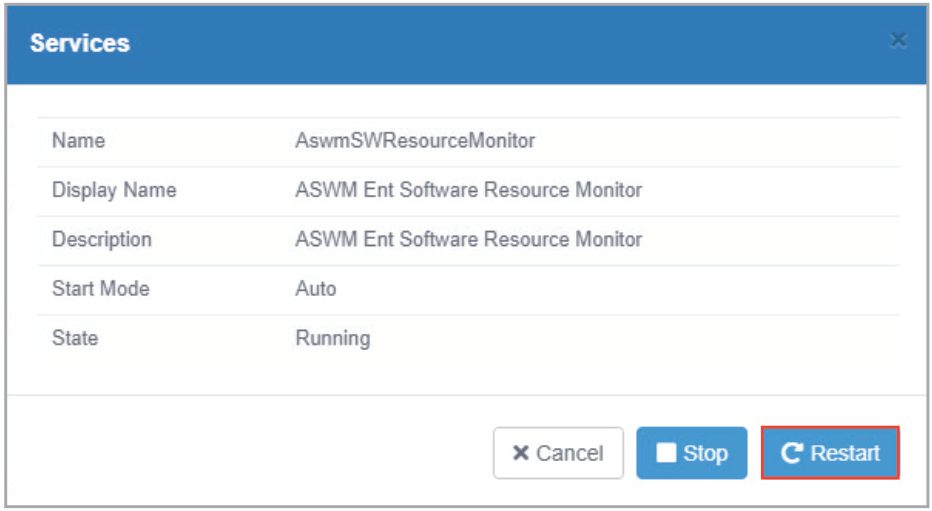

## Processes

This tab shows all the processes on the managed device. On Windows ® devices, this is equivalent to the Task Manager’s processes list in most cases.

**For Windows ® system:**

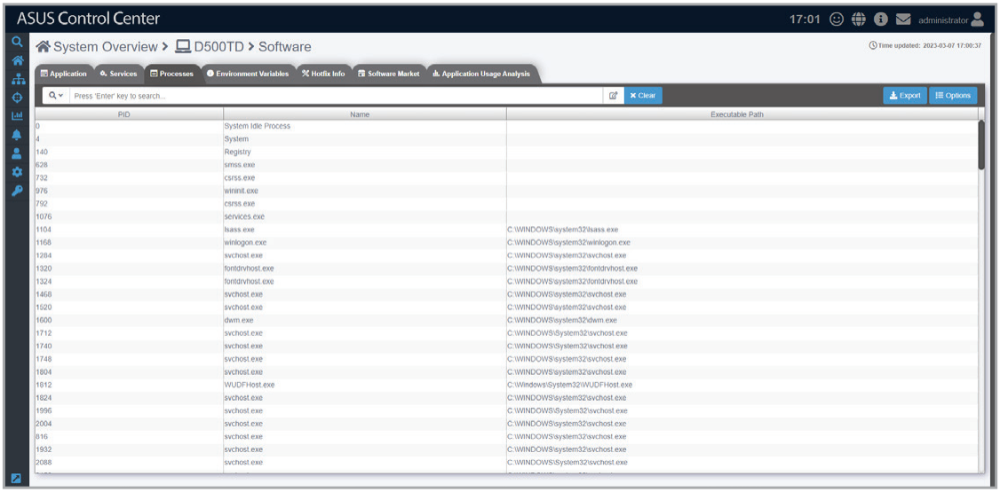

**For Linux system:**

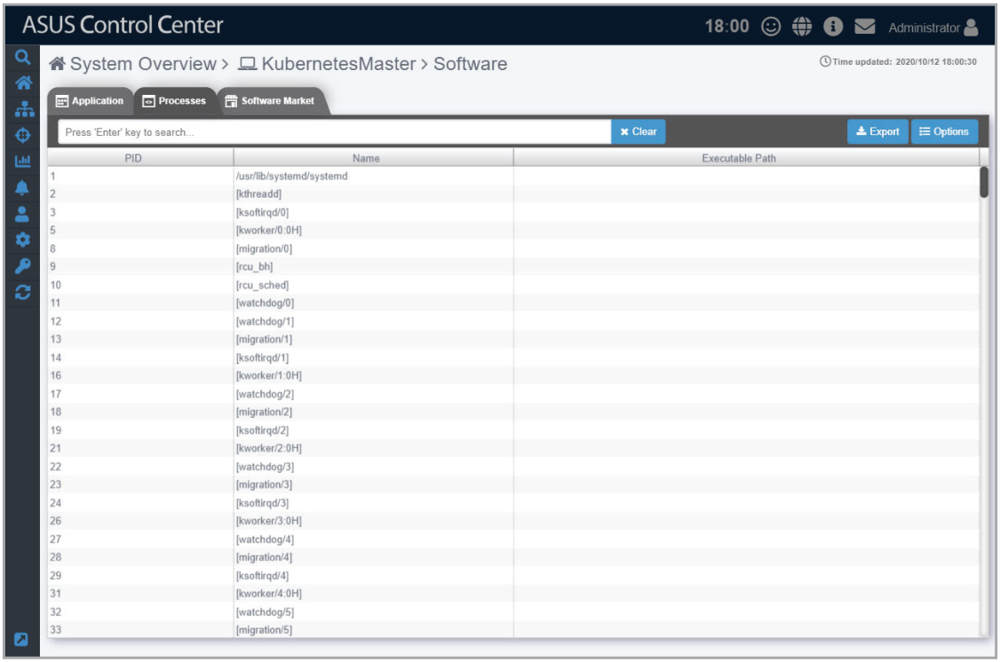

You may also click on a process then select **End Task** to end the process.

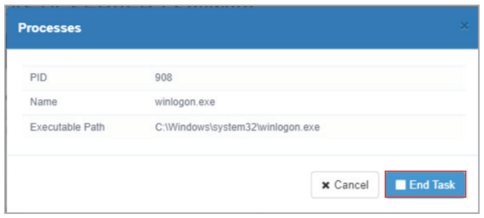

## Environment Variables (Windows only)

This tab shows all the environment variables on the managed device. On Windows ® devices, this is equivalent to the System Properties environment variables list in most cases.

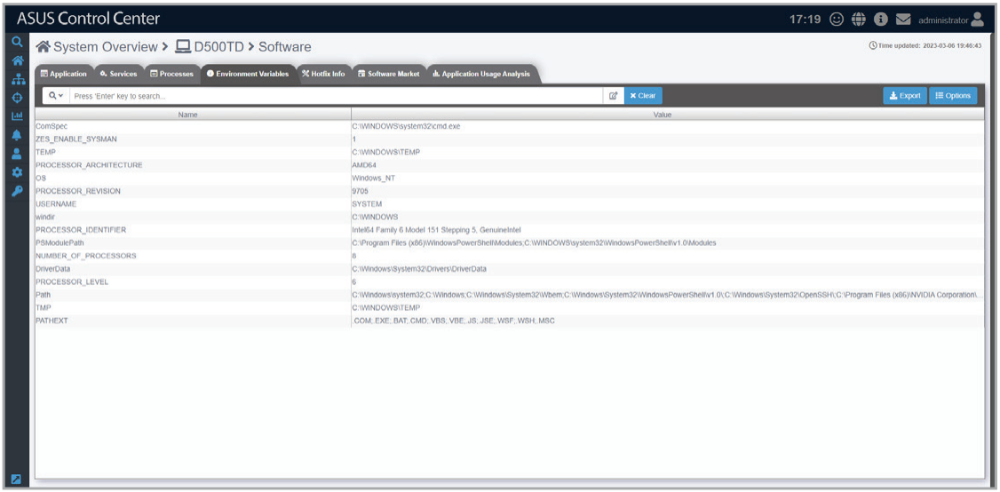

## Hotfix Info (Windows only)

This tab shows installed and still pending hotfix updates of a managed device, and also allows you to sort the hotfix by **MsrcSecurity**, **Categories**, or **Source**.

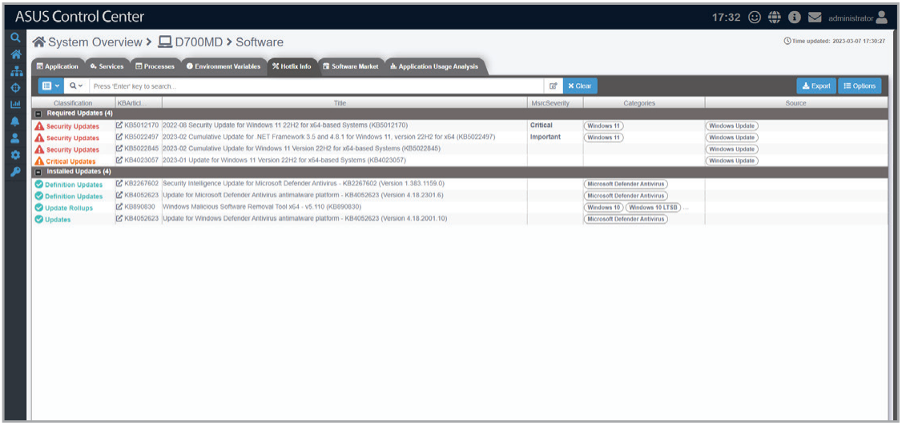

You can also filter the Hotfix by clicking on , then selecting **All**, **Installed Updates**, and **Required Updates** as your filter option, then view more information about the hotfix by clicking on an item in the hotfix list.

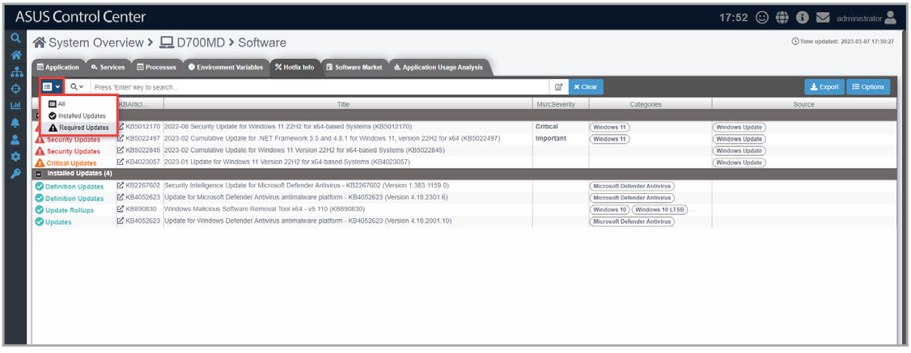

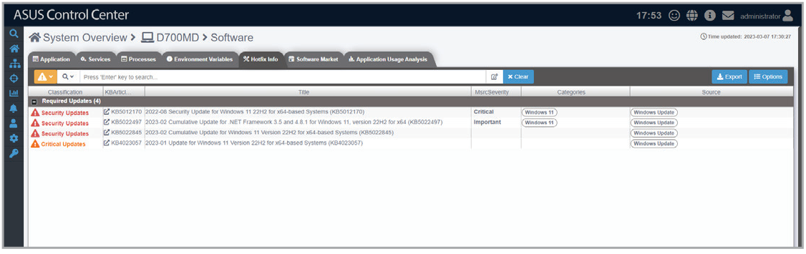

## Software Market

This tab shows software packages uploaded to the software pool, and also whether a software package has been installed to this device. The software packages displayed depends on the OS of this device, Windows ® devices will only see Windows ® software, and Linux devices will only see Linux software. You may also click on **Install Now** on software package that has not yet been installed on to install the software package to this device.

> **NOTE:** Refer to the **Software Pool** section for more information on adding and removing software packages from the software pool.

**For Windows ® system:**

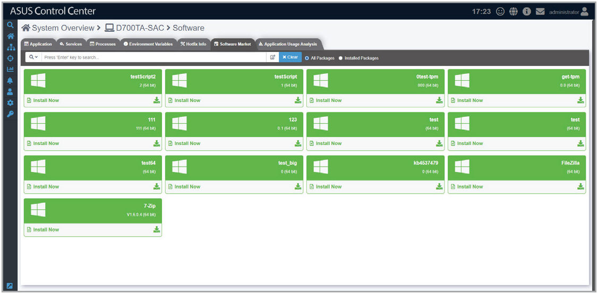

**For Linux system:**

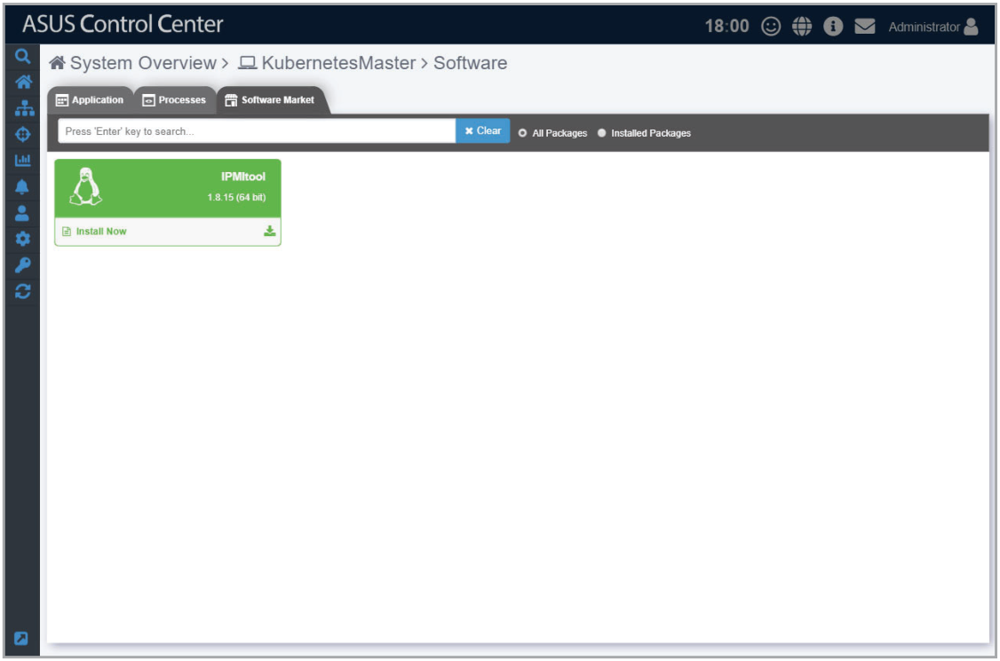

## Application Usage Analysis

This tab shows usage information for the top ten most used applications on the managed device. You can filter the Application List by date to only show usage information for the past day, week, month, half year, or year. Select an application in the Application List to view usage information for that specific application.

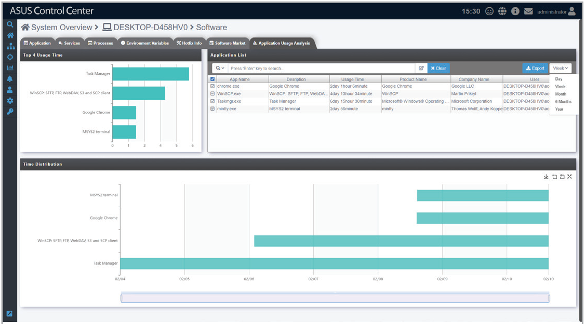

Click 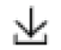 to save a screenshot of the time distribution graph. Click  and drag select a portion of the graph to zoom in. To zoom out, click 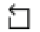 to return to the previous zoom level or 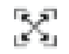 to return to the default zoom level.

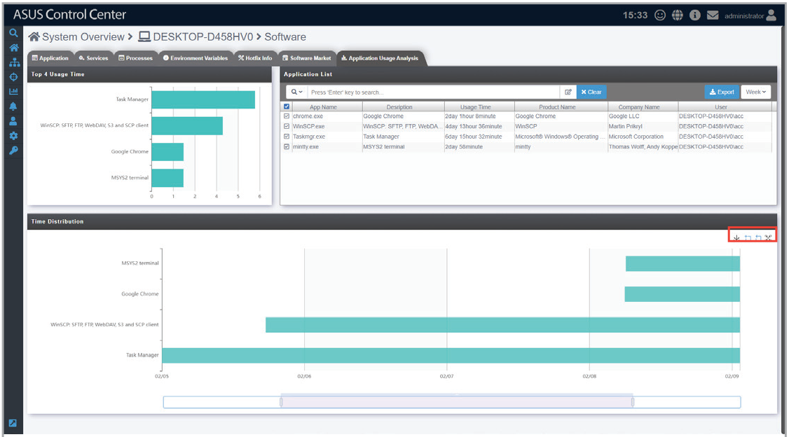
