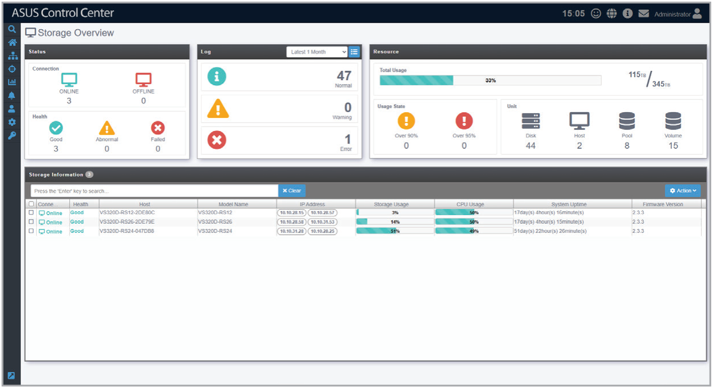
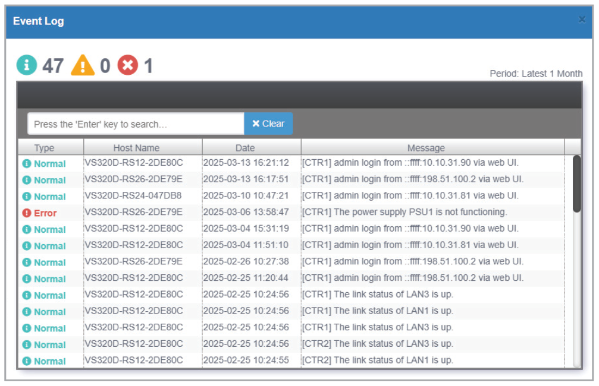
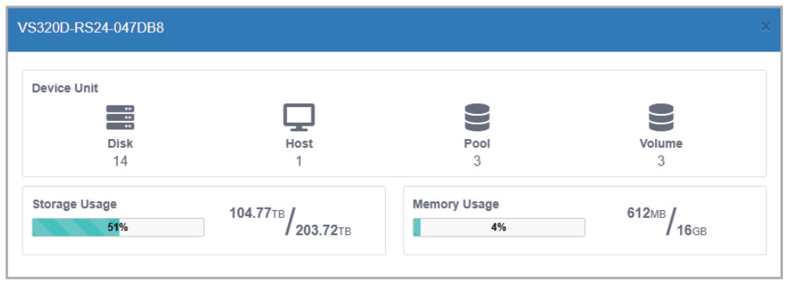
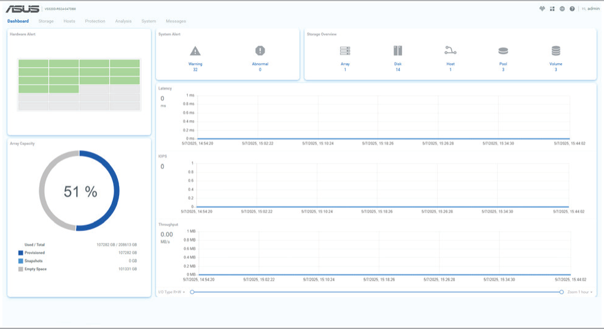

# Storage Overview

The storage overview screen allows you to view information from all managed storage devices.

To access **Storage Overview**, click  > **Storage Overview** from the left menu.

> **NOTE:** Refer to the **Add/Remove Storage** section of the **Deployment** chapter for more information on adding or removing managed storage devices.

## Viewing the storage device event log

To view the storage device event log, select a date range from the drop-down menu in the **Log** block, then click the  icon.

## Viewing detailed storage information

Click a managed storage device in the **Storage Information** block to view detailed information.

## Opening the ASUS Storage dashboard

Click the IP address of a managed storage device in the **Storage Information** block to open the ASUS Storage dashboard.

## Shutting down or restarting a managed storage device

Click **Action** in the **Storage Information** block, then select the desired action from the **Power Control** menu.

**Using the search bar and search options**

Refer to the **Search Options** and **Search and Filter Devices** sections of the **Monitor** chapter for more information.
