# System Overview

The **System Overview** screen gives you a quick overall status check for all managed devices and basic overview of device status at a glance. You may also select an individual managed device for details on its status, or perform actions such as remotely control it, power it off, or turn on its locator LED.

To access the **System Overview**, click  > **System Overview** from the left menu.

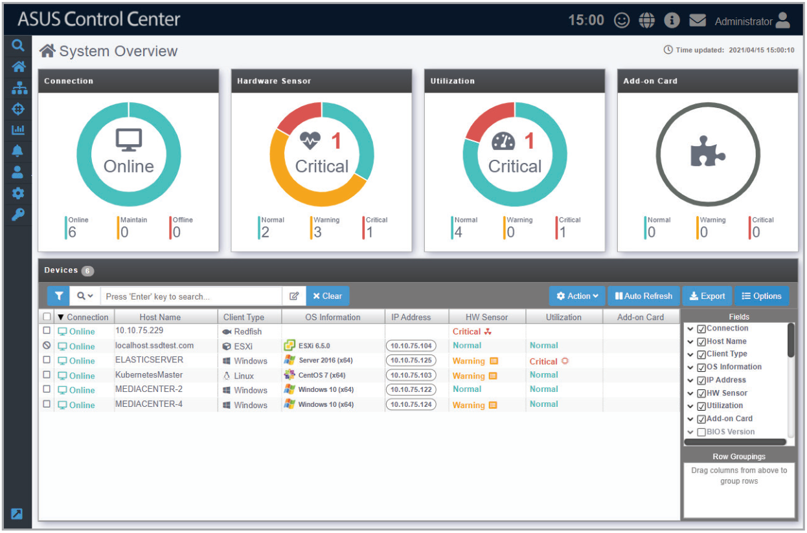

## Status Dashboard

These items allow you to view a summary of the connection status, hardware status, and utilization status of all managed devices, as well as the event log of the managed devices. This will help you pinpoint problems such as connection errors, hardware sensor errors, or utilization errors at a quick glance.

### Connection overview

The Connection overview circle displays the connection statuses of managed devices. The number of devices for each status is also displayed below the overview circle.

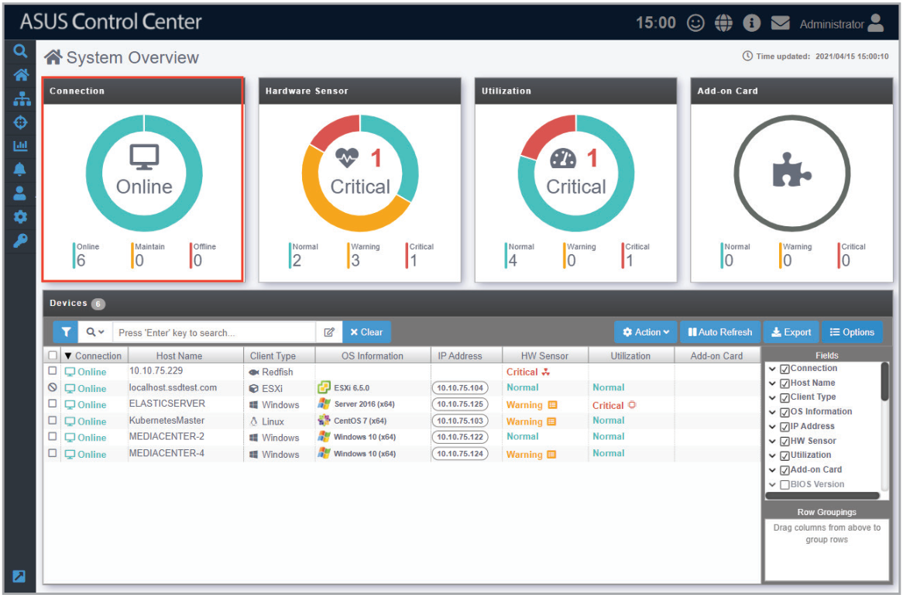

Please refer to the table below for the color status of the Connection overview circle

| Color | Green | Orange | Red |
| --- | --- | --- | --- |
| **Connection Status** | Online | Maintain\* | Offline |

> **NOTE:** This status indicates that the managed device’s agent is updating.

### Hardware Sensor overview

The Hardware Sensor overview circle displays an overview of the Voltage, Temperature, Fan, Backplane, Power Supply, Chassis, and S.M.A.R.T. statuses of managed devices. The number of devices for each status is also displayed below the overview circle.

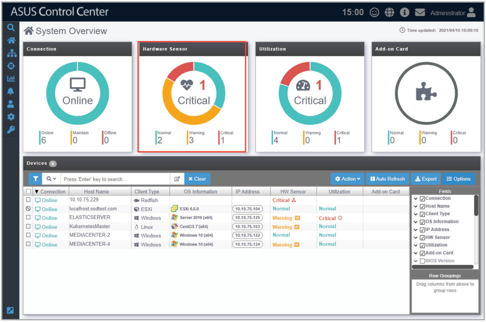

Please refer to the table below for the color status of the Hardware Sensor overview circle

| Color | Green | Orange | Red |
| --- | --- | --- | --- |
| **Hardware Sensor Status** | Normal | Warning | Critical |

### Utilization overview

The Utilization overview circle displays an overview of the CPU, DIMM, Partition, and Network statuses of managed devices. The number of devices for each status is also displayed below the overview circle.

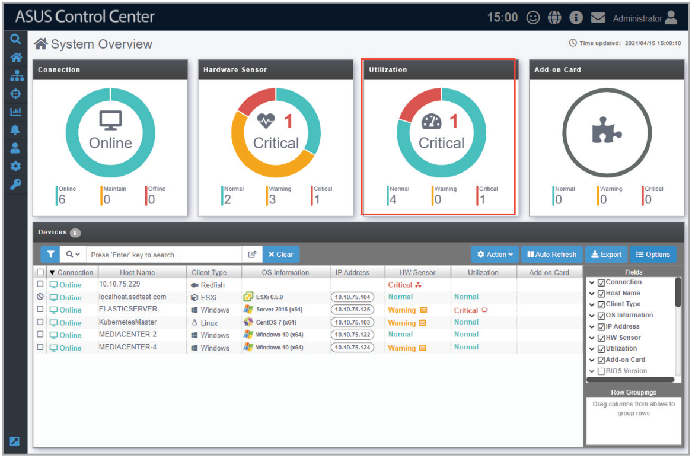

Please refer to the table below for the color status of the Utilization overview circle

| Color | Green | Orange | Red |
| --- | --- | --- | --- |
| **Utilization Status** | Normal | Warning | Critical |

### Add-on Card overview

The Add-on Card overview circle displays an overview of the Add-on card statuses of managed devices. The number of devices for each status is also displayed below the overview circle.

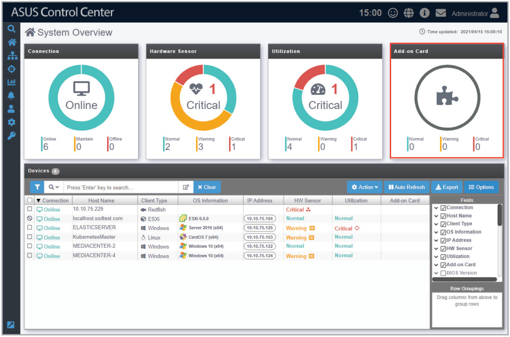

Please refer to the table below for the color status of the Add-on Card overview circle

| Color | Green | Orange | Red |
| --- | --- | --- | --- |
| **Add-on Card Status** | Normal | Warning | Critical |

## Devices list

The **Devices** list displays all managed devices as well as the metadata on each managed device. You may also access the remote desktop for these managed devices; remotely power on, off, or reset these managed devices; or export the list of managed devices and their metadata to a .csv file. These functions provide you with a effortless method of accessing commonly used functions for managing these devices.

> **NOTE:**
>
> - To add more metadata columns to the **Devices** list, click on **Options**, then check the metadata item you wish to display.
> - Click on the name of a column header to sort the filter results alphabetically.
> - The **Devices** list will display the items that correspond to the search and filter results. For more information on using search and filter, please refer to the **Search and Filter devices** section.

### Setting power control (Action)

You can control the power settings of selected devices from the **Devices** list allowing you quick access to power controls such as powering on and off, rebooting, and refreshing the device without having to navigate to **Power Control** located under **Centralized** or **Device Information**.

1. Select the devices you would like to apply the power control option to.
2. Click on the . You can check or uncheck items in the popup window that appears, confirm that the correct devices are selected, then click **Update**.

    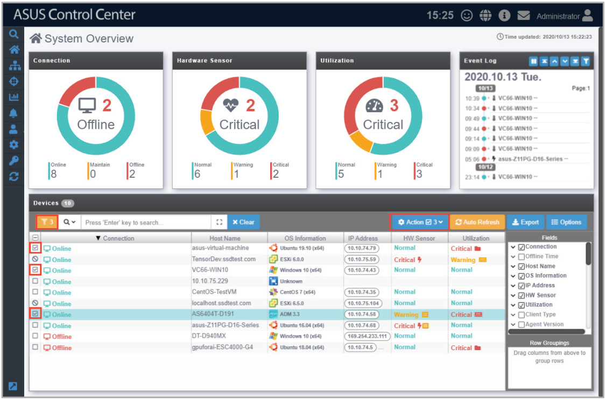

    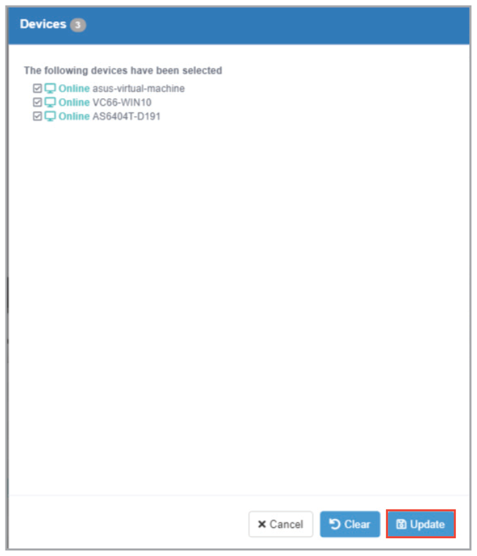

3. Click on **Action**, then select the power control option you would like to apply to the selected devices.

    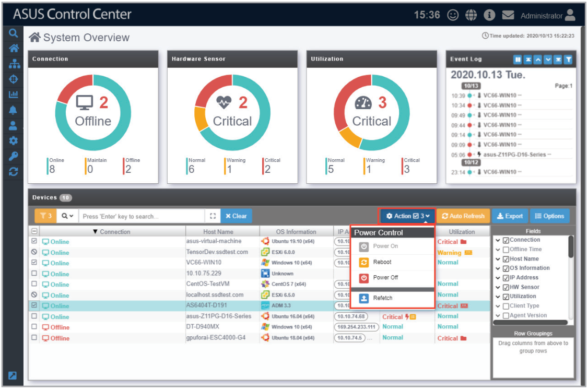

### Auto Refreshing the devices list (Auto Refresh)

The **Auto Refresh** function will automatically refresh the items shown on the web page. Disabling Auto Refresh will only disable the web page refresh, but the ASUS Control Center will still receive updates from the agents of managed devices. Click on the **Auto Refresh** button to enable () or disable () it.

### Exporting devices list (Export)

You can export the managed devices and metadata in the **Devices** list to a CSV or PDF file.

1. Click **Export**, then select an **Export Type** and enter the **File Name** in the popup window.
2. (Optional) To include or exclude a metadata field in the export, click and drag it to the left column to exclude it or to the right column to include it.
3. Click **Export in the popup window** to export the device list based on the selected settings.

    

    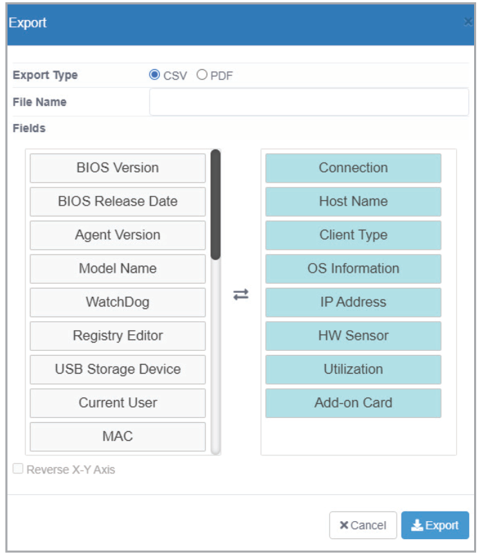

### Using the sensor shortcut

Clicking on a **Warning** or **Critical** status in the **HW Sensor**, **Utilization**, and **Add-on Card** column of a managed device will redirect you to the **Hardware Sensor** and **Utilization** page of a managed device, allowing you to quickly locate your problem.

> **NOTE:** The sensor shortcut function will only redirect you to the **Hardware Sensor** or **Utilization** page of the managed device if the status is **Warning** or **Critical**.

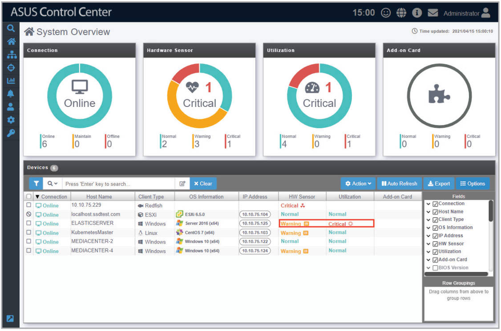

**Link to managed device’s Hardware Sensor:**

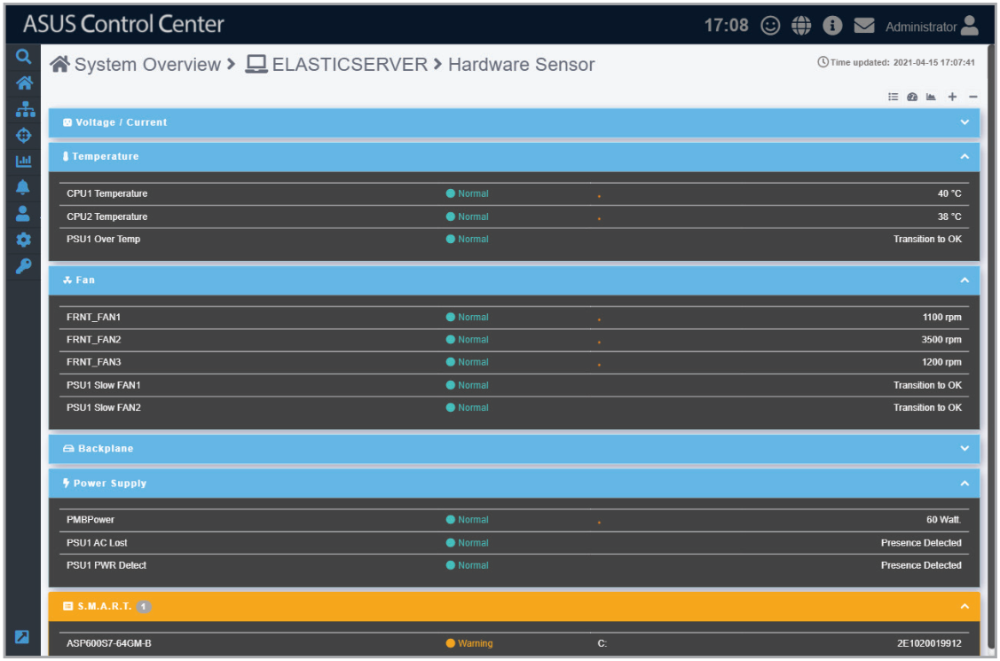

**Link to managed device’s Utilization:**

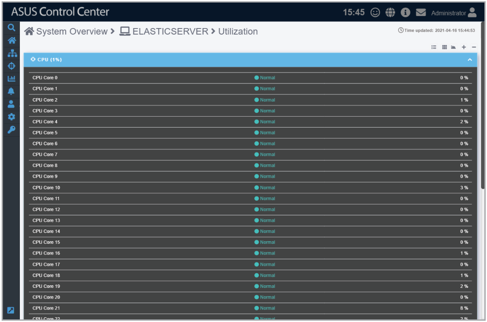

## Search Options

Clicking on **Options** will display the **Fields** and **Row Groupings** functions. The **Fields** function controls which metadata columns are displayed in the **Devices** list. You can check the metadata items you wish to hide or display in the **Fields** list.

> **NOTE:** For more information, please refer to the **Metadata Management** section.

You can sort and group the managed devices in the **Devices** list according to a column criteria using the **Row Groupings** function.

### Hiding or displaying metadata fields

1. Click on **Options** to display the **Fields** window.

    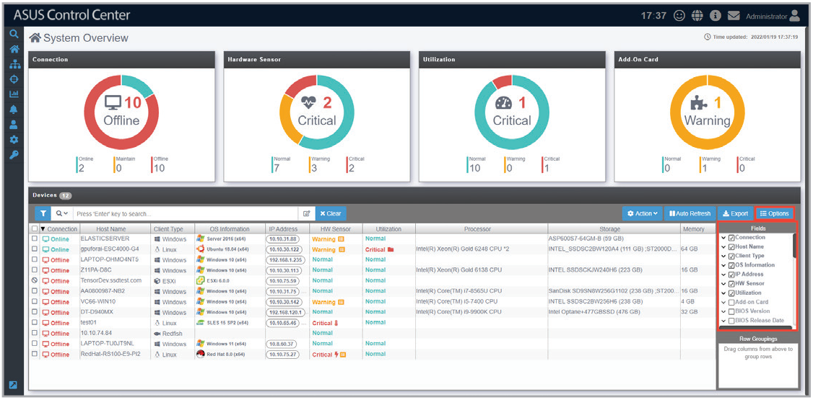

2. You can check the metadata field in the **Fields** window to hide or display the metadata field. In the screenshot below, the **Client Type** field is checked.

    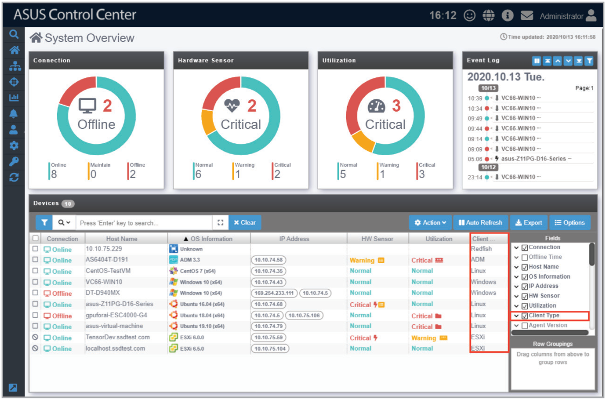

### Using the Row Groupings function

1. Drag the column items from the **Fields** list into the **Row Groupings** list to filter by those columns.

    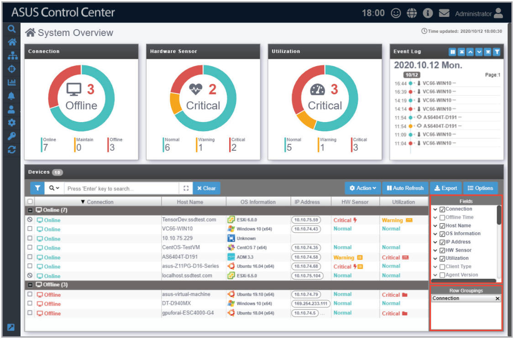

2. Click on the **X** to remove or disband a row.

    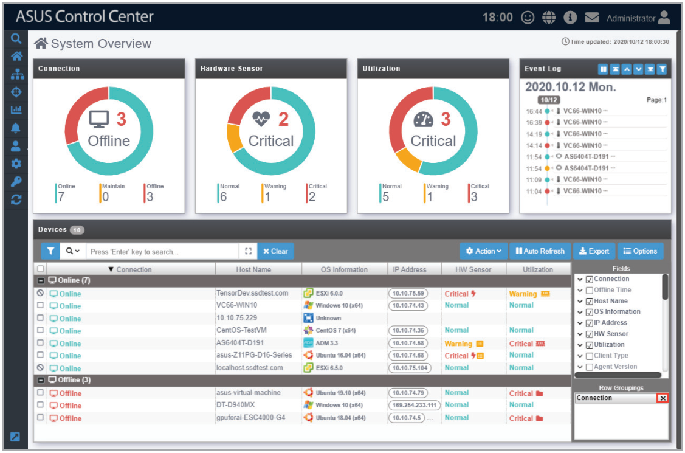

### Accessing remote desktop

The remote control function provides a flexible interface for device management through the desktop or command-line accessed in ASUS Control Center. You can quickly access the remote desktop of managed devices from the **Devices** list, without having to navigate to **Device Information**.

Device operating systems which support remote control:

| Operating System | Supported Versions |
| --- | --- |
| **Windows 7** | Professional, Enterprise, Ultimate |
| **Windows 8** | Professional, Enterprise |
| **Windows 10** | Professional, Enterprise |
| **Windows Server** | 2008, 2008 R2, 2012, 2012 R2, 2016 |
| **Windows Multipoint Server** | 2011, 2012 |
| **Windows Small Business Server** | 2008, 2011 |

1. In the **System Overview** screen, select a managed device from the **Devices** list.
2. Click on the **IP address** of the selected device, you should be directed to the **Remote Desktop Login** screen.

    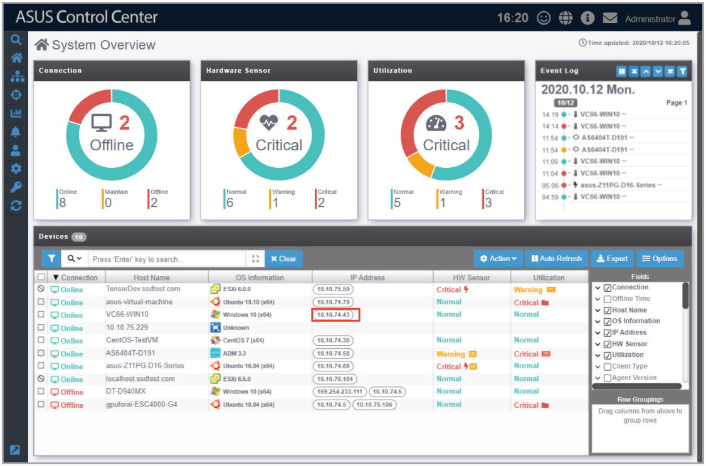

3. Select a resolution to display the managed device in the Remote Desktop window.
4. Select the login Account type, then enter the **Account**, **Password**, and **Domain** information.

    > **NOTE:**
    >
    > - **Local Account**: The agent’s administrator privileges only allow you to manage the device the agent is installed on.
    > - **Domain Account**: The agent’s administrator privileges allow you to manage all devices in the domain. The **Domain** field only appears if you selected **Domain Account**.

    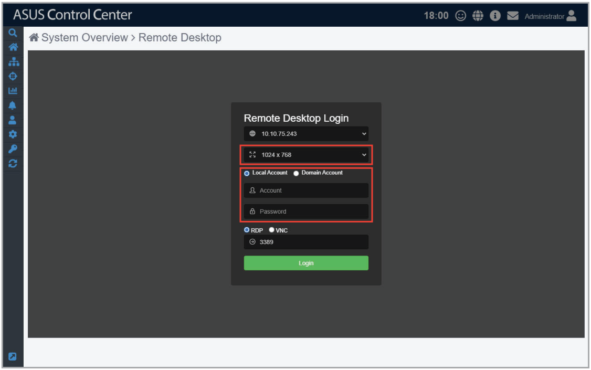

5. Select the protocol to use when connecting, then click **Login**.

    > **NOTE:**
    >
    > - Linux and Windows ® systems use different protocols, ensure the managed device is reachable through the selected protocol:
    >     - **RDP:** Available on Windows only; allows only a single user to view and configure at the same time.
    >     - **VNC:** Available on both Windows and Linux; allows multiple users to view and configure at the same time.
    >     - **SSH:** Available on Linux only.

    > **IMPORTANT:**
    >
    > - Ensure the managed device you wish to remote control has a stable power supply and Internet connection.
    > - The managed device may be remote controlled if it is logged out or locked, but cannot be remote controlled if the managed device is powered off or in sleep mode. If the managed device is in sleep mode, please wake the device using the **Power Control (Wake-on-LAN)** function.
    > - (for RDP only) Please ensure that the following two items are checked on the remote device and enabled to allow remote connections to the remote device. Search for **Control Panel** in the Windows Search Box, then navigate to **System** > **Remote settings**.
    > - (for RDP only) Please ensure that the **Microsoft Remote Desktop** application is enabled in the **Windows Defender Firewall Allowed Apps** list. Search for **Control Panel** in the Windows Search Box, then navigate to **Windows Defender Firewall** > **Allowed Apps**.

    

6. Once the login has been successfully authenticated, you will be logged into the desktop or command line of the device system; this varies between systems.

    > **NOTE:** To switch mouse and keyboard control to the ASUS Control Center, press `<Ctrl>` + `<Alt>` on the keyboard. To switch mouse and keyboard control back to the remote device, click in the remote device window.

7. Click on the Menu Path at the top of the screen, or click on another menu item from the left menu to end the remote session.

## Search and Filter Devices

There are various methods of searching and filtering managed devices on the System Overview screen, giving you the freedom of searching or filtering managed devices according to your needs.

> **NOTE:** The screenshots in this section are for reference only and may differ according to the different ASUS Control Center functions, but the steps remain the same.

### Filter devices using the Overview Circle

> **NOTE:** To clear the filter and view all managed devices, click on **Clear**.

1. Click on a colored segment of an overview block to filter according to the selected overview and status:
    - **Connection:** Click on a colored segment on the circle to display all items which correspond to the selected connection status.
    - **Hardware Sensor:** Click on a colored segment on the circle to display all items which correspond to the selected hardware sensor status.
    - **Utilization:** Click on a colored segment on the circle to display all items which correspond to the selected utilization status.
    - **Add-on Card:** Click on a colored segment on the circle to display all items which correspond to the selected Add-on Card status.
2. The filter criteria and filtered managed devices will be displayed in the **Devices** list. You may select a single managed device from the list to view more details.

    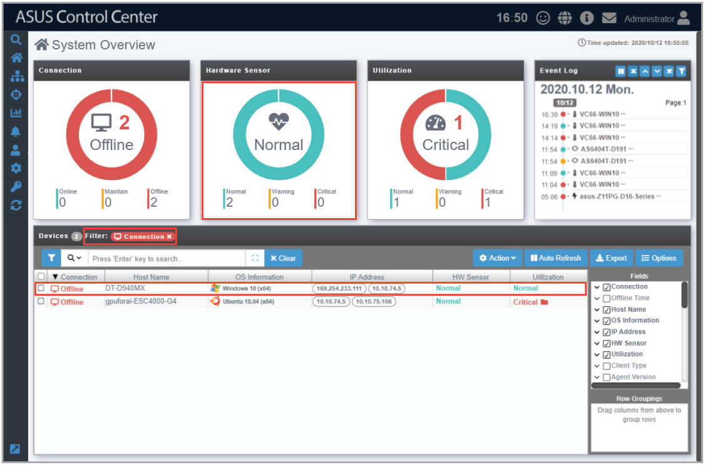

### Filter devices using the Search Bar

> **NOTE:** To clear the filter and view all managed devices, click on **Clear**.

1. Enter keywords into the Search bar.
2. Click on , then select the operator you wish to use.

    > **NOTE:**
    >
    > - Selecting the **Search with 'AND' operator** option will return search results of items which match all the keywords.
    > - Selecting the **Search with 'OR' operator** option will return search results of items which at least one of the keywords.
    > - Checking the **Full string compare** option will only return search results of items which have a string with an exact match to the keywords, and can be applied to any of the above search operators selected.

    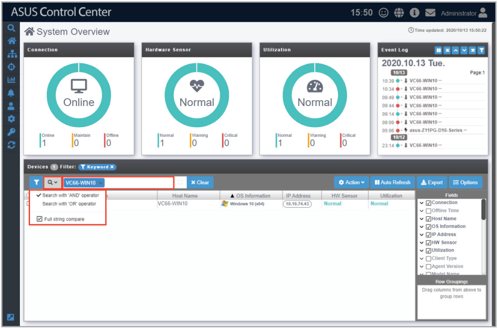

3. (optional) You may also click on  to expand the search bar to view, edit or add additional search criteria. You may also import a .csv file by clicking on **Import**. Click on **Save** once you are finished editing your search criteria.

    > **NOTE:**
    >
    > - Selecting the **‘AND’** option will return search results of items which match all the keywords.
    > - Selecting the **'OR'** option will return search results of items which at least one of the keywords.
    > - Enabling the **Full string compare** option will only return search results of items which have a string with an exact match to the keywords, and can be applied to any of the above search operators selected.
    > - Enabling the **Sensors Type Filter** option will allow you to limit your search results to the **Hardware Sensor**, **Utilization** and **Other** criteria you have checked.

    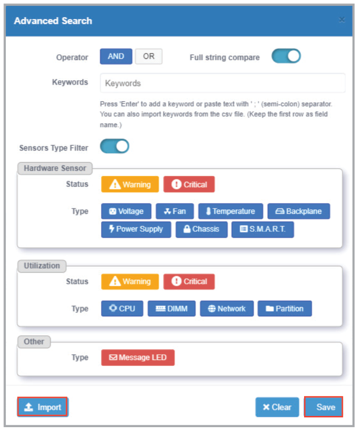

4. The search results will be displayed in the **Devices** list.
    - Result of selecting the **Search with ‘AND’ operator** option.

        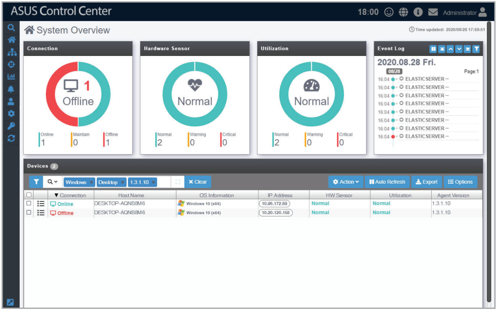

    - Result of selecting the **Search with ‘OR’ operator** option.

        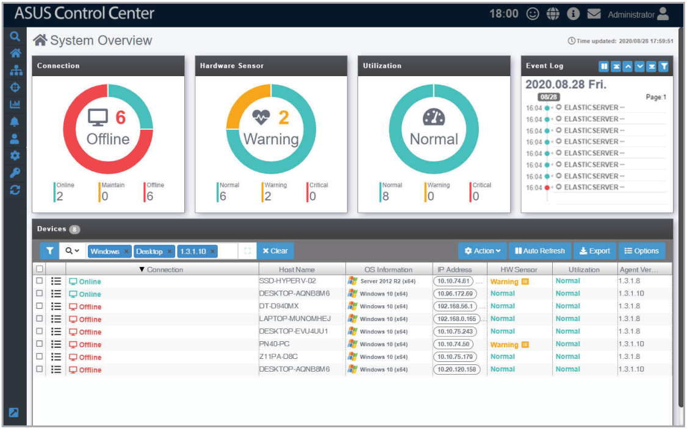

### Filter devices using Column Headers

> **NOTE:** To clear the filter and view all managed devices, click on **Clear**.

1. Hover over a column header in the **Devices** list then click on .

    > **NOTE:** Some column headers may not support the filter function.

2. Select a filter rule (**Contains**, **Equals**, **Starts with**, **Ends with**) and enter the keyword to search.

    > **NOTE:**
    >
    > - To add more metadata columns to the **Devices** list, click on **Options**, then check the metadata item you wish to display.
    > - Click on the Name of a column header to sort the filter results alphabetically.

    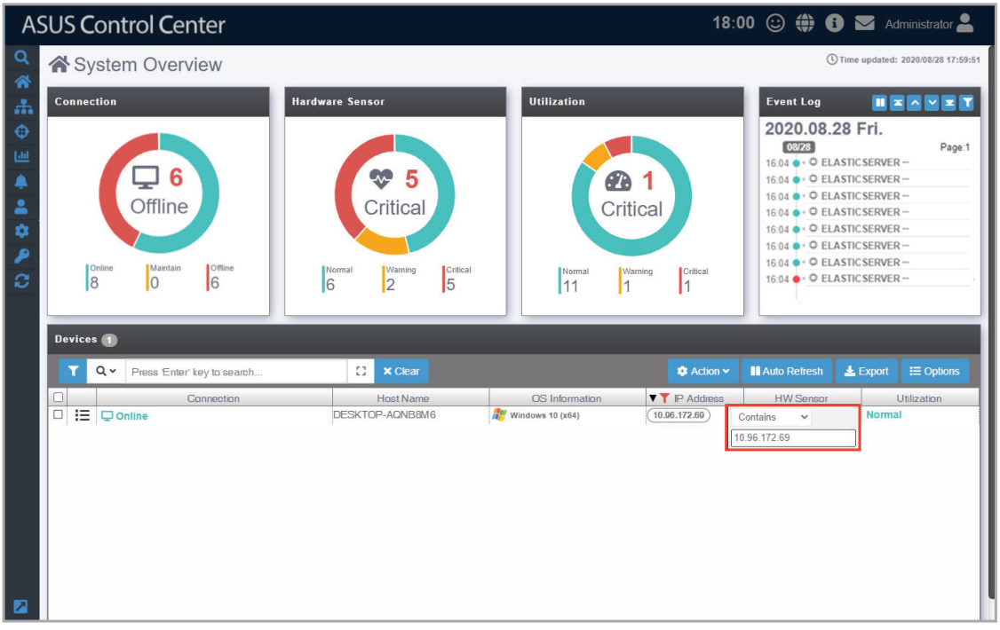
