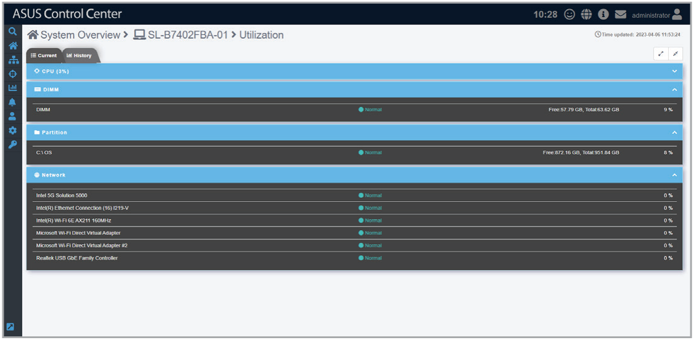
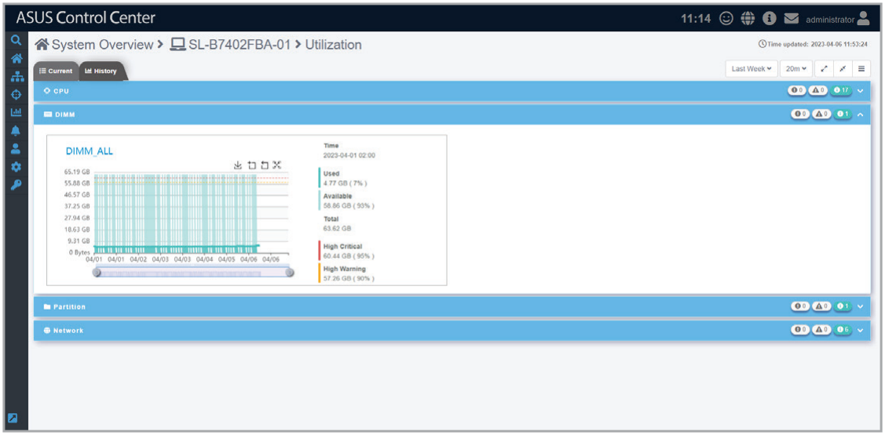
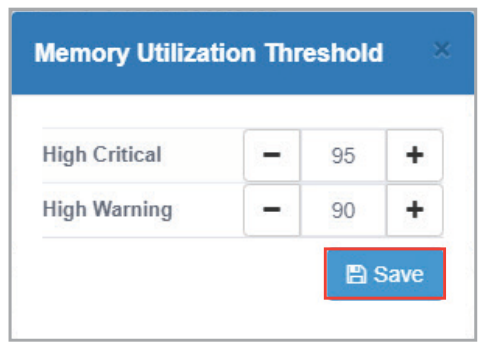
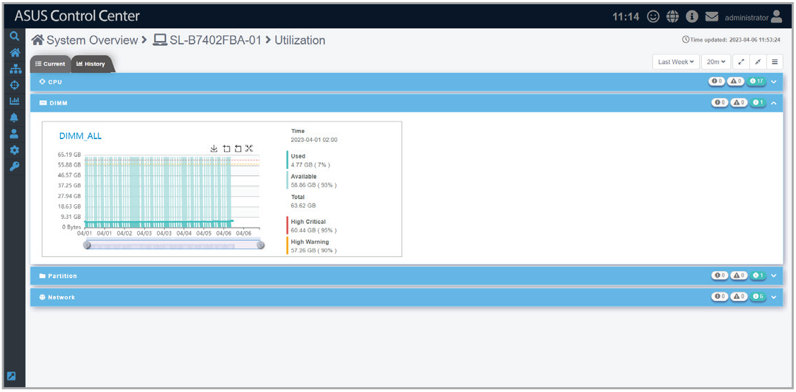
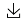
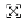
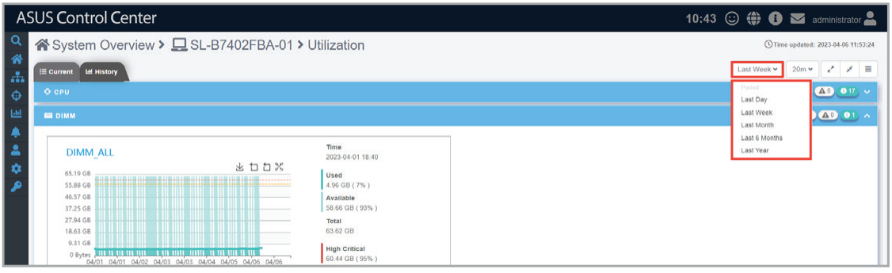
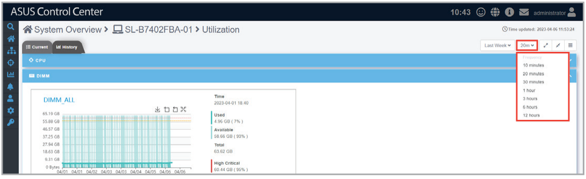
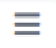
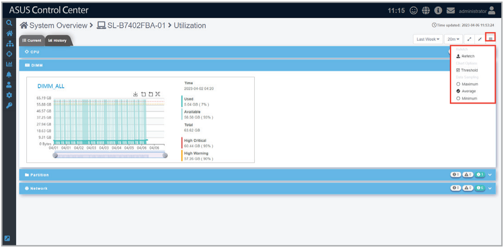

# Utilization

This item allows you to view real time data and set the utilization threshold value for the CPU, DIMM, Partition, and Network.

> **NOTE:** The Disk Partition block naming may differ between Windows ® and Linux systems. The Disk Partition block is titled **Partition** for Windows ® systems, and **File System** for Linux systems.

## Quick Buttons

| Icon | Description |
| --- | --- |
|  | Click to switch to the Current tab. |
|  | Click to switch to the History tab. |
|  | Click to expand all blocks. |
|  | Click to minimize all blocks. |
|  | Click to expand this block. |
|  | Click to minimize this block. |

## Toggling between tabs

You can switch between different **Utilization** tabs by clicking the tabs in the top bar.

-  **Current tab (default)**

    

-  **History tab**

    

## Editing the threshold values

You can edit the critical and warning threshold values for **Utilization** items.

1. Click on a item to adjust the threshold values:
    - High Critical: When the value exceeds this threshold value, the sensor will display **Critical**.
    - High Warning: When the value exceeds this threshold value, the sensor will display **Warning**.

    > **NOTE:** The threshold options for each item may vary.

2. Click on **Save** once you have finished adjusting the threshold values of the item.

    

## Customizing the Utilization history tab

You can customize the history tab which displays historical data for the CPU, DIMM, Partition, and Network sensor events according to different periods of time.

### Quick Buttons

| Icon | Description |
| --- | --- |
|  | Click to expand all blocks. |
|  | Click to minimize all blocks. |
|  | Click to expand this block. |
|  | Click to minimize this block. |

### Chart Quick Buttons

| Icon | Description |
| --- | --- |
|  | Click to download an image of the chart as a .png file. |
|  | Click to zoom in on the timeline of the chart. |
|  | Click to zoom out on the timeline of the chart. |
|  | Click to restore the chart to its default view. |

You can customize the charts by selecting the period of time you wish to view for the charts, then selecting the frequency for which the sensors should return data. This will be applied to the charts for all the sensors shown on this page.

| Period of time | Frequency |
| --- | --- |
| **Last day** | 1 minute, 10 minutes, 20 minutes, 30 minutes, 1 hour |
| **Last week** | 10 minutes, 20 minutes, 30 minutes, 1 hour, 3 hours, 6 hours, 12 hours |
| **Last month** | 30 minutes, 1 hour, 3 hours, 6 hours, 12 hours, 1 day |
| **Last 6 months** | 3 hours, 6 hours, 12 hours, 1 day, 7 days, 14 days |
| **Last year** | 6 hours, 12 hours, 1 day, 7 days, 14 days, 30 days |

Additionally, by clicking on the  icon, you can customize the data you wish to view on the chart.

| Item | Description |
| --- | --- |
| **Refetch** | Allows you to trigger a refetch of device data. |
| **Chart Options** | Allows you to select whether the **Threshold** should be displayed on the chart. |
| **Data Sampling** | Allows you to select whether the **Maximum** values, **Average** values, or **Minimum** values should be displayed on the charts. |
