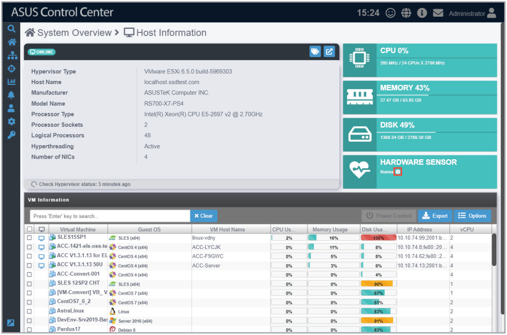
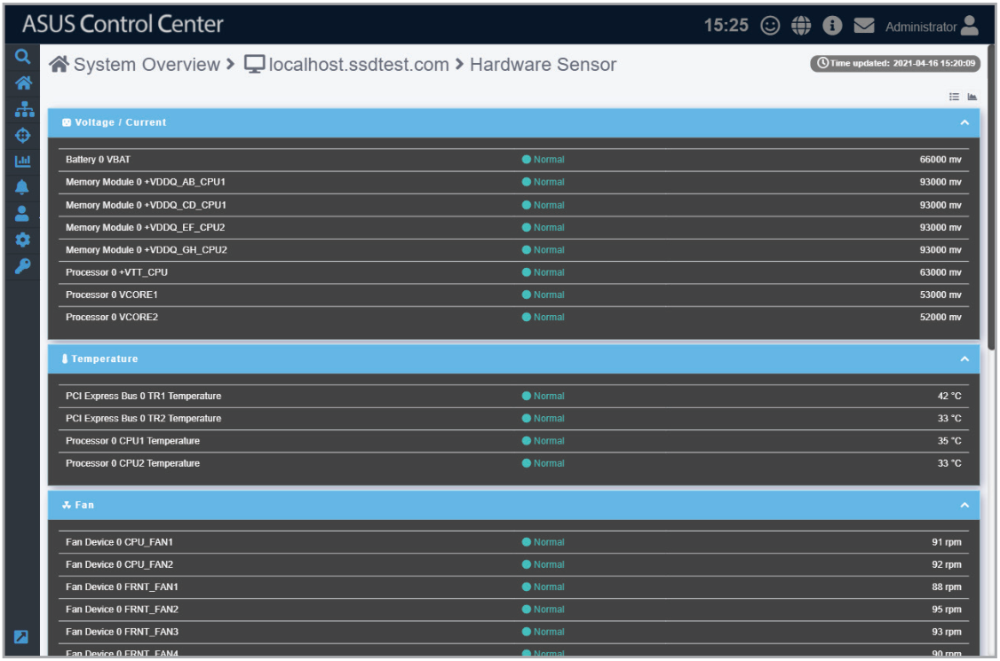
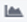
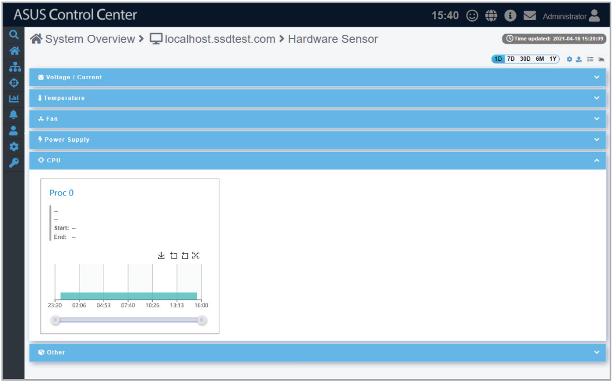
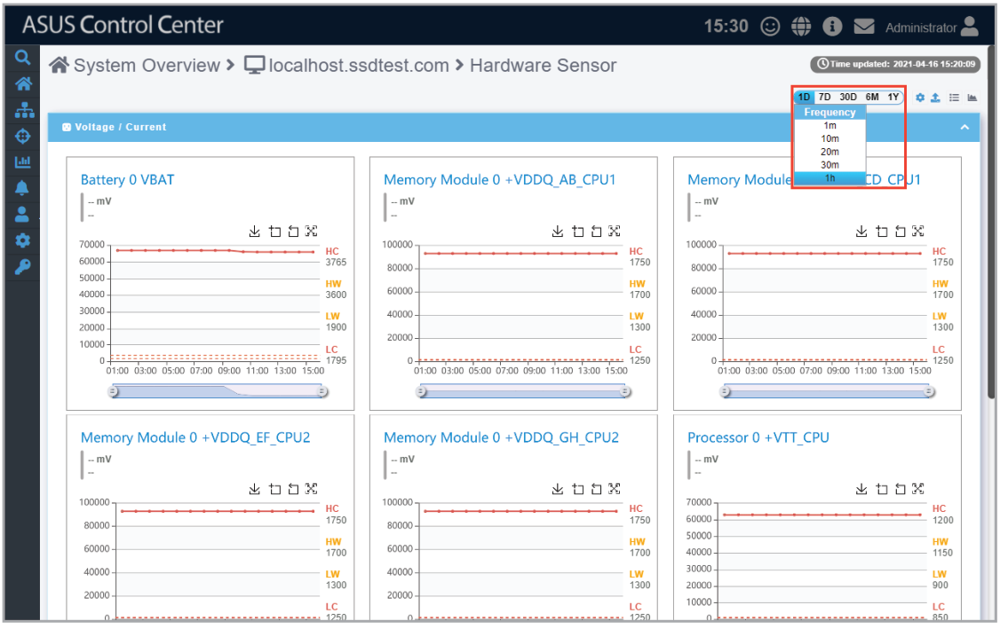
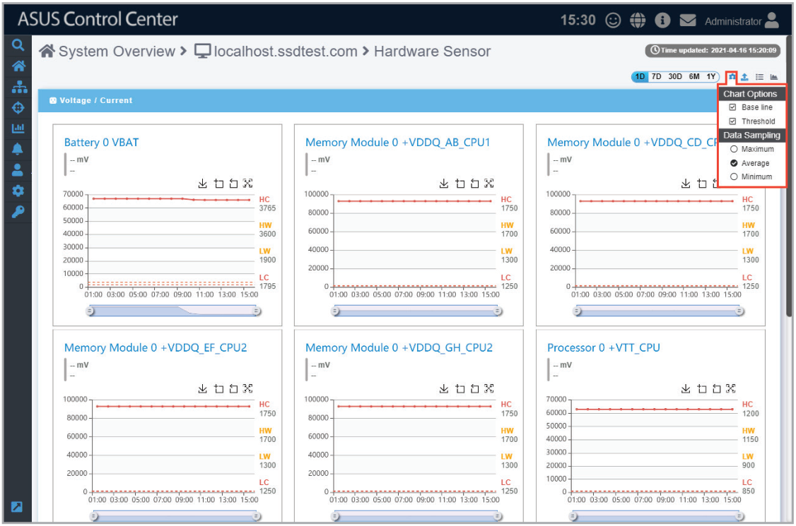

# Hardware Sensor

This item allows you to view the details and values for the Voltage / Current, Temperature, Fan, Power Supply, CPU, and Other items. You can view the Hardware Sensor information for the selected device by clicking on the  arrow in the Hardware Sensor block.

## Quick Buttons

| Icon | Description |
| --- | --- |
|  | Click to switch the layout to list view. |
|  | Click to view timeline chart of hardware sensor statuses. |
|  | Click to expand this block. |
|  | Click to minimize this block. |

## Toggling the chart view for Hardware sensors

You can toggle the chart view which displays historical data for the Voltage / Current, Temperature, Fan, Power Supply, CPU, and Other sensor events according to different periods of time.

### Quick Buttons for timeline chart

| Icon | Description |
| --- | --- |
|  | Click to refetch the device data. |
|  | Click to select which data to display on the timeline chart. |
|  | Click to expand this block. |
|  | Click to minimize this block. |

You can customize the timeline chart by selecting the period of time you wish to view for the timeline charts, then selecting the frequency for which the sensor should return data. This will be applied to the timeline charts for all the sensors shown on this page.

| Period of time | Frequency |
| --- | --- |
| **1D** | 1m, 10m, 20m, 30m, 1h |
| **7D** | 10m, 20m, 30m, 1h, 3h, 6h, 12h |
| **30D** | 30m, 1h, 3h, 6h, 12h, 1d |
| **6M** | 3h, 6h, 12h, 1d, 7d, 14d |
| **1Y** | 6h, 12h, 1d, 7d, 14d, 30d |

Additionally, by clicking on the  icon, you can customize the data you wish to view on the timeline

| Item | Description |
| --- | --- |
| **Chart Options** | Allows you to check the items you wish to display on the timeline charts such as the **Base line** and **Threshold**. |
| **Data Sampling** | Allows you to select whether the **Maximum** values, **Minimum** values, or **Average** values should be displayed on the timeline chart. |
