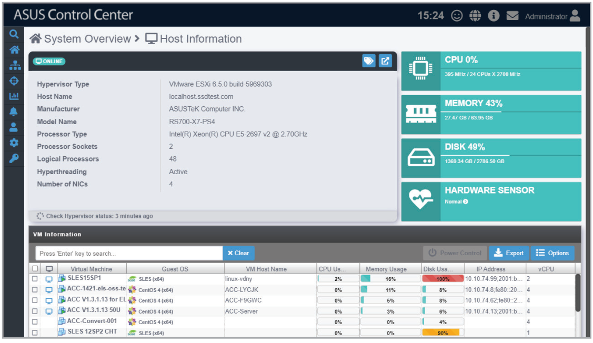
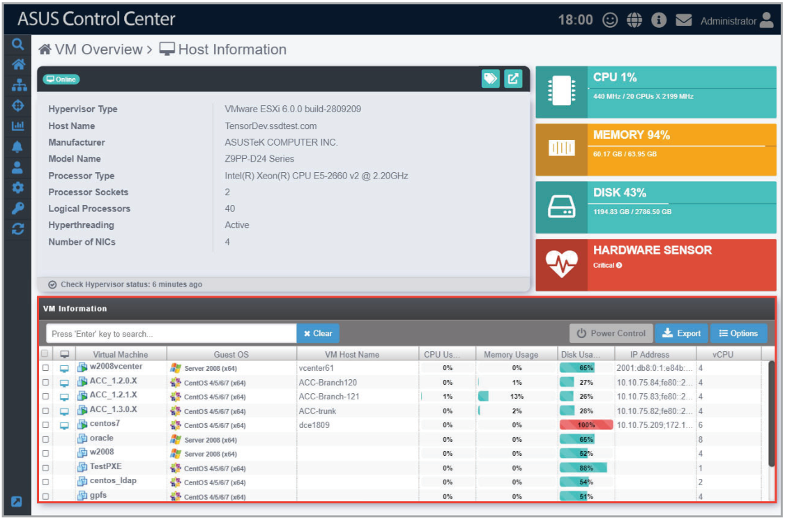
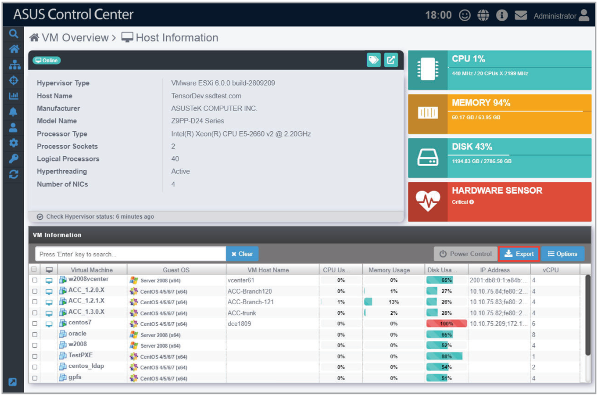
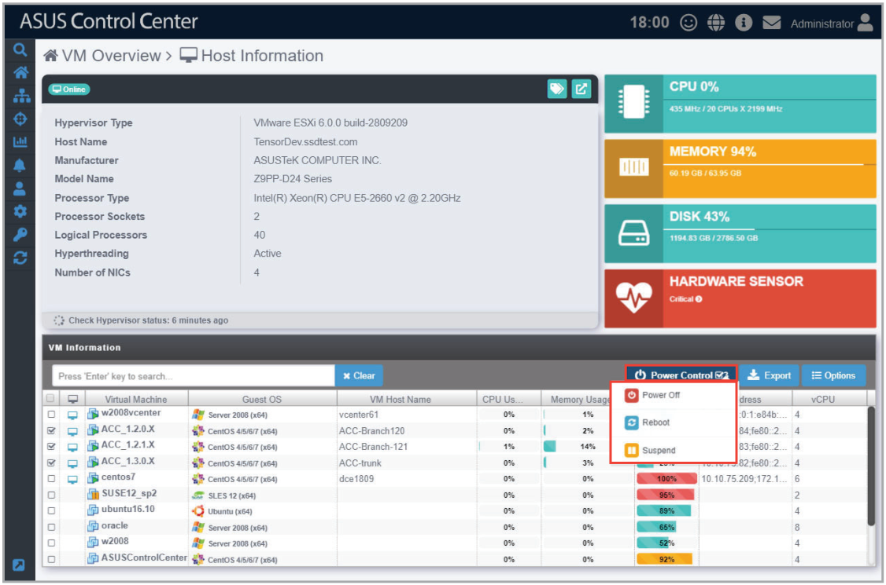
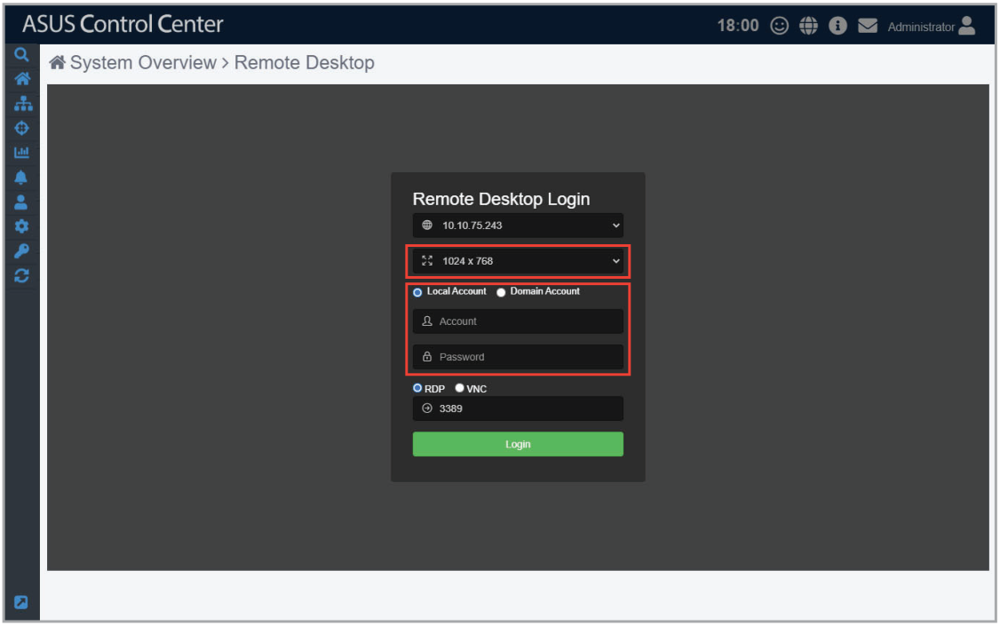
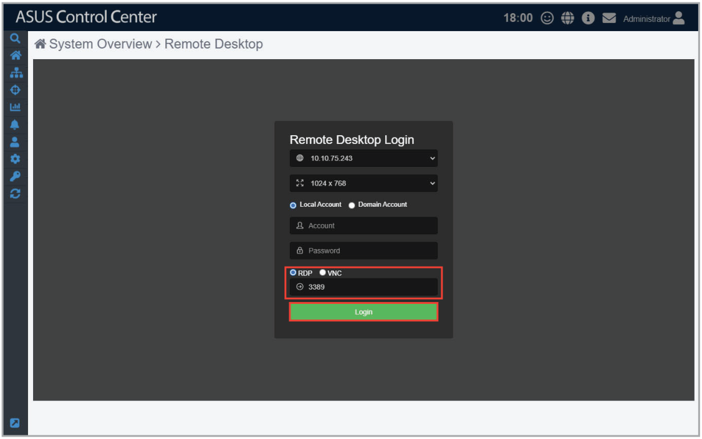

# Host Information

> **NOTE:** The screenshot may vary between agent and agentless devices, for more details on viewing details on devices with agents, refer to the **Device Information** section.

The **Host Information** screen gives you various functions to view the status and manage the selected hypervisor.

To access the **Host Information** of a hypervisor, you can use the following methods:

- From **System Overview**:
    1. Click  > **System Overview** in the left menu.
    2. Click on the hypervisor you wish to see more details about in the **Devices** list.

        > **NOTE:** VMware vSphere will display a  icon in the OS Information column.

- From **VM Overview**:
    1. Click  > **VM Overview** in the left menu.
    2. Click on a VM of a hypervisor you wish to see more details about in the **VM Information** list.

## Device Statuses and Quick Buttons

| Icon | Item | Description |
| --- | --- | --- |
|  | **Connection status** | This item displays the connection status of the selected managed device. |
|  | **Metadata Editor** | This item allows you to edit the metadata of the hypervisor by double clicking in the **Value** field. |
|  | **VMware ESXi** | This item allows you to link to the vSphere Web Client management interface. **NOTE:** VMware ESxi link is only available if a Web Client management interface link is detected. |

**Using the search bar and search options**

Refer to the **Search Options** and **Search and Filter Devices** sections of the **Monitor** chapter for more information.

## VM Information

The virtual machines installed on the ESXi device are displayed in the VM Information block.

### Exporting VM Information

You can export the virtual machines and metadata of the selected hypervisor to a .csv file by clicking on **Export**.

> **NOTE:** Only metadata columns that are shown in the **VM Information** block will be exported to the .csv file. To add more metadata columns to the **VM Information** block, click on **Options**, then check the metadata item you wish to display.

### Setting Power Control

You can control the power settings of selected VM(s) from the **VM Information** block allowing you quick access to power controls such as powering on and off, and rebooting selected VM(s).

> **NOTE:** The Power Control options may vary between VMs and is controlled by the **VMware Tools** application managing the VM.

1. Select the VMs you would like to apply the power control option to.
2. Click on **Action**, then select the power control option you would like to apply to the selected VMs.

    

### Accessing remote desktop

The remote control function provides a flexible interface for device management through the desktop or command-line accessed in ASUS Control Center. You can quickly access the remote desktop of VMs from the **VM Information** block.

> **IMPORTANT:** VMware Tools is required on the VM device you wish to use remote desktop on.

1. Select a VM from the **VM Information** block.
2. Click on the  icon located next to the VM you wish to view in the **VM Information** block, you should be directed to the **Remote Desktop Login** screen.
3. Select a resolution to display the managed device in the Remote Desktop window.
4. Select the login Account type, then enter the **Account**, **Password**, and **Domain** information.

    > **NOTE:**
    >
    > - **Local Account**: The agent’s administrator privileges only allow you to manage the device the agent is installed on.
    > - **Domain Account**: The agent’s administrator privileges allow you to manage all devices in the domain. The **Domain** field only appears if you selected **Domain Account**.

    

5. Select the protocol to use when connecting, then click **Login**.

    > **NOTE:**
    >
    > - Linux and Windows ® systems use different protocols, ensure the managed device is reachable through the selected protocol:
    >     - **RDP:** Available on Windows only; allows only a single user to view and configure at the same time.
    >     - **VNC:** Available on both Windows and Linux; allows multiple users to view and configure at the same time.
    >     - **SSH:** Available on Linux only.

    > **IMPORTANT:**
    >
    > - Ensure the managed device you wish to remote control has a stable power supply and Internet connection.
    > - The managed device may be remote controlled if it is logged out or locked, but cannot be remote controlled if the managed device is powered off or in sleep mode. If the managed device is in sleep mode, please wake the device using the **Power Control (Wake-on-LAN)** function.
    > - (for RDP only) Please ensure that the following two items are checked on the remote device and enabled to allow remote connections to the remote device. Search for **Control Panel** in the Windows Search Box, then navigate to **System** > **Remote settings**.
    > - (for RDP only) Please ensure that the **Microsoft Remote Desktop** application is enabled in the **Windows Defender Firewall Allowed Apps** list. Search for **Control Panel** in the Windows Search Box, then navigate to **Windows Defender Firewall** > **Allowed Apps**.

    

6. Once the login has been successfully authenticated, you will be logged into the desktop or command line of the device system; this varies between systems.

    > **NOTE:** To switch mouse and keyboard control to the ASUS Control Center, press `<Ctrl>` + `<Alt>` on the keyboard. To switch mouse and keyboard control back to the remote device, click in the remote device window.

7. Click on the Menu Path at the top of the screen, or click on another menu item from the left menu to end the remote session.
