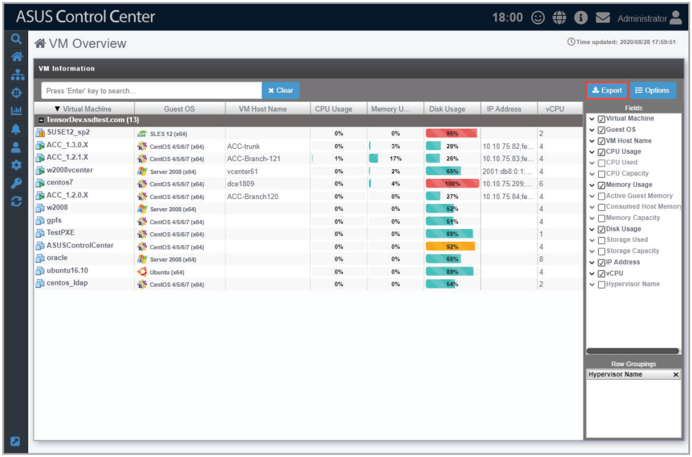

# VM Overview

The VM overview screen allows you to view all VMware vSphere Hypervisors as well as view the virtual machines of each vSphere device. The VM Information list displays details on all the virtual machines on the hypervisor, including CPU usage, Disk usage, Guest OS, and IP address.

To access the **VM Overview**, click  > **VM Overview** from the left menu.

> **NOTE:**
>
> - Click on the name of a column header to sort the filter results alphabetically.
> - If **VMware Tool** is not installed, some items may not be displayed, such as IP address. To view all information about VMware vSphere installed, ensure to install **VMware Tool**.

**Using the search bar and search options**

Refer to the **Search Options** and **Search and Filter Devices** sections of the **Monitor** chapter for more information.

## Exporting VMware vSphere Hypervisors list

You can export the list of VMware vSphere Hypervisors, virtual machines and metadata in the **VM Information** block to a .csv file by clicking on **Export**.

> **NOTE:** Only metadata columns that are shown in the **VM Information** block will be exported to the .csv file. To add more metadata columns to the **VM Information** block, click on **Options**, then check the metadata item you wish to display.

