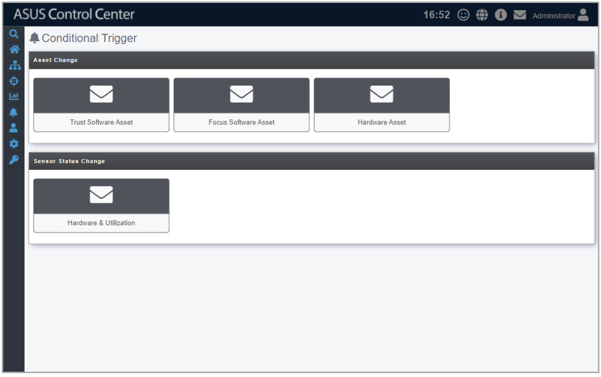

# Conditional Trigger

Conditional Trigger allows you to set notifications for software changes, or hardware changes on managed devices. Notifications are sent when software not on the Trust or Focus list have been installed on managed devices, or if hardware such as CPUs or DIMMs that are removed or do not comply to company specifications are installed onto managed devices. This function will keep you alerted of potential risks to managed devices.

To access **Conditional Trigger**, click  in the left menu, then click on **Conditional Trigger**.

**Using the search bar and search options**

Refer to the **Search Options** and **Search and Filter Devices** sections of the **Monitor** chapter for more information.
