# Hardware & Utilization

**Hardware & Utilization** allows you to add or delete rules on notifications. When a managed device's hardware sensor or utilization status changes to one that you have set a notification for, a notification will be sent to the system administrator. Below is an example of a notification sent when the CPU status of a managed device changes from **Normal** to **LowCritical**.

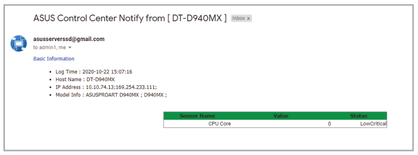

## Adding a new rule

1. Click **Add**.

    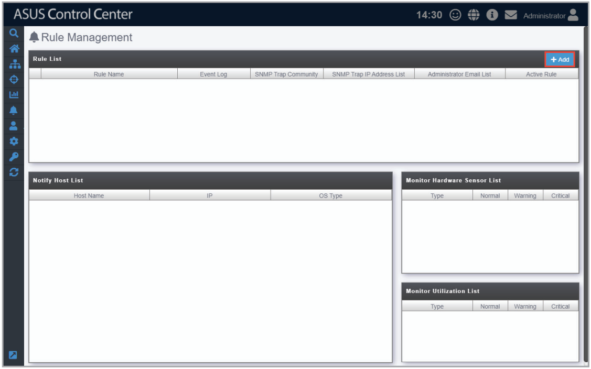

2. Enter a rule name, then select the devices to apply the rule to. Click **Next**.

    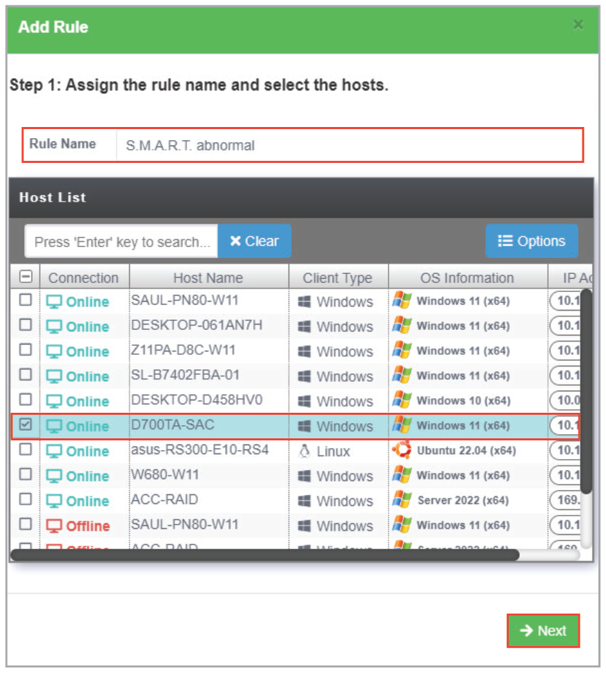

3. Select conditions (type and status of hardware sensors or utilization) to send notifications, then click **Next**.

    > **NOTE:**
    >
    > - The checkbox checked when selecting the hardware sensor or utilization type and status will send notifications when the status shifts from the other two statuses to the status checked. For example, checking **Normal** will send notifications when the status changes from **Warning** or **Critical** to **Normal**.
    > - To set the status thresholds for the Utilization Type, please refer to the **Utilization** section.

    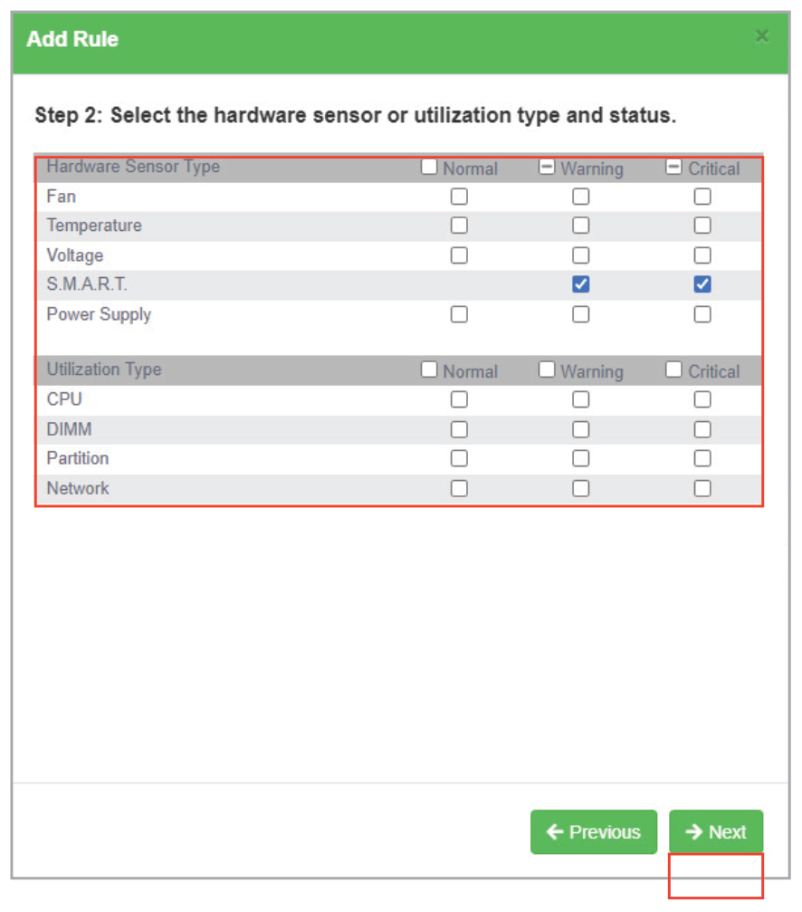

4. Select the notification method between the following options (multiple notification methods may be selected):

    - Event Log

        The notification will be displayed on the device's event log and system overview.

        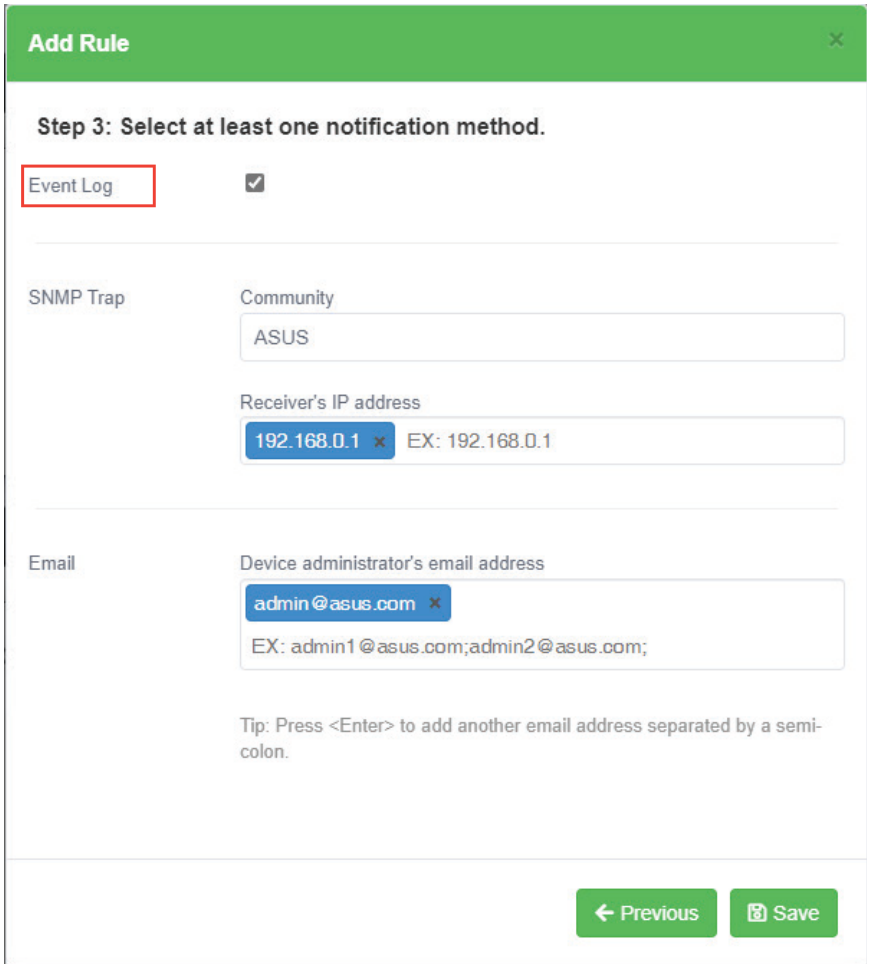

    - SNMP Trap

        The notification is recorded in the SNMP Trap Receiver, ensure to enter the corresponding information into the **Community** and **Receiver's IP address** fields.

        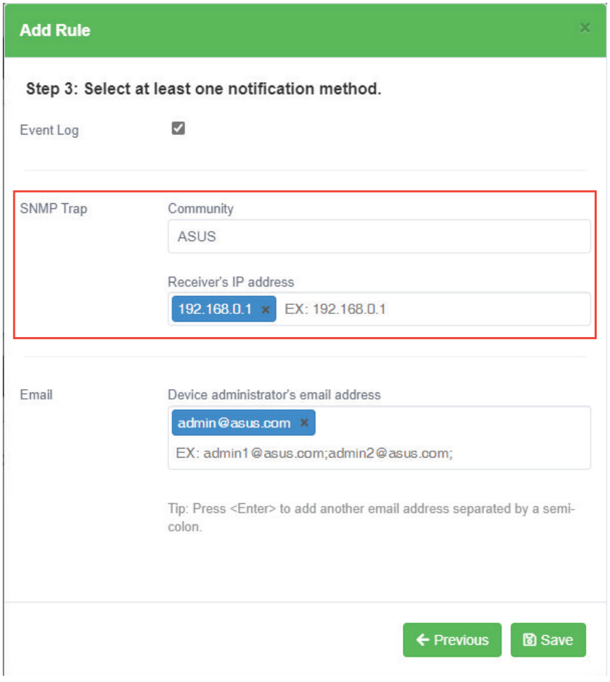

    - Email

        The notification is sent to the entered email addresses of the IT department as well as all people associated with the device.

        > **NOTE:**
        >
        > - Ensure to set up the SMTP server settings before using the email function. For more information please refer to the **SMTP Settings** section.
        > - When entering multiple emails, use a semicolon '**;**' to separate the emails.

        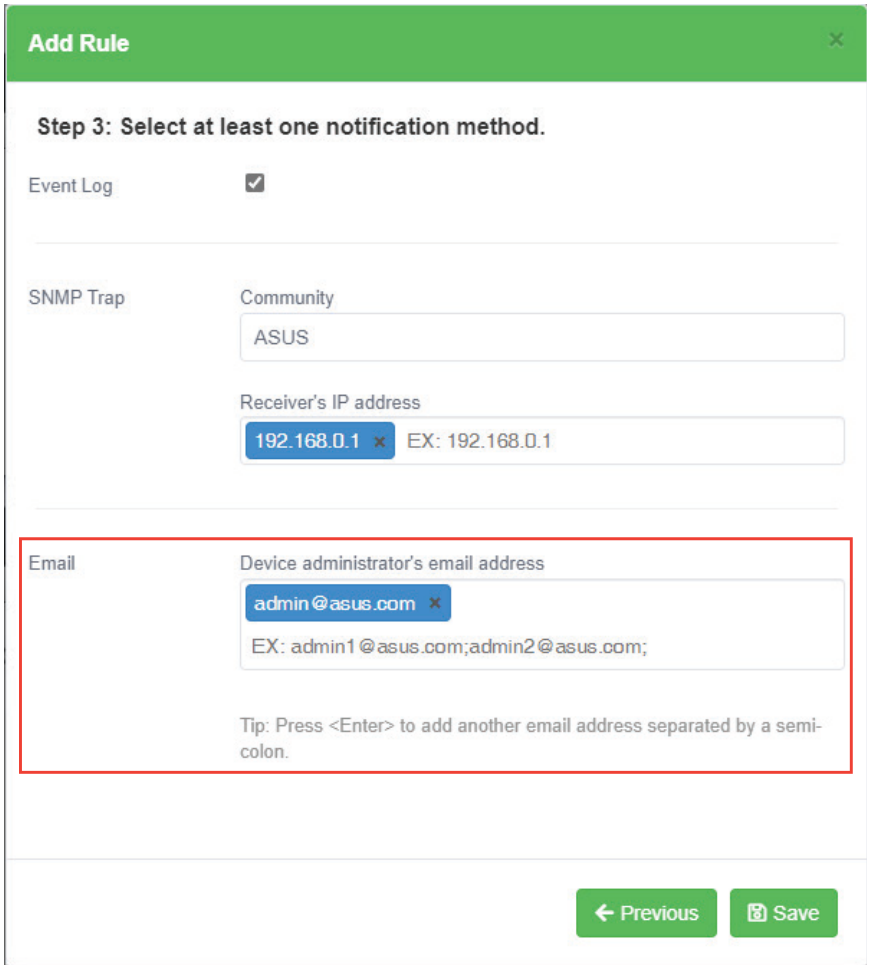

5. Click on **Save** after finished selecting your notification method(s).

    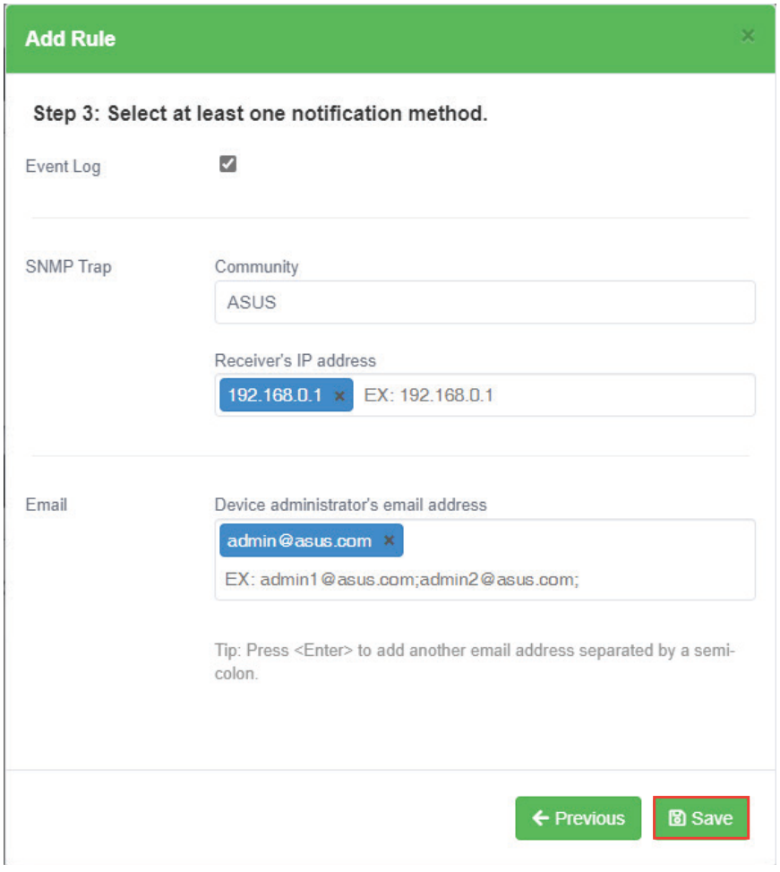

    Your newly added rule should appear in the main Hardware & Utilization screen, under **Rule List**, this displays the rule name and details of your selected notification method. Clicking on the newly added rule will display the devices associated with the rule in the **Notify List**, and the list of hardware and utilizations being monitored in the **Monitor Hardware Sensor List** and **Monitor Utilization List**.

    > **NOTE:** Ensure SMTP settings have been set and that a test email can be successfully sent to ensure notifications can be properly sent and received. For more information on SMTP settings and sending a test email, please refer to the **SMTP Settings** section.

    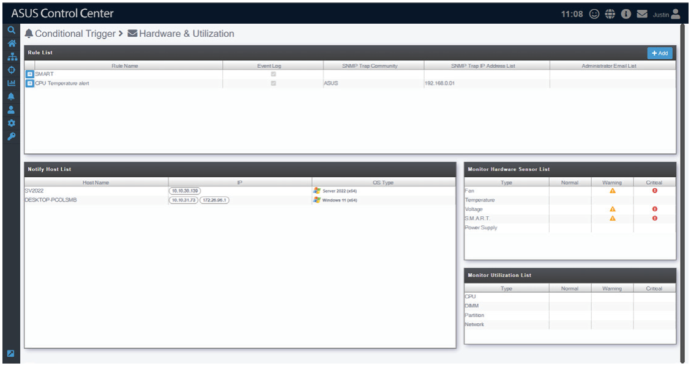

## Editing an existing rule

1. Click on  next to the rule you wish to edit.

    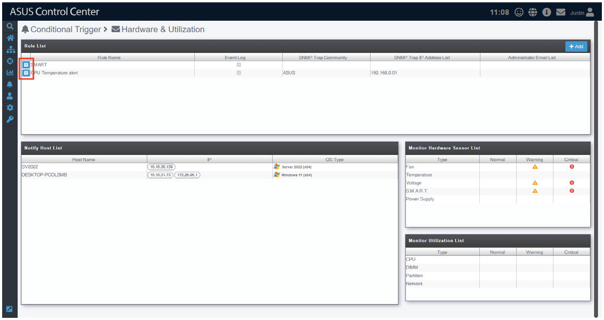

2. You can edit the rule name and select the hosts to apply the rule to. Click **Next**.

    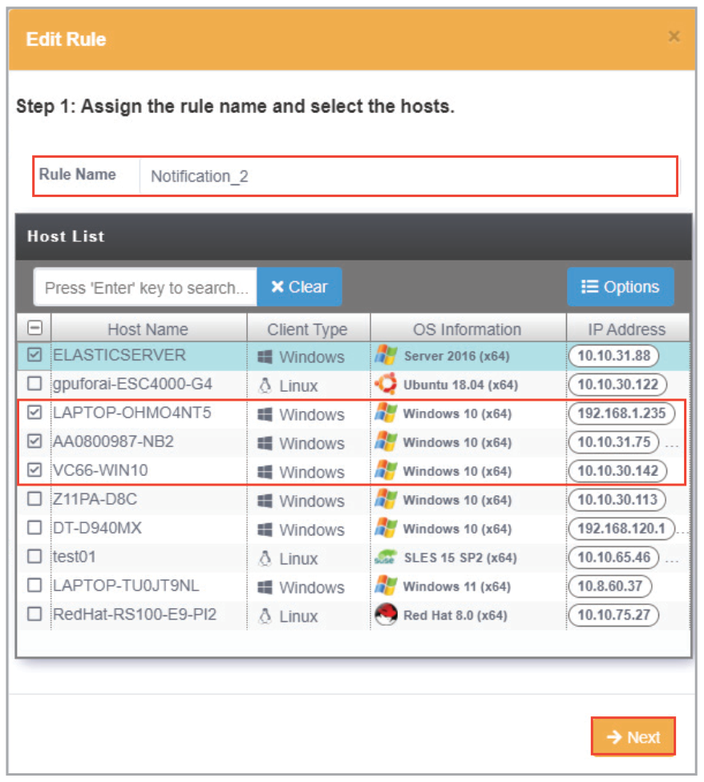

3. Select conditions (type and status of hardware sensors or utilization) to send notifications, then click **Next**.

    > **NOTE:**
    >
    > - The checkbox checked when selecting the hardware sensor or utilization type and status will send notifications when the status shifts from the other two statuses to the status checked. For example, checking **Normal** will send notifications when the status changes from **Warning** or **Critical** to **Normal**.
    > - To set the status thresholds for the Utilization Type, please refer to the **Utilization** section.

    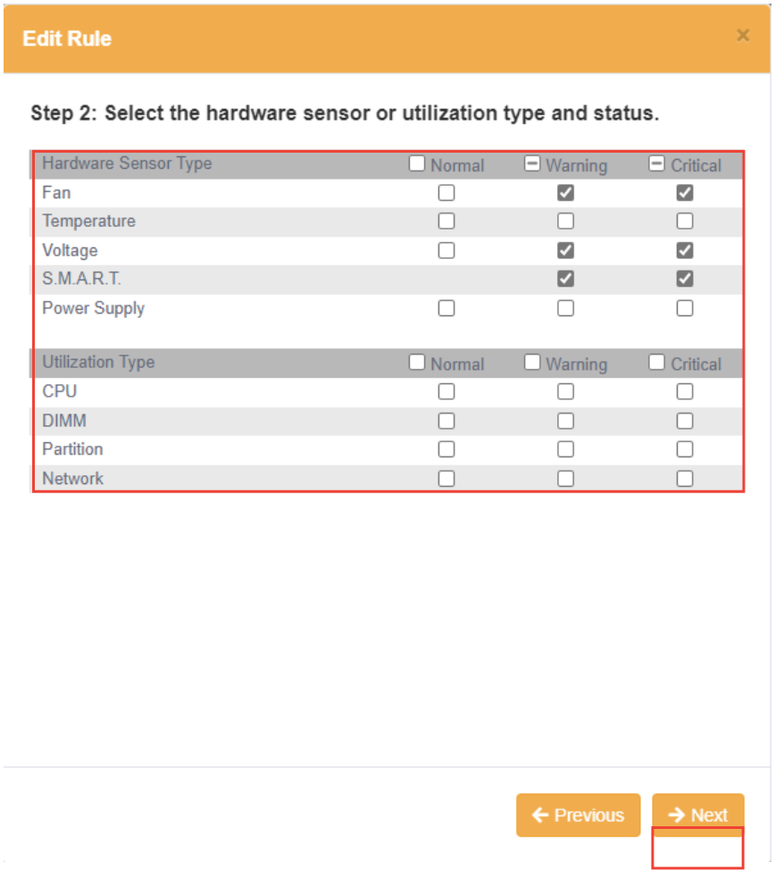

4. Select the notification method (multiple notification methods may be selected).

    > **NOTE:** For more details on the notification methods, please refer to the **Adding a new rule** section.

    

5. Click on **Update** once you have finished editing the rule.

## Deleting a notification rule

1. Click on  next to the rule you wish to delete.

    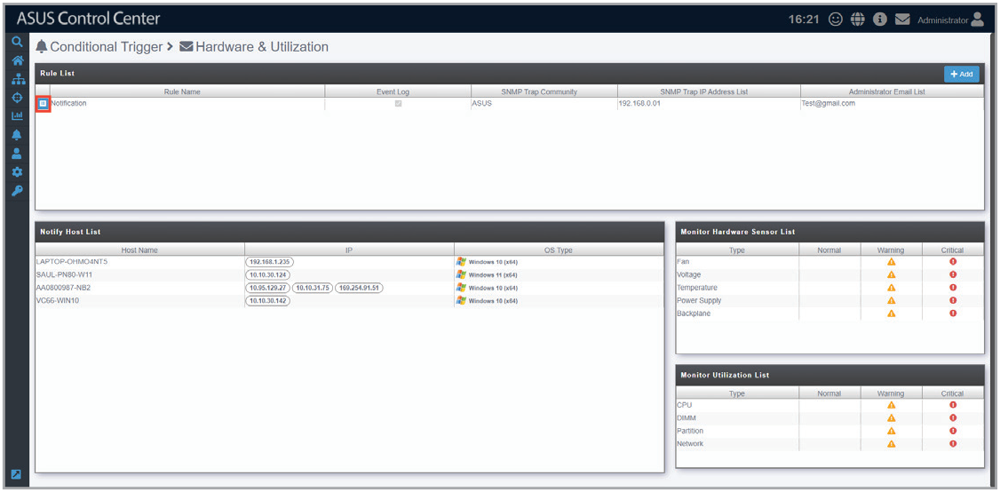

2. Click **Next**, then **Next** again until you reach the following window, then click **Delete**.

    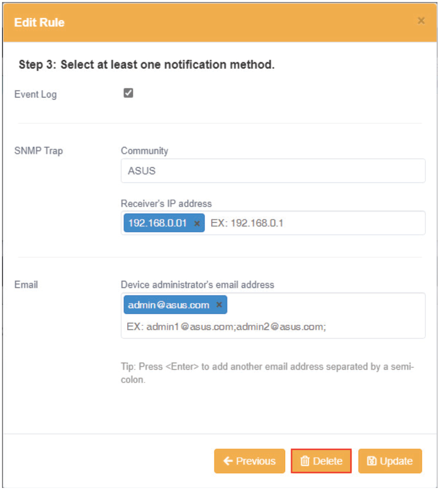

3. Click **Delete** on the pop up window to delete the rule.

    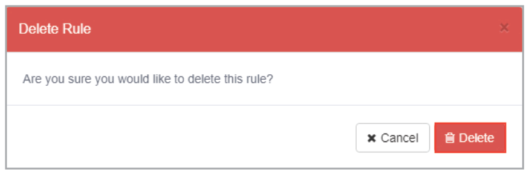
