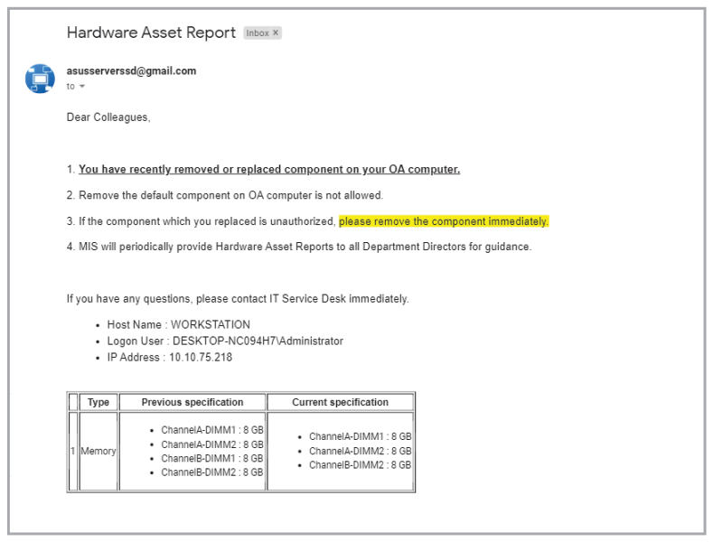
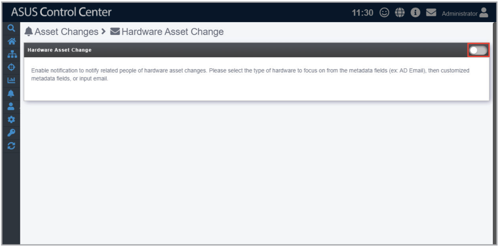
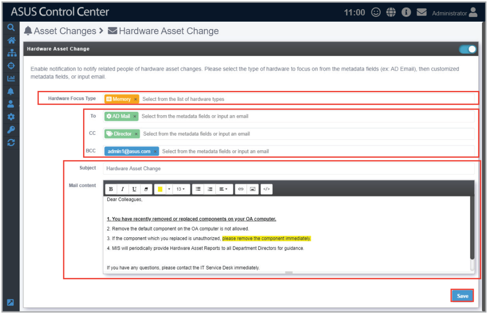

# Hardware Asset

This function allows you to send notifications when the following events occur:

- Components which do not comply to company specifications are installed on managed devices
- Specified components are removed from managed devices

These notifications will list the hardware changes and be sent immediately to the owner of managed device and their superior. Below is an example of a notification sent when a DIMM is removed from a managed device.

To enable Hardware Asset:

1. Click on the button to configure and enable Hardware Asset change notifications.

    

2. Select which hardware component types (**Processor**, **Memory**, **Fixed Disk**, **Removable Disk**) you wish to receive notifications for.
3. Enter the recipients of the notification email.
4. Click on **Save** after composing the title and content of the notification email.

    > **NOTE:** Ensure SMTP settings have been set and that a test email can be successfully sent to ensure notifications can be properly sent and received. For more information on SMTP settings and sending a test email, please refer to the **SMTP Settings** section.

    
