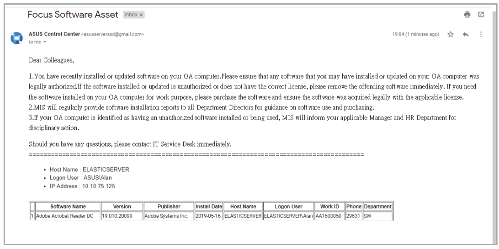
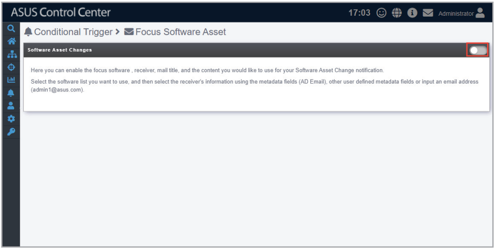
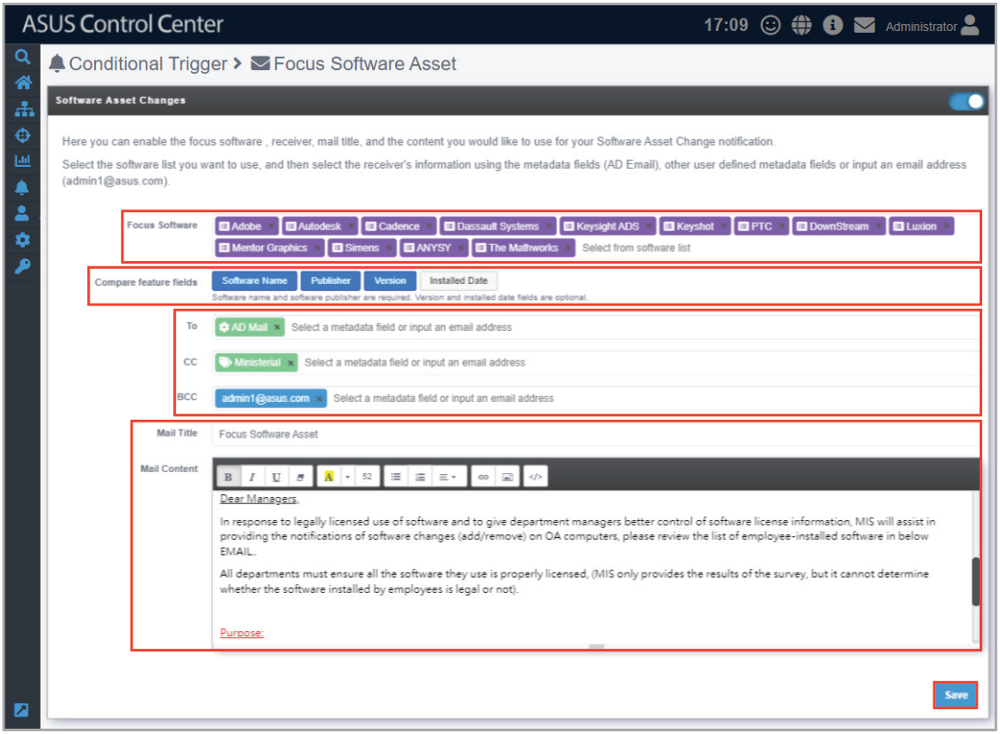

# Focus Software Asset

This function allows you to send notifications when the following events occur:

- Applications in the Focus Software Asset are installed on non-authorized managed devices

These notifications will be sent immediately to the owner of the managed device and their superior. Below is an example of a notification sent when an application in the Focus Software Asset is installed on a non-authorized managed device.

To enable Focus Software Asset:

1. Click on the button to configure and enable Software Asset Changes notifications.

    

2. Select softwares from the software list to be applied as a Focus Software Asset. Notifications will be sent when new software is installed on managed devices which do not appear on the Focus Software Asset.

    > **NOTE:** For more information on Software List, please refer to the **Software List** section of this manual.

3. Select the Compare feature fields **Software Name** and **Publisher**, as these two compare feature fields are required. **Version** and **Installed Date** are optional.
4. Enter the recipients of the notification email.
5. Click on **Save** after composing the title and content of the notification email.

    > **NOTE:** Ensure SMTP settings have been set and that a test email can be successfully sent to ensure notifications can be properly sent and received. For more information on SMTP settings and sending a test email, please refer to the **SMTP Settings** section.

    
