# Subscription Report

**Subscription Report** allows you to manage your Software Reports such as which list set to apply (Trust Software or Focus Software), the receiver of the report, which devices to create reports on and when to receive the reports. This gives you the flexibility to tailor each subscription report according to your needs and focus on the device and applications you want to focus on.

> **NOTE:** The report mail sender information can be set at the SMTP settings section, please refer to **SMTP Setting** section in this manual.

- Below is an example of a monthly Trust Software Asset report on the softwares of a department's managed devices.

    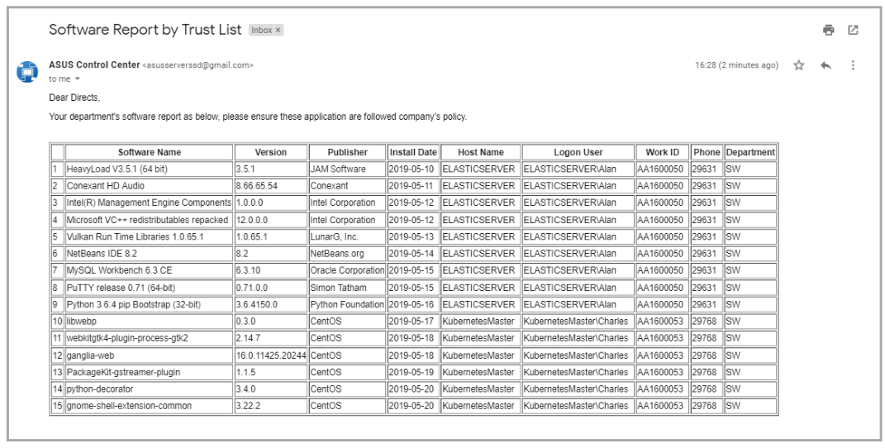

- Below is an example of a monthly Focus Software Asset report on the software applications of a department's managed devices.

    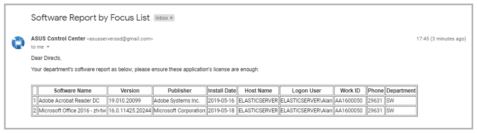

## To create a Subscription Report

1. Click on **Add** on the Subscription Report main screen to create a new report subscription.

    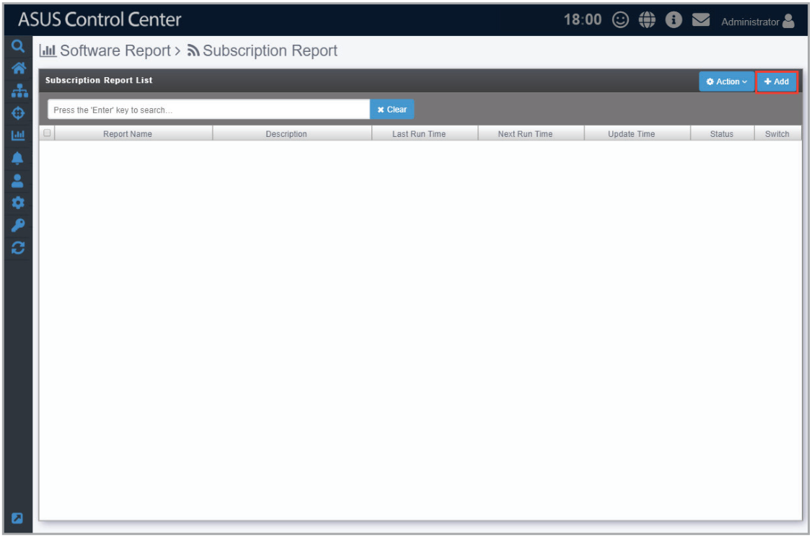

2. Enter the Report name as well as a brief description of the report into their respective fields. Then select which list to apply to the report, Trust Software or Focus Software, and select the specific list(s) you wish to apply.

    > **NOTE:**
    >
    > - Selecting the **Trust Software** option will exclude applications on the trust list when a report is generated. For more information please refer to the **Trust Software Asset** section of this chapter.
    > - Selecting the **Focus Software** option will only include applications on the focus list when a report is generated. For more information please refer to the **Focus Software Asset** section of this chapter.

    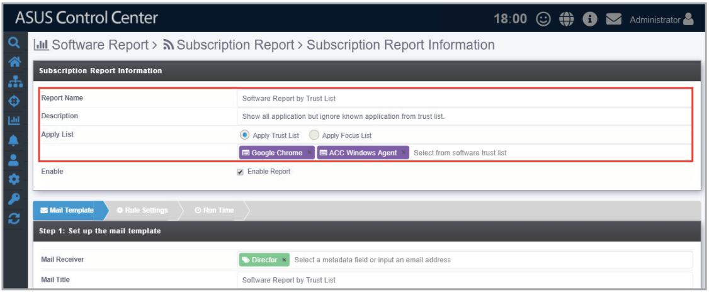

3. Check **Enable Report** to enable this report.

    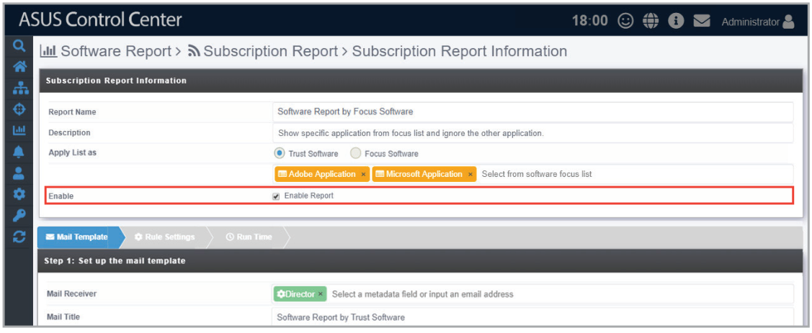

4. Select a metadata tag or enter an email address into the **Mail Receiver** field, then enter your mail title and mail content.

    > **NOTE:** The metadata tag allows you to use customized groups as your mail recipients. For more details on metadata, please refer to the **Metadata Management** section in this manual.

5. Select **Only Mail Content** to only include the mail content entered when the report is sent. Select **Mail Content with Details** to also include a software list in the mail content when the report is sent.

    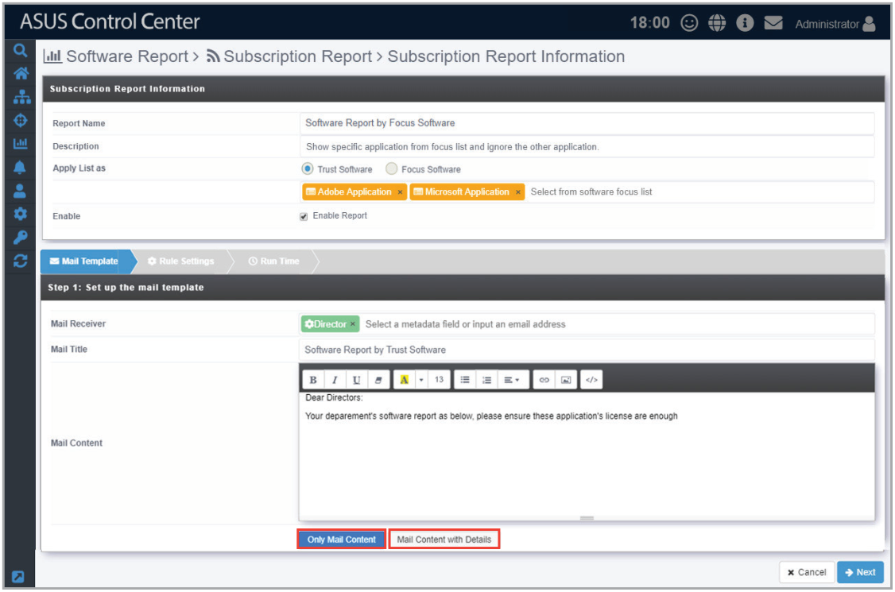

6. In the **Rule Settings** step, you have to filter out the managed devices you wish to generate this report on. You can either select Custom rules or Grouping by selected metadata field.

    > **NOTE:**
    >
    > - Selecting the **Custom rules** option will allow you to select the rules to filter by.
    > - Selecting the **Grouping by selected metadata** option will filter by the metadata tag selected. To use the **Grouping by selected metadata** option ensure you have added a metadata tag as the **Mail Receiver** in step 4.

7. If you selected the **Custom rules** option, Click on **Add Rule**.

    > **NOTE:** Follow this step only if you selected the **Custom rules** option.

    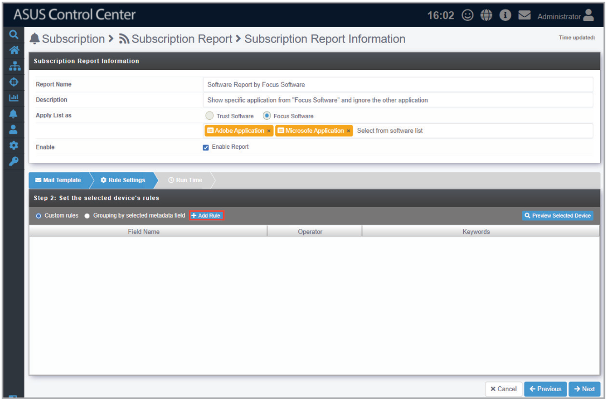

8. Enter the information required on the Rule Editor pop-up window. Once you have finished editing the rule on which to filter devices, click on **Save**.

    > **NOTE:** Follow this step only if you selected the **Custom rules** option.

    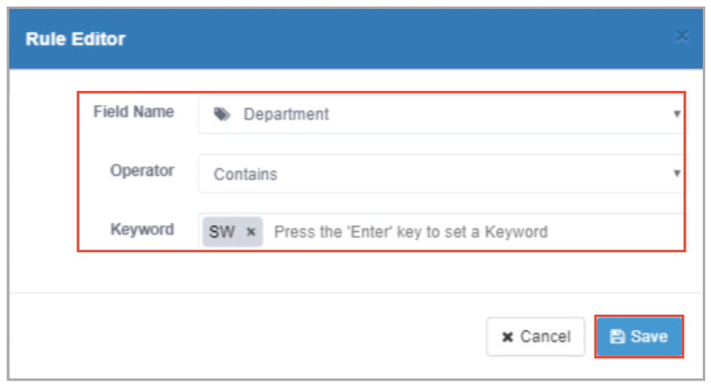

9. Your new rule will appear in the window below. Click on **Preview Selected Device** to view the device(s) results of your newly added rule.

    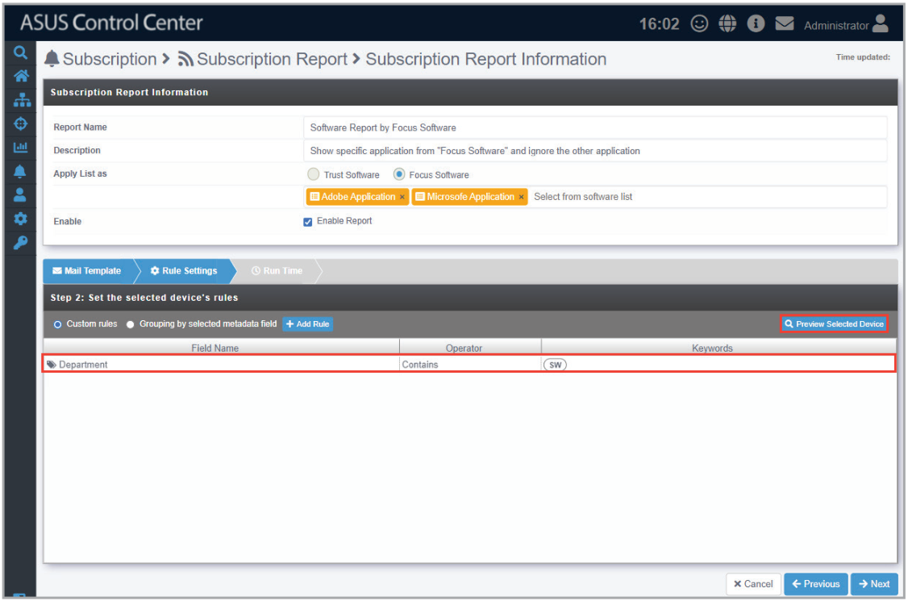

    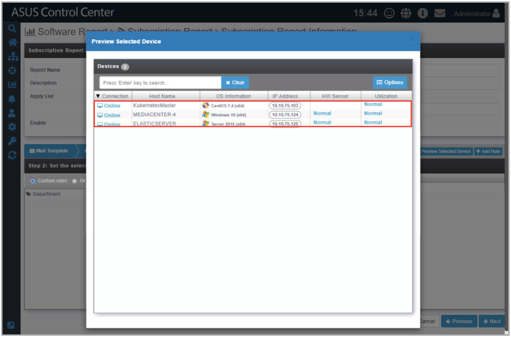

10. Repeat steps 6 to 8 to add another rule.
11. (optional) You may also edit or delete a rule by clicking on the rule, then repeat steps 4 to edit the rule, or click on **Delete** to delete the rule.

    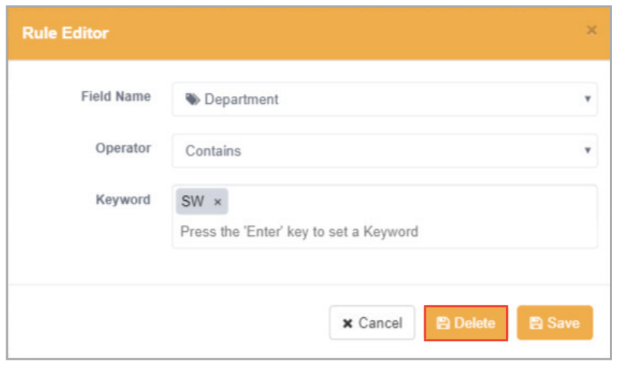

12. Click on **Next** once you are finished.

    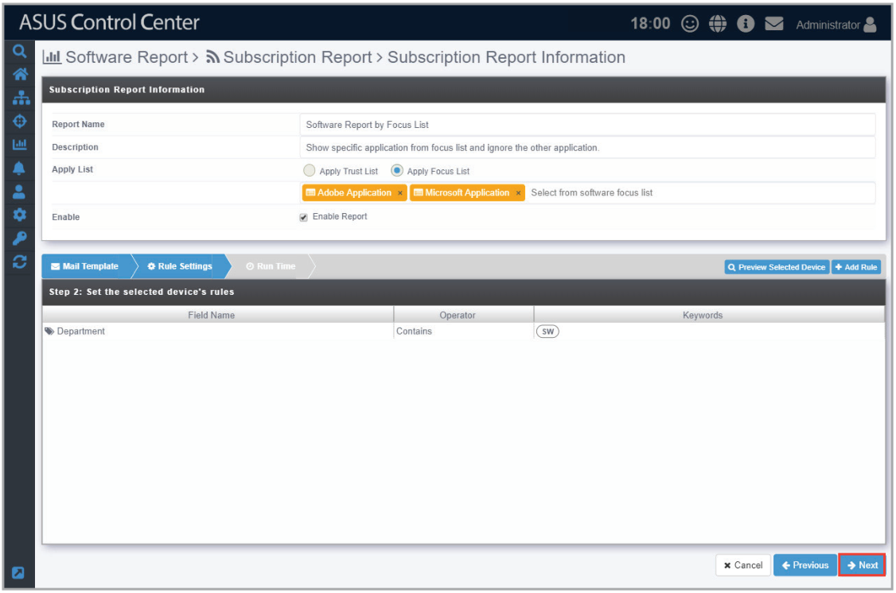

13. Select a **Send Date** from the drop down menu to specify when the report will be sent. The **Send Date** options are as below:

    - **Every Day**: Send a report every day.
    - **Every Week**: Send a report every week on a selected weekday.
    - **First day of the month**: Send a report on the first day of every month.
    - **Nth day of the month**: Send a report on the selected day of each month.
    - **Last day of the month**: Send a report on the last day of each month.

    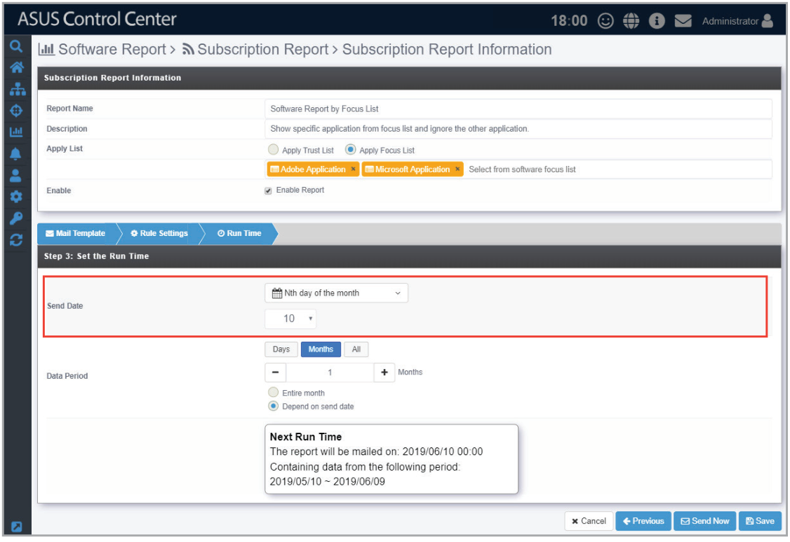

14. In the date period field, select the period of time the report will be generated on. The report will be generated on the information prior to the day the report is mailed, including the day it will be mailed.

    The different **Date Period** options are as below:

    - **Days**: The report generated will be based on information from your selected number of days before the day the report is mailed.
    - **Months**: The report generated will be based on information from your selected number of months before the day the report is mailed. Additional options are available if you selected **Months**.
        - **Entire Month**: This will generate information starting on the **Send Date**'s previous month, with each month calculated from start of the month till the last day of the month.
        - **Depend on send date**: This will generate information starting on the **Send Date**, with each month calculated as the previous day of the send date till the day of the send date.

    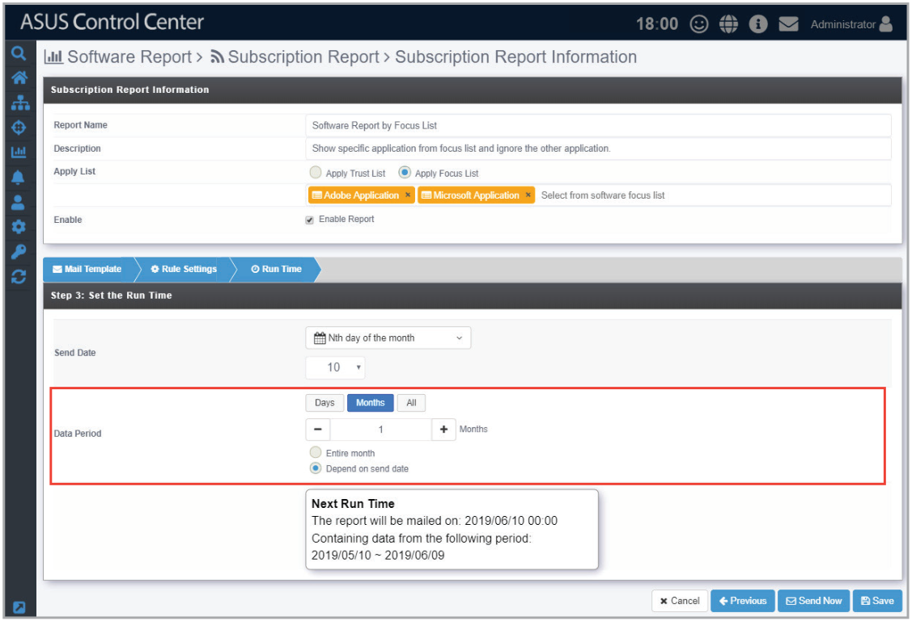

15. You can view information on when you will receive the next report, and the time period the report is based on in the window below. Once you finished editing the Run Time, you may click on **Send Now** to immediately receive a report, then click on **Save** to save your settings.

    > **IMPORTANT:** Ensure SMTP settings have been set and that a test email can be successfully sent to ensure notifications can be properly sent and received. For more information on SMTP settings and sending a test email, please refer to the **SMTP Settings** section.

    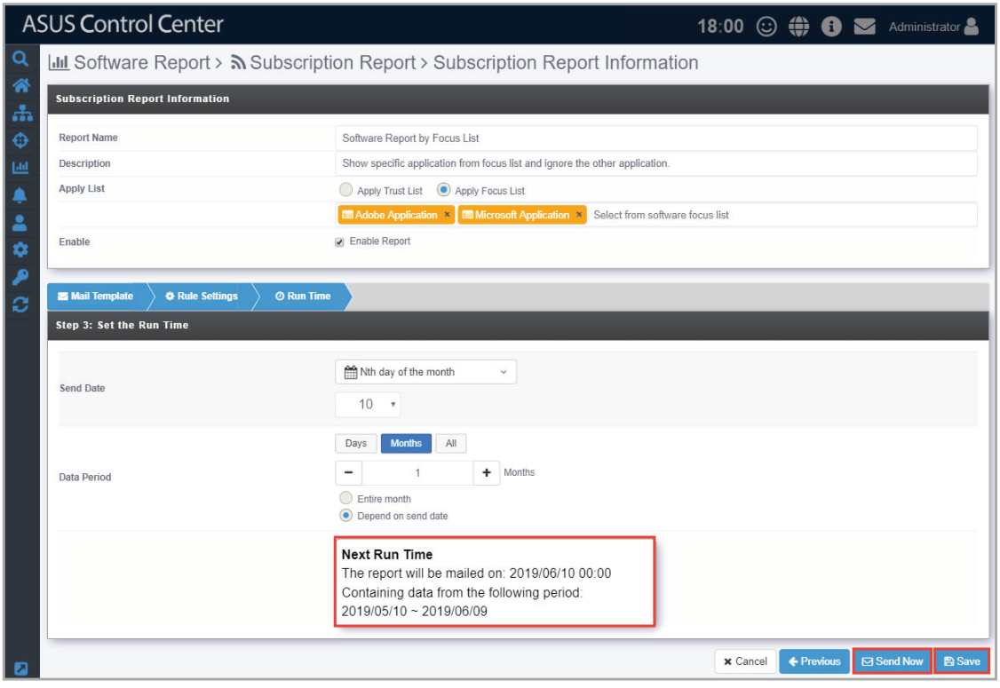

    - Report as a result of applying **Trust Software Asset**. (Does not show white listed applications)

        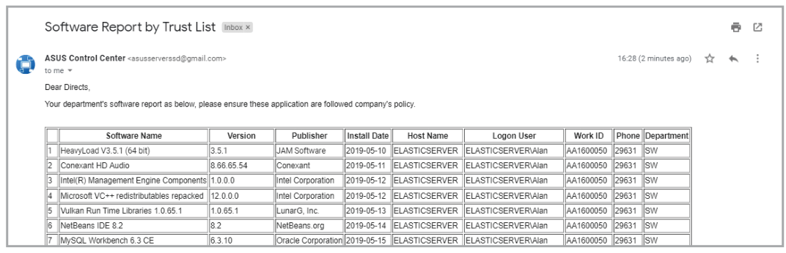

    - Report as a result of applying **Focus Software Asset**. (Only shows applications on the focus list)

        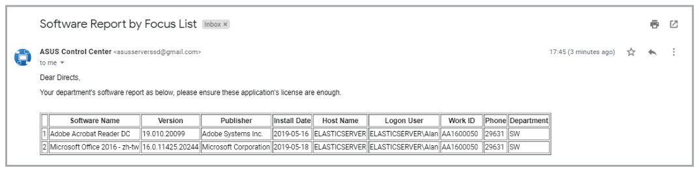

16. Your new report subscription should appear in the Subscription Report List on the main screen of **Subscription Report**.

    

## To edit or delete a subscription report

1. Click on the subscription report you wish to edit.

    

2. Repeat steps 2 to 14 of the **To create a Subscription Report** section to edit a subscription report, or click on **Delete** to delete the subscription report.

    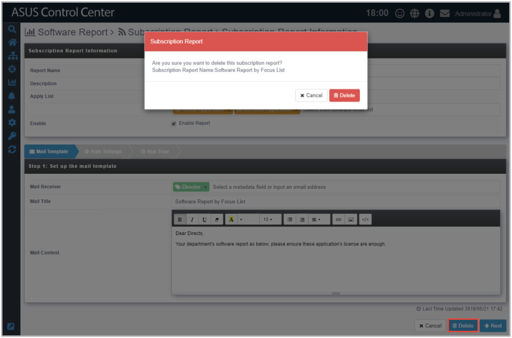

## Switching the status of a subscription report

1. Click on the subscription reports you wish to switch the subscription status of.

    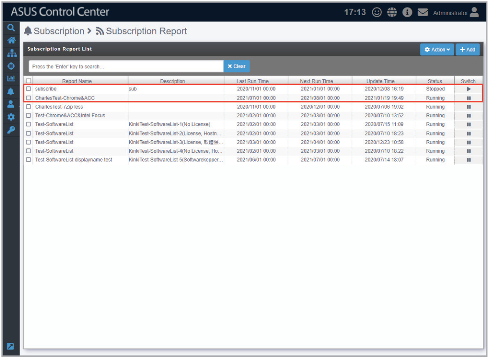

2. Click on **Action**, then select if you want to pause or run the report.

    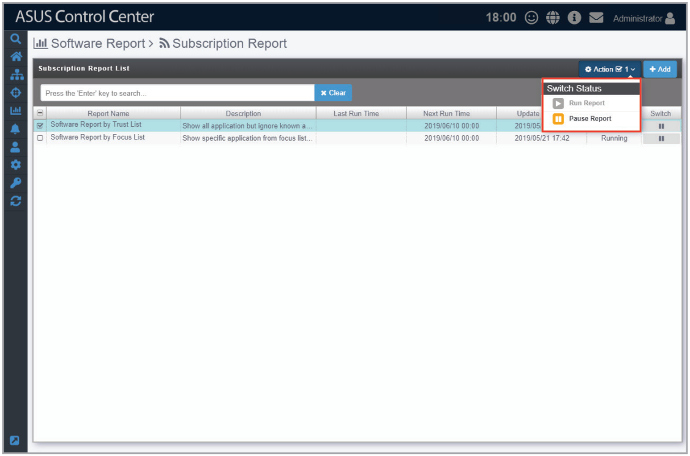
