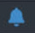
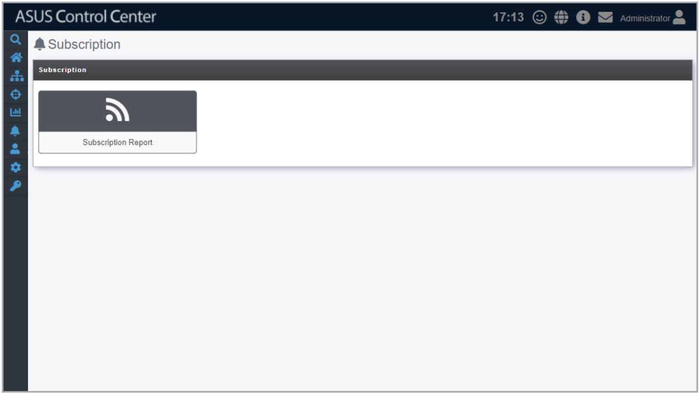

# Subscription

> **NOTE:** The information entered in this section is for reference only.

Subscription allows you to set a periodic report on the hardware or software of managed devices. The reports are then sent to the department's director, allowing them to easily manage the department's software and hardware.

To access **Subscription**, click  in the left menu, then click on **Subscription**.

