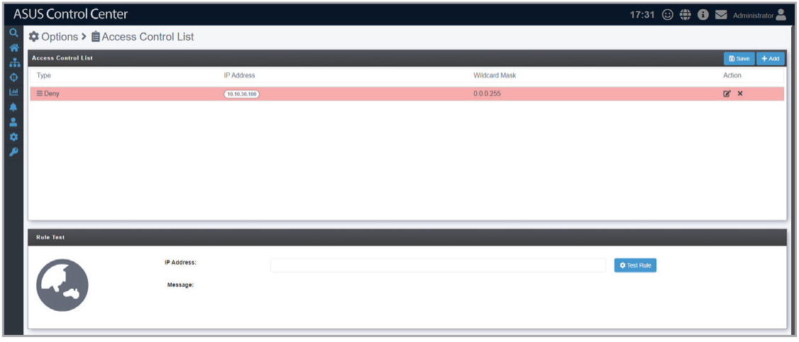
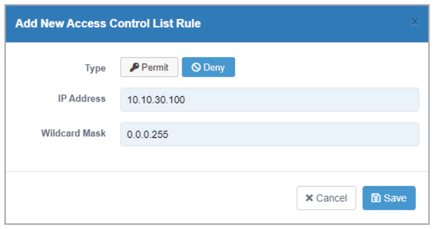
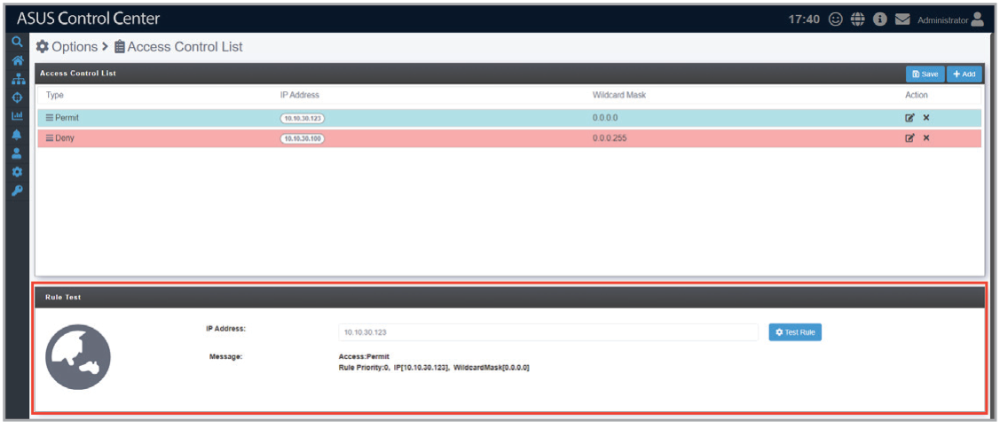

# Access Control List

The **Access Control List** allows you to configure rules to permit or deny access to ASUS Control Center from specified IP addresses.

## To add an access control rule

1. Click  to start adding a new access control rule.
2. Select **Permit** or **Deny** in the popup window, then enter an **IP address** and **Wildcard Mask**.

    > **NOTE:**
    >
    > - For example, to deny access from a Class C IP range, set the **Type** to Deny, **IP address** to 10.10.30.100, and the **Wildcard Mask** to 0.0.0.255. The resulting access control rule will deny access from any IP address from 10.10.30.1 to 10.10.30.254.
    > - For example, to permit access from a specific IP address, set the **Type** to Permit, **IP address** to 10.10.30.123, and the **Wildcard Mask** to 0.0.0.0. The resulting access control rule will permit access from 10.10.30.123.

3. Click  to save the access control rule.

## To adjust the priority of an access control rule

1. Click and drag an access control rule up or down to adjust its priority.
2. Click  to save changes to the access control rule list, then click **OK** in the popup window to confirm your changes.

    > **NOTE:** The access control rules are applied in descending order.

## To test an access control rule

1. Enter an **IP address** under **Rule Test**.
2. Click  to view if the specified IP address will be permitted or blocked based on the existing access control rules.

    

## To edit an access control rule

1. Click  to start editing a new access control rule.
2. After making the desired changes, click  to save the access control rule, then click **OK** in the popup window to confirm your changes.

## To delete an access control rule

1. Click  to delete an access control rule, then click **Delete** in the popup window to confirm deletion.
2. Click  to save changes to the access control rule list.
