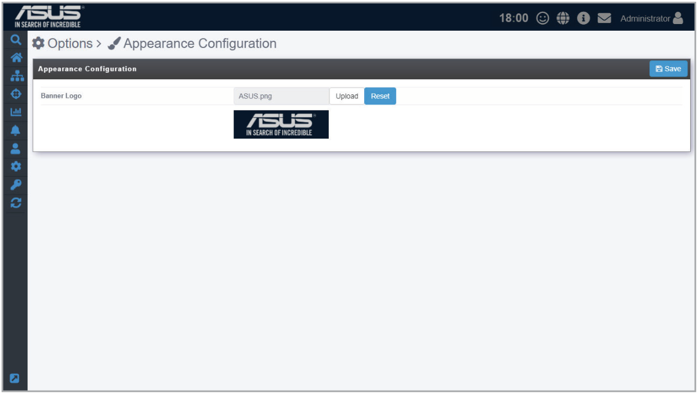
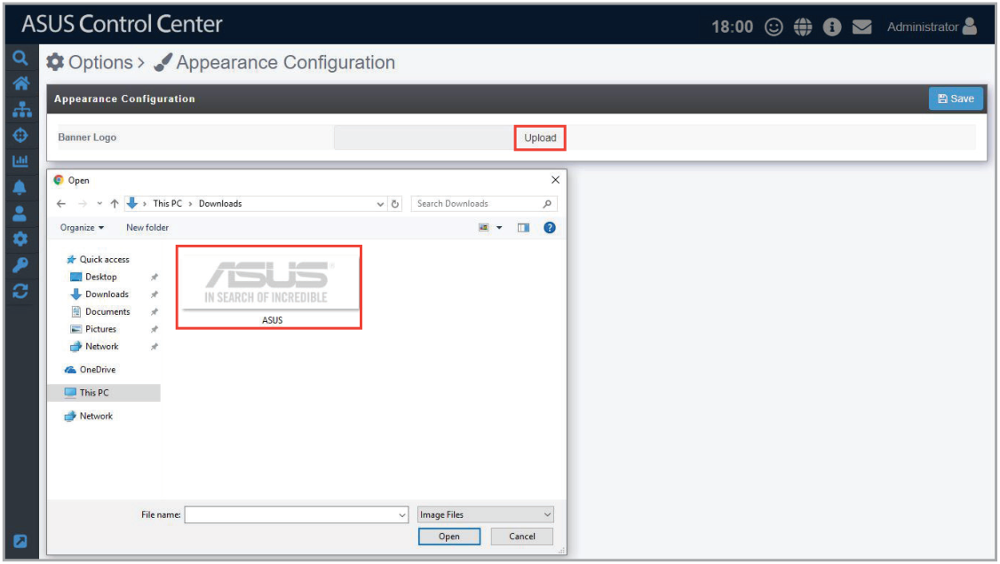
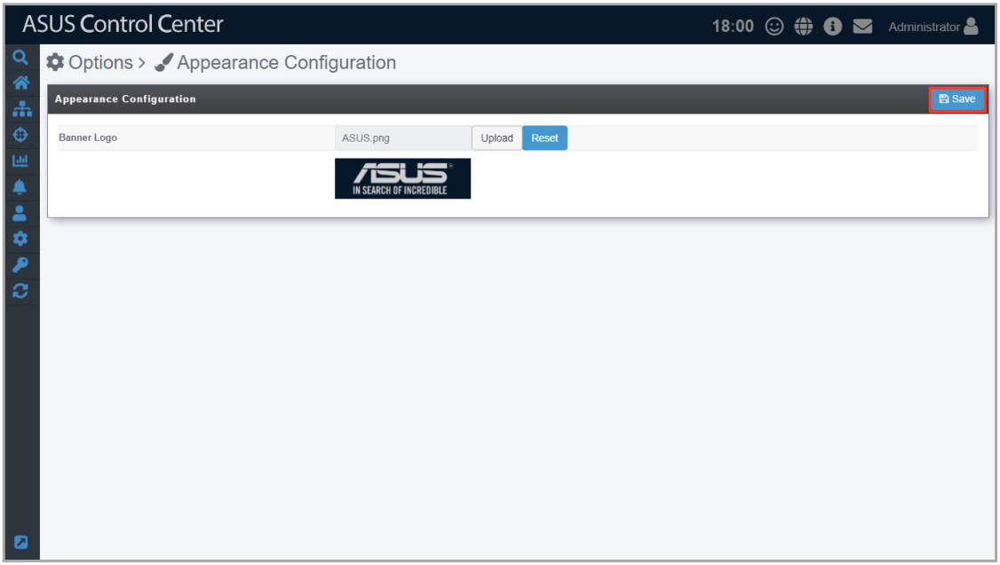
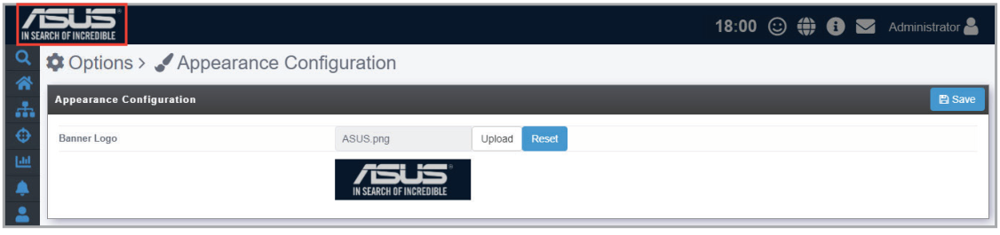
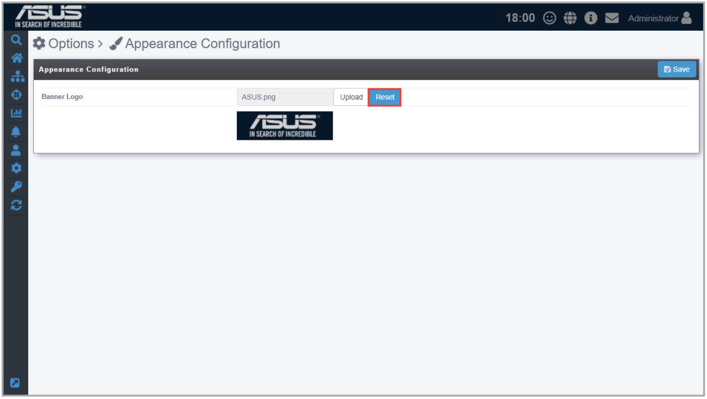
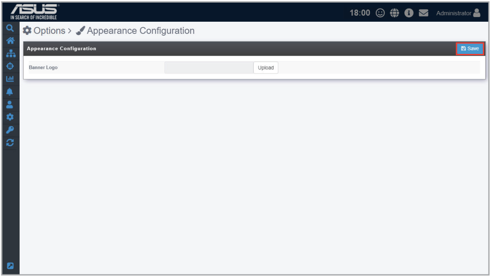

# Appearance Configuration

The **Appearance Configuration** allows you to customize and personalize your ASUS Control Center’s top left banner logo.

To access **Appearance Configuration**, click  in the left menu, then click on **Appearance Configuration**.

## Setting a custom banner logo

1. Click on **Upload**, then select your new banner logo.

    > **NOTE:** The height dimension of the logo image file should be 56 pixels.

    

2. Once you have finished uploading the new banner logo, click on **Save**.

    

    

## Resetting the banner logo

1. Click on **Reset** to reset your banner logo to the default banner logo.

    

2. Click on **Save** to save the changes made.

    
