# Backup & Restore

> **NOTE:** This function is only available for ASUS Control Center Enterprise edition.

The **Backup & Restore** function allows you to set a periodic backup of the settings and configurations of ASUS Control Center to another backup device, allowing you to easily restore the backup settings and configurations if something were to happen to the ACC VM.

To access **Backup & Restore**, click  in the left menu, then click on **Backup & Restore**.

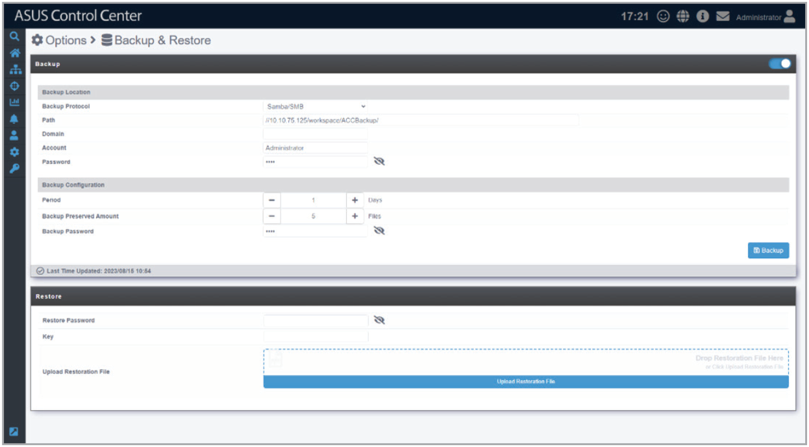

## Enabling periodic backup

1. Select a Backup Protocol (currently only supports Samba / SMB protocols).

    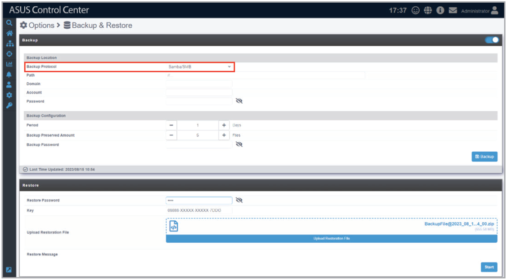

    If you wish to back up your ACC to a Linux OS device’s SMB folder, do the following:

    - Close SELinux
        - For RHEL, CentOS, Scientific Linux
            1. Open `/etc/sysconfig/selinux`.
            2. Set `SELINUX=enforcing` to `SELINUX=disabled`.
            3. Reboot the system.
        - For Debian, Ubuntu
            - SELinux is not installed by default in Debian and Ubuntu.
    - Adding to the Firewall whitelist
        - For RHEL, CentOS, Scientific Linux
            - If you are using **iptables**:
                1. Input the following command to allow 137, 138, and 139 ports:

                    ```
                    -A INPUT -m state --state NEW -m udp -p udp --dport 137 -j ACCEPT
                    -A INPUT -m state --state NEW -m udp -p udp --dport 138 -j ACCEPT
                    -A INPUT -m state --state NEW -m tcp -p tcp --dport 139 -j ACCEPT
                    ```

                2. Restart the service for the changes to take effect by using the following command: `systemctl restart iptables`.
            - If you are using **firewalld**: Enter the following commands to add Samba access privileges: `firewall-cmd -permanent -zone=public -add-service=samba`.
        - For Debian, Ubuntu
            - If you are using **ufw**, the system has already added nf_conntrack_netbios_ns to IPT_MODULES under /etc/default/ufw by default, so access should already be allowed.
    - Enable write permissions for the destination folder
        - The “Write” permission should be enabled for “other(O)” in the folder you wish to back up to. You can use the following command: `chmod -R 755 /home/acc/backup`.
    - Modify the Samba configuration file
        1. Open `/etc/samba/smb.conf`.
        2. Set the **security** variable in **Galbol Setting** to “user”.
        3. Set the **writable** variable in **Share Definitions** to “yes”.

    If you wish to back up your ACC to a Windows OS device’s SMB folder, do the following on the Windows OS device you wish to backup to:

    - Create, share, and enable permissions for the destination folder
        1. Create a new folder and enter a name for it, for example AccBackup.

            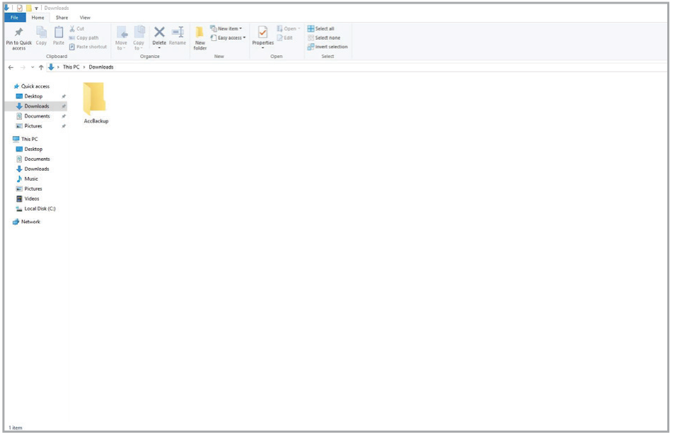

        2. Right click on the newly created folder and select **Properties** > **Sharing** > **Advanced Sharing...**.

            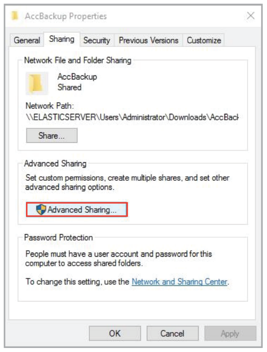

        3. Check **Share this folder**, then click on **Permissions**.

            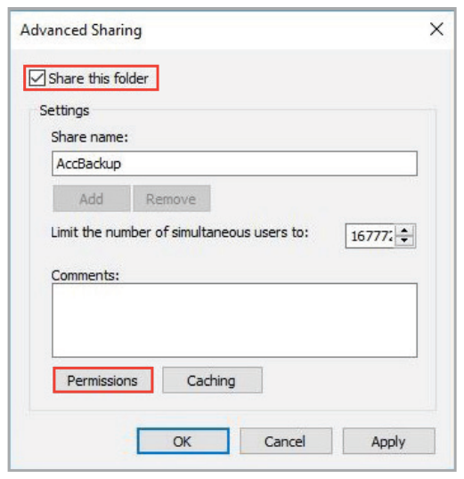

        4. Click on **Add...**, then enter the users you would like to allow permissions for, click on **Check Names** and click **OK**.

            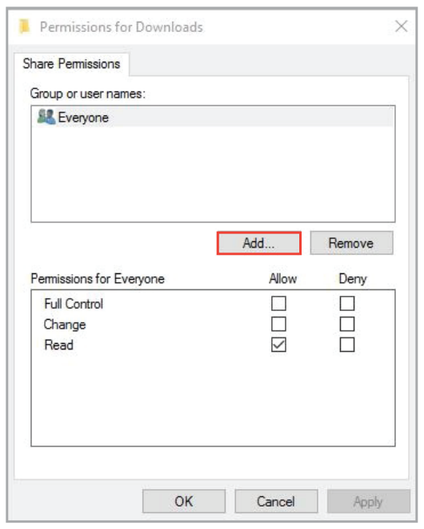

            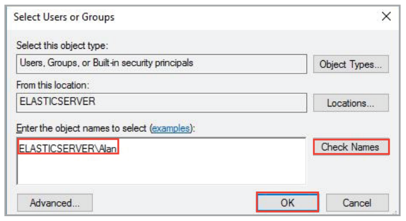

        5. Select the newly added group or username and check the **Full Control** permission. Ensure the **Full Control**, **Change** and **Read** permissions are all checked, click **Apply**, then click **OK**.

            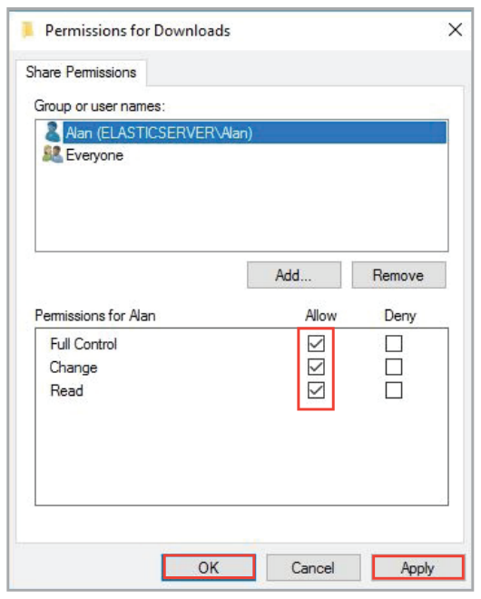

        6. Return to your ASUS Control Center main server.

2. Fill in the **Path**, **Domain**, **Account**, and **Password** fields.

    > **NOTE:**
    >
    > - The **Account** and **Password** fields refer to the credentials used to access the backup location, not the credentials used to log into ASUS Control Center.
    > - The folder should be set as a shared folder and discoverable by the system you wish to back up, and should have read and write permissions enabled.
    > - Take note of the syntax of the path. Ensure that the syntax of your selected protocol from the previous step is correct.

    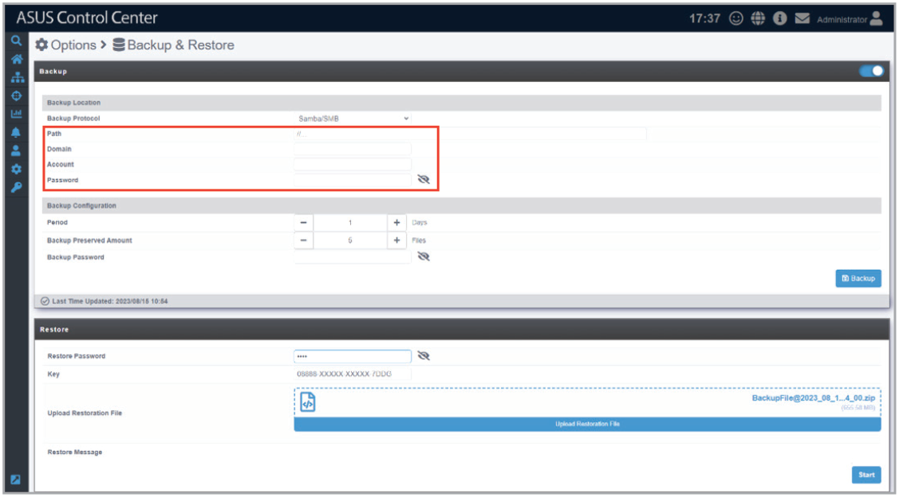

3. Select the **Period** and **Preserved Backup** numbers. **Period** determines the amount of days each periodic backup should be done. The **Preserved Backup** amount determines how many backup files should be saved, when the amount of files exceed the **Preserved Backup** number, the backup file with the earliest date will be deleted.

    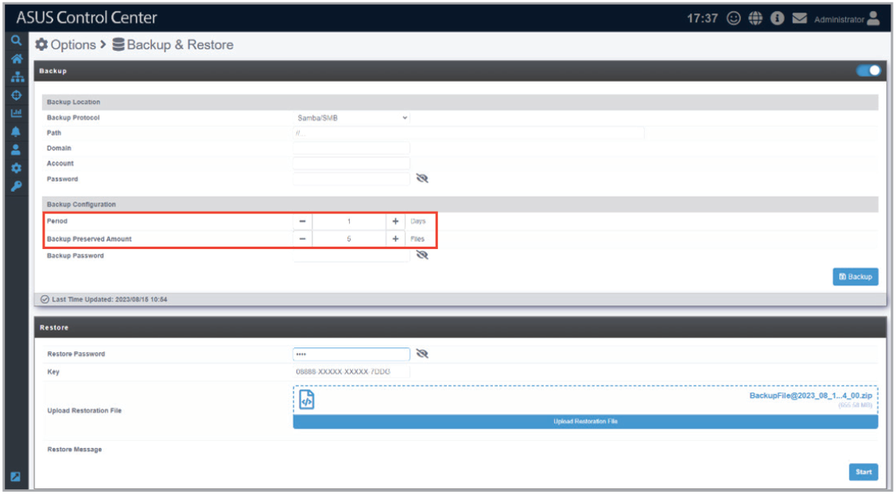

4. Enter a backup password. This password is required when you use the **Restore** function.

    > **NOTE:** Store the backup password in a safe place. If the backup password is lost, you will not be able to restore from the backup file.

    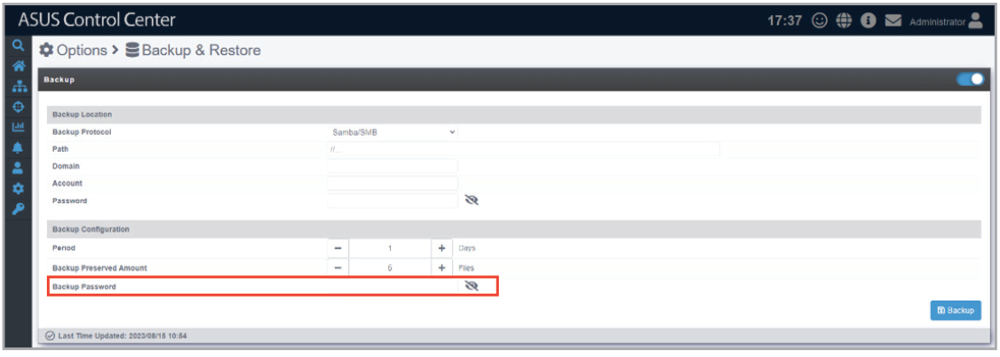

5. Click **Backup** to save the backup settings and start the initial backup.

    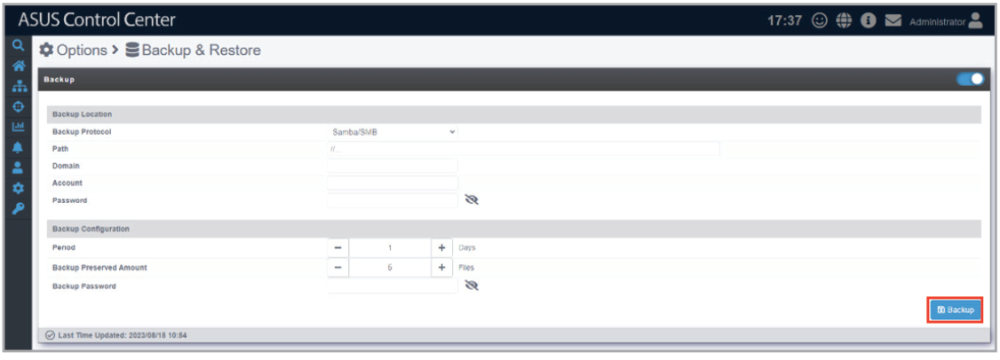

    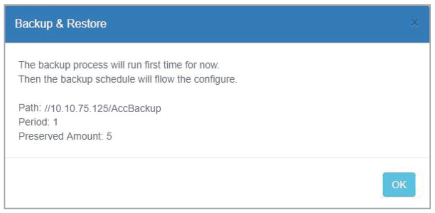

## Restoring the backup file

1. Enter the **Backup Password** previously set when enabling periodic backup into the **Restore Password** field.

    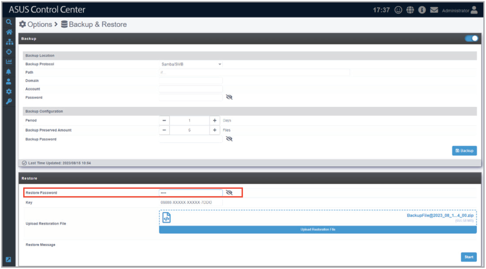

2. Enter the license key in the **Key** field.

    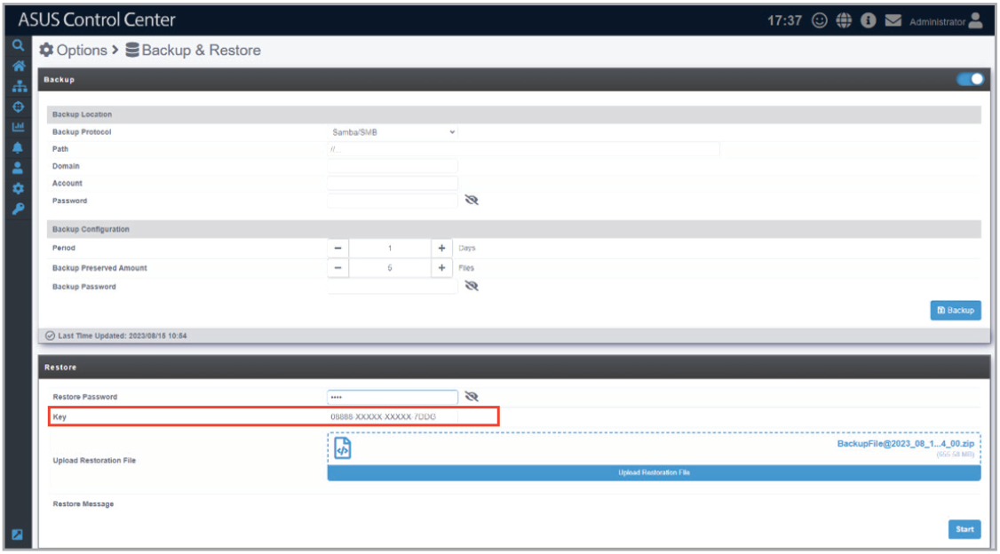

3. Drag a backup file you wish to restore into the **Upload Restoration File** field, or click on **Upload Restoration File** and select the backup file you wish to use to restore.

    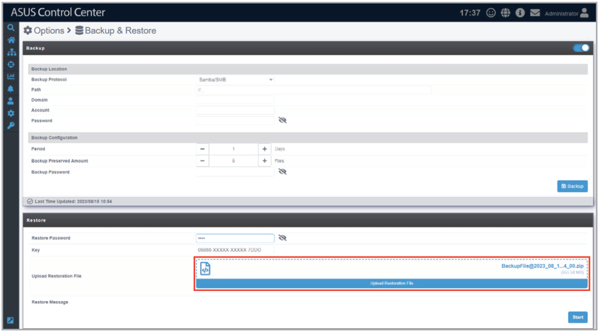

4. Click **Start** to restore from the selected backup file.

    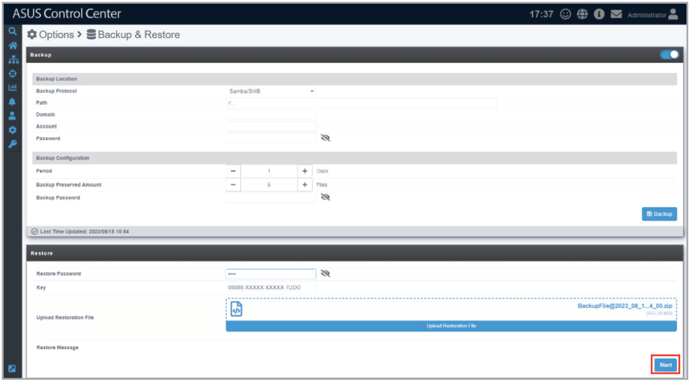

5. The session will expire and you will be logged out of ACC when the restore process begins, please restart the browser and log in again once the restore process is complete.

    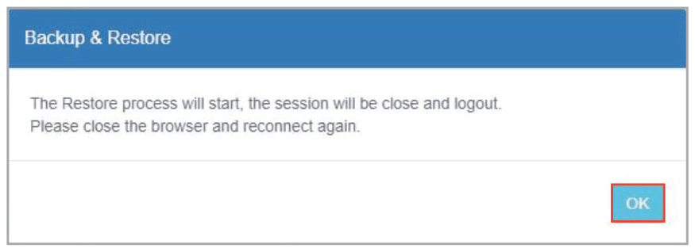

6. Once you’ve logged into the restored ACC, you will need to configure the network settings such as the Host Name and IP Address of the restored ACC, for managed devices to return and display the correct information and data.

    Navigate to  > **Network Configuration**, and change the **Host Name** of the restored ACC to the same host name as the backed up ACC, then click **Save**.

    For example, if the backed up ACC’s host name was ACC TUTOR, then after restoring it to an ACC main server with the host name ACC NWONE, change the host name ACC NWONE to ACC TUTOR.

    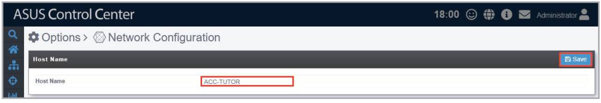

7. Change the IP Address of the restored ACC to the same IP address as the backed up ACC, then click Save.

    For example, if the backed up ACC’s IP address was 10.10.75.123, then after restoring it to an ACC main server with the IP address 10.10.75.235, change the IP address 10.10.75.235 to 10.10.75.123.

    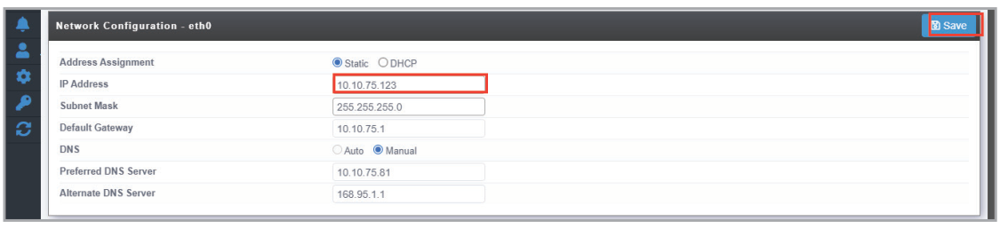
