# Customize Page

**Customize Page** allows you to create and edit custom pages.

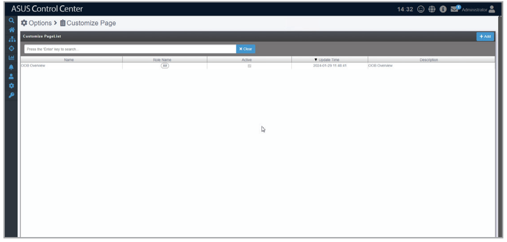

## Adding a blank custom page

1. Click **Add** to open the custom page editor and create a blank custom page.

    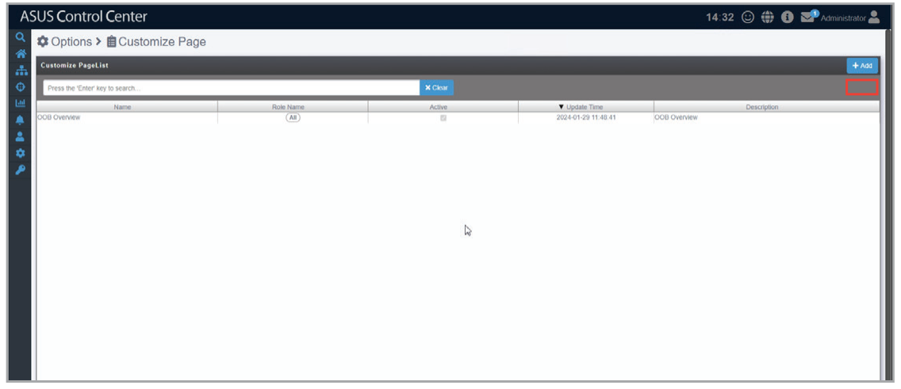

2. Fill in the **Name** and **Description** fields.

    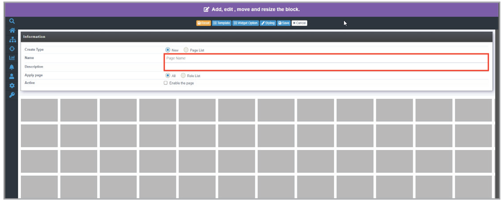

3. Select the **Role List** option in the **Apply page** field, then select a role from the drop down menu to specify which roles should have access to the custom page (optional).

    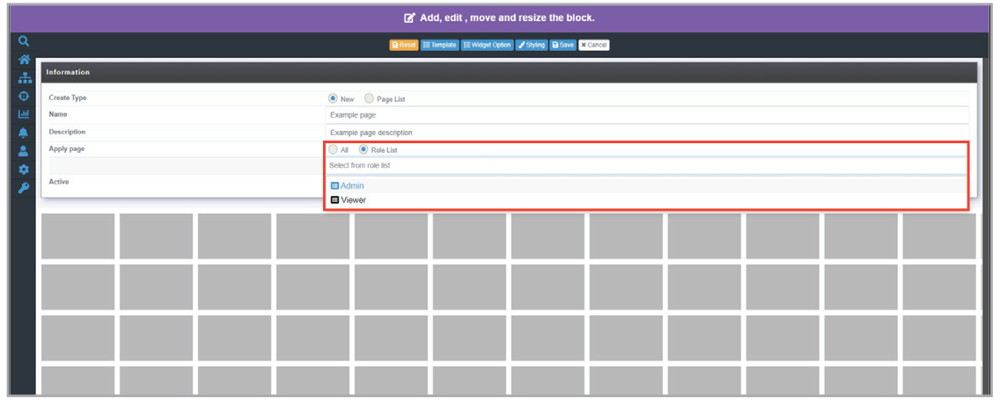

4. Tick **Enable this page** to enable the custom page.

    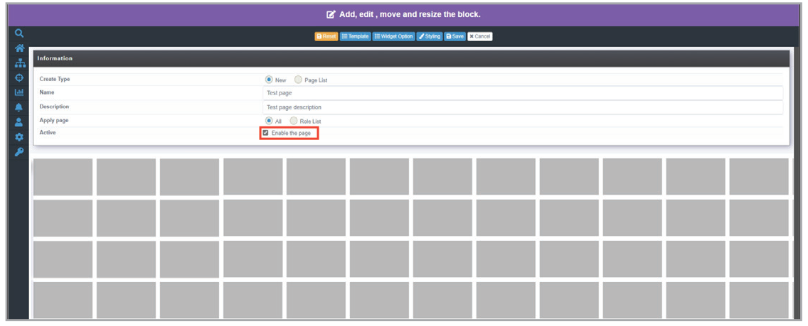

## Editing an existing customized page

Select an existing custom page to open the custom page editor.

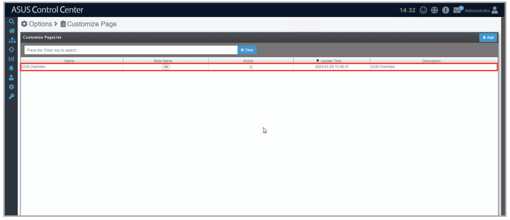

## Using an existing custom page as a template

In the custom page editor, select the **Page List** option in the **Create Type** field, then select a custom page from the drop down list to use as a template.

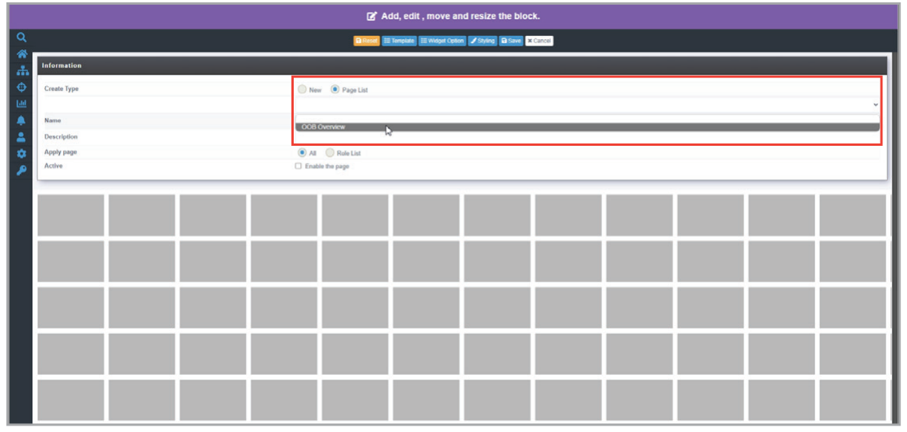

## Loading a custom page template

1. In the custom page editor, click **Template**.

    

2. Select a template, then click **Add**.

    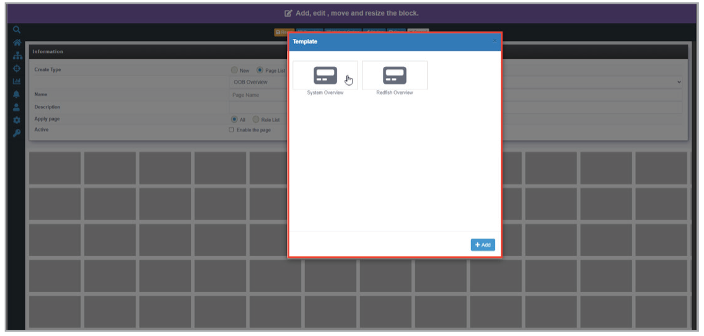

## Changing the theme of the custom page

In the custom page editor, click **Styling**, then select a theme from the drop down menu.

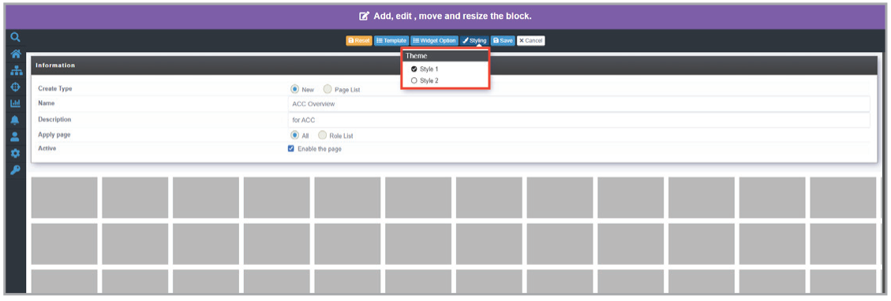

## Changing the size of widgets

Click the enlarge or shrink button in the title bar of the widget.

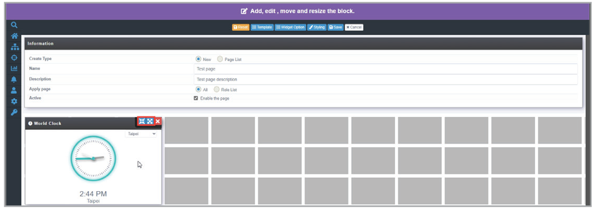

## Adding a widget using the widget gallery

1. In the custom page editor, click **Widget Option**.

    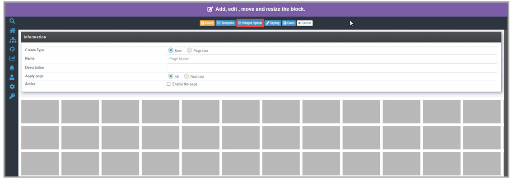

2. Select a widget from the Widget Gallery, then click **Add**.

    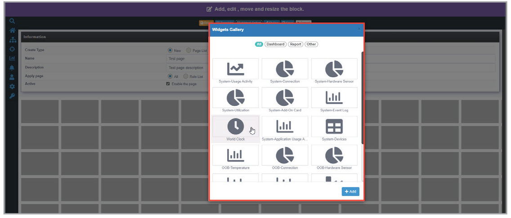

## Changing the location of widgets

Drag and drop a widget to the desired location.

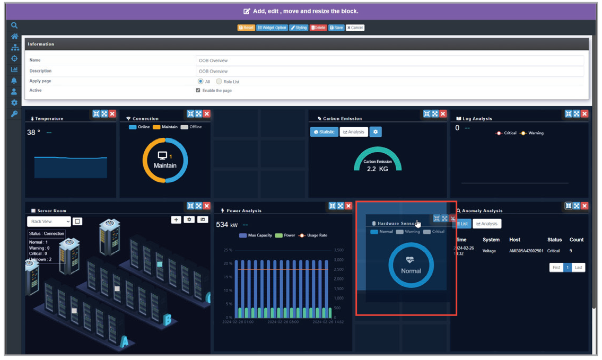
