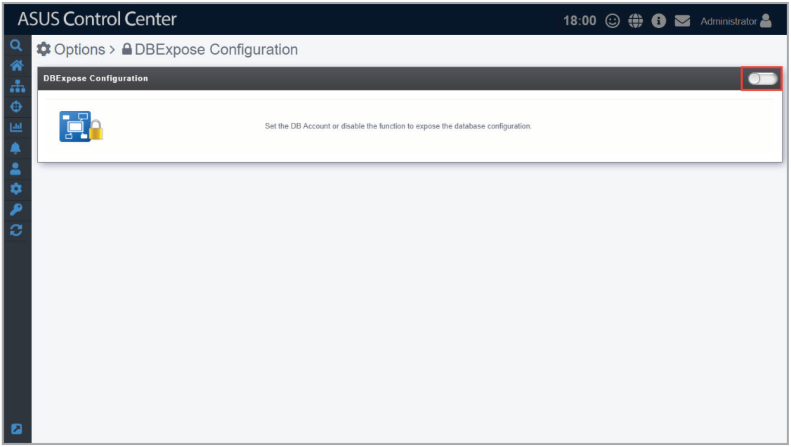
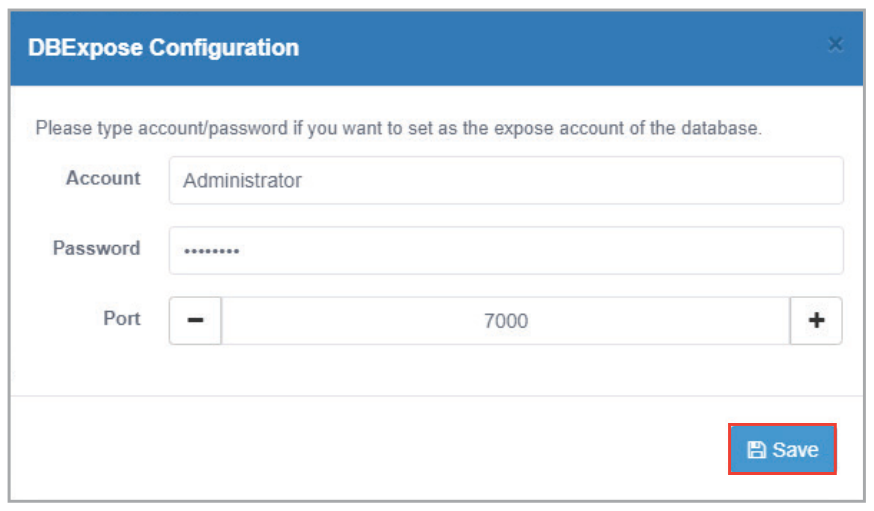
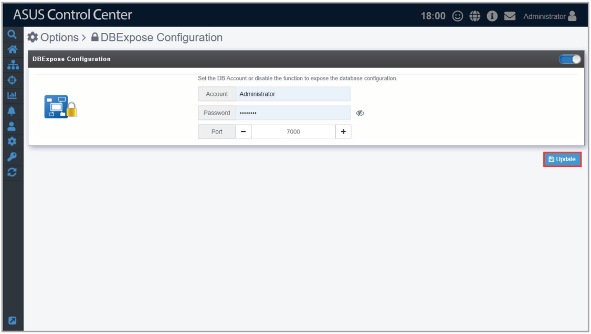
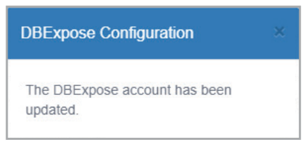
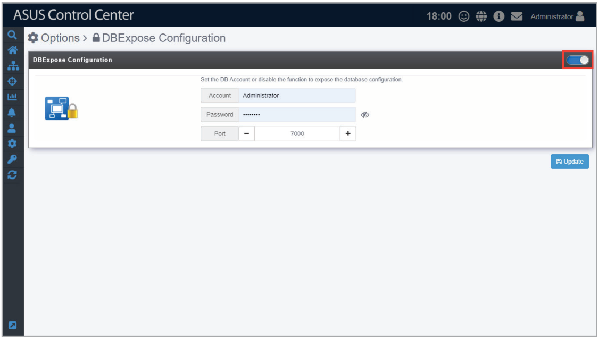
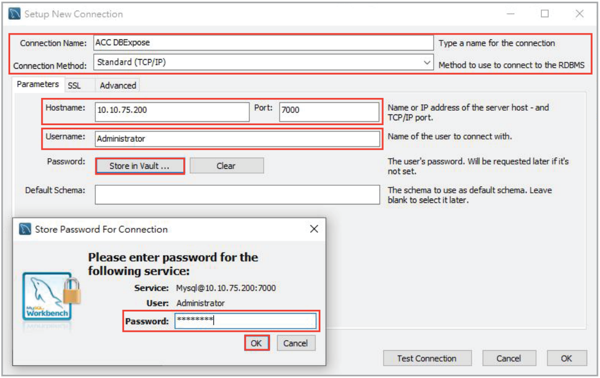
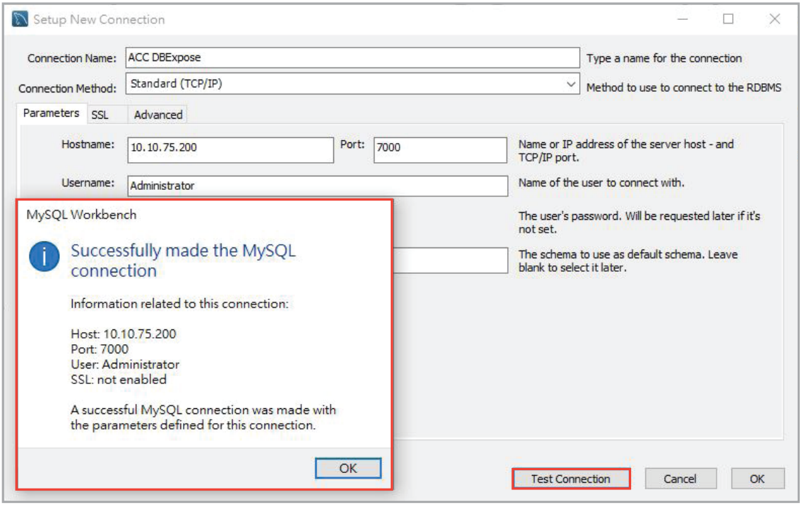
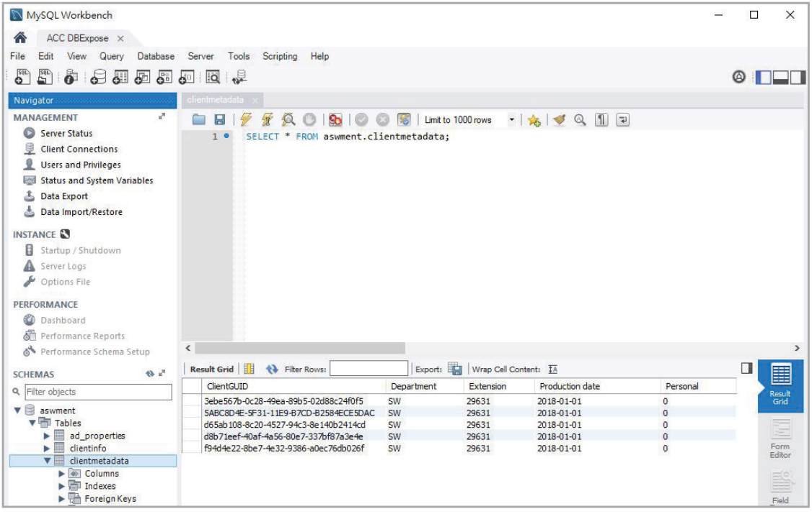

# DBExpose Configuration

The **DBExpose Configuration** allows you to set an account and password which allows users to use third-party software, such as MySQL Workbench to access data on ASUS Control Center, such as device information or metadata. This information is read-only and cannot be edited.

To access **DBExpose Configuration**, click  in the left menu, then click on **DBExpose Configuration**.

## To set the DBExpose account and password

1. Click on the slide button on the top right of the main screen.

    

2. Enter an account and password, then enter a port (between 7000-7999) which is not being used. Once you have finished entered the required fields, click on **Save**.

    

## To edit the DBExpose account information

Edit the account, password, and port information then click on **Update** to save the changes made.

## To delete the DBExpose account information

Click on the slide button on the top right to disable and delete the DBExposure Configuration settings.

## Access ASUS Control Center with third-party software

> **NOTE:** The example in this section is for reference only.

You can use a third-party software such as **MySQL Workbench** to access information such as the metadata and device information of your ASUS Control Center.

1. Load MySQL Workbench, then set up a new connection and enter the required information.
2. Enter the ip and port of the ASUS Control Center server into the **Hostname** and **Port** field.
3. Next, enter the DBExposure account created into the **Username** field.
4. Click on **Store in Vault...** then enter the DBExposure password you created into the password field and click **OK**.

    

5. Click on **Test Connection** to test if the connection to ASUS Control Center was successfully created.

    

6. Save the connection settings, now when using MySQL Workbench, you should be able to access some of the data on ASUS Control Center.

    > **NOTE:** The screenshot below is an example of accessing the metadata of ASUS Control Center.

    
