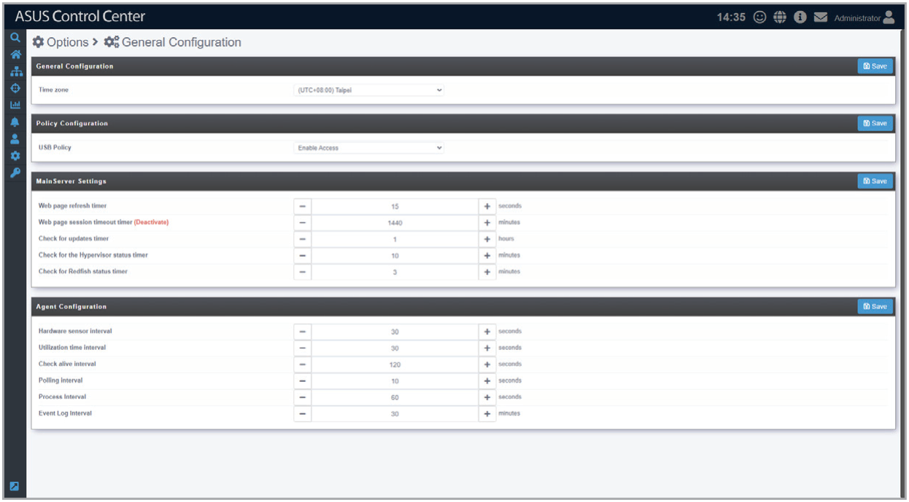

# General Configuration

The **General Configuration** allows you to configure different settings for the main ASUS Control Center server and agents, as well as set the time zone.

To access **General Configuration**, click  in the left menu, then click on **General Configuration**.

## Adjusting items on the General configurations page

Configure the items in the **General Configurations** block, **MainServer Settings** block, and **Agent Configuration** block, then click on **Save** to save the changes made. For more details on the different configuration options available, please refer to the tables below:

### General Configuration

| Item | Description |
| --- | --- |
| **Time Zone** | Adjust the time zone of the underlying Linux system the ASUS Control Center’s main server is installed on. **\* The time zone set here should match the time zone of the system of the VM with ASUS Control Center installed.** **\*\* Adjusting this item will only affect the initialization of ASUS Control Center, and will not affect the time displayed in the top right of ASUS Control Center, nor will it affect the Agent and Event Log response times.** |

### Policy Configuration

| Item | Description |
| --- | --- |
| **USB Policy** | Set the default USB policy to enable or disable USB devices on new managed devices. |

### Main Server Settings

| Item | Description |
| --- | --- |
| **Web page refresh timer** | Set the time interval in seconds between each refresh of data on all webpages of the main server. **\* This setting will affect the response time for items such as System Overview and Event Log.** |
| **Web page session timeout timer** | Set the time interval in seconds for the web page session timeout timer, which causes web sessions to be logged out after no activity is detected for the specified amount of time. The default setting of 1440 minutes (24 hours) disables the web page session timeout timer. |
| **Check for updates timer** | Set the time interval in hours for the main server and agent update check. **\* This setting will affect the main server and agent version check timer in the Updates page, and may require an Internet connection.** |
| **Check for the Hypervisor status timer** | Set the time interval in minutes ASUS Control Center should perform a status check on managed vSpheres. **\* This setting will affect the response times for items in the VM Overview page such as vSphere hardware sensors and utilization.** |
| **Check for Redfish status timer** | Set the time interval in minutes ASUS Control Center should perform a status check on managed Redfish devices. |

### Agent Configuration

| Item | Description |
| --- | --- |
| **Hardware sensor interval** | Set the time interval in seconds for the agents of all managed devices to return **Hardware Sensor** values. The default setting is 30 seconds, which means that the agents need to report **Hardware Sensor** values and status every 30 seconds. For example, if a fan was removed from a device, ASUS Control Center’s web interface should receive and update the status for fan abnormality within 30 seconds (Web page refresh time could affect the update time). |
| **Utilization time interval** | Set the time interval in seconds for the agents of all managed devices to return **Utilization** values. The default setting is 30 seconds, which means that the agents need to report Utilization values and status every 30 seconds. For example, if a stress test was performed on a CPU, ASUS Control Center’s web interface should receive and update the status for CPU abnormality within 30 seconds (Web page refresh time could affect the update time). |
| **Check alive interval** | Set the time interval in seconds for the agents of all managed devices to return the connection status. The default setting is 120 seconds, which means that the agents need to report the connection status every 120 seconds. For example, if a device loses connection, ASUS Control Center’s system overview should display it as “Offline” after 120 seconds (Web page refresh time could affect the update time). |
| **Polling interval** | Set the time interval in seconds for the agents of all managed devices to query tasks from ASUS Control Center. The default setting is 10 seconds, which means that the agents need to query ASUS Control Center if there is a task for that device every 10 seconds. For example, the device should perform a task of disabling the registry, locally, within 10 seconds of disabling the registry of that device on the ASUS Control Center web interface. |
| **Process interval** | Set the time interval in seconds for the agents of all managed devices to return PID (Process ID) values. The default setting is 60 seconds, which means that the agents need to report PID values every 60 seconds. **\* To view process information, refer to Software under the Device Information section.** |
| **Event log interval** | Set the time interval in seconds for the agents of all managed devices to return Event Log entries. The default setting is 30 minutes, which means that the agents need to provide an updated Event Log every 30 minutes. **\* To view event logs, refer to Event Log under the Device Information section.** |
