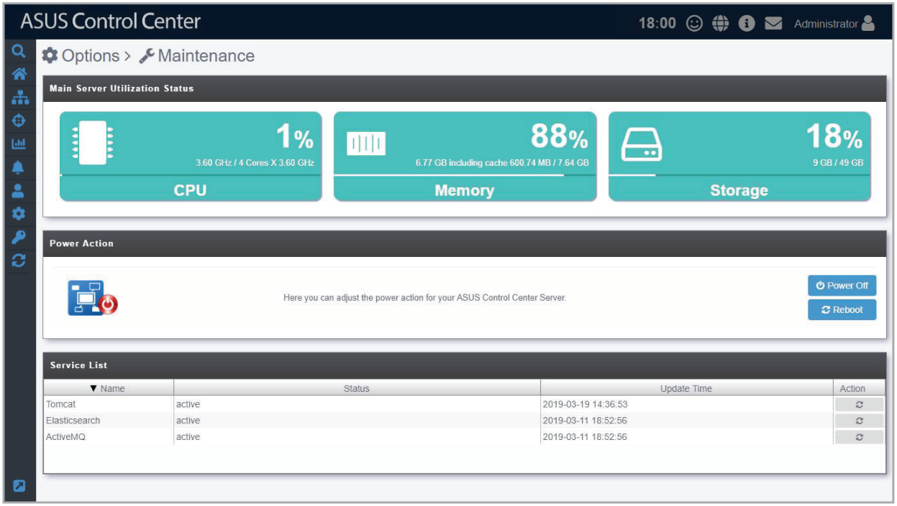
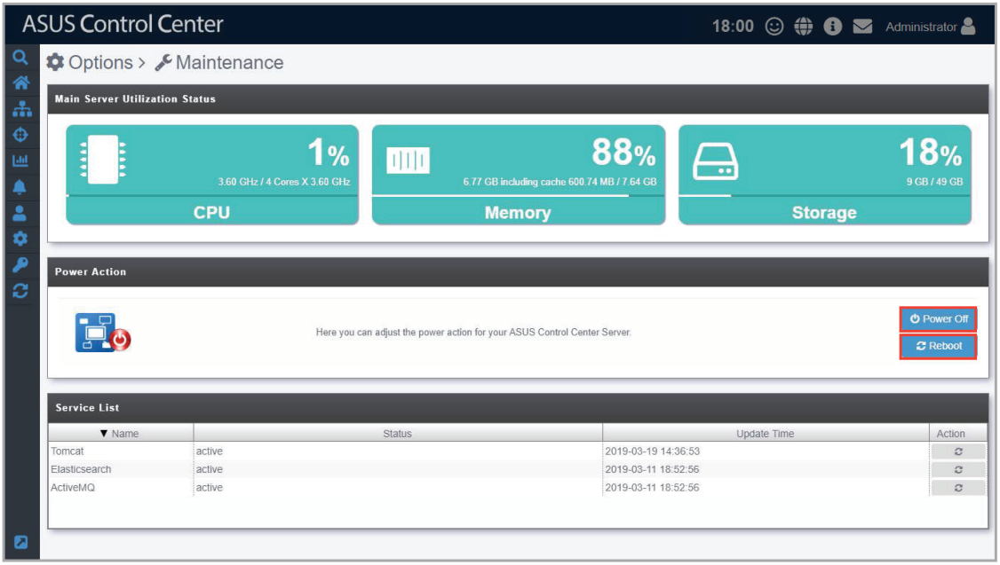
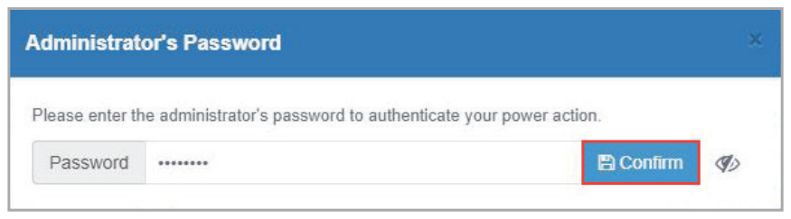
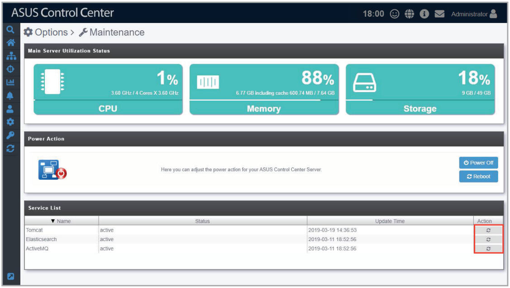
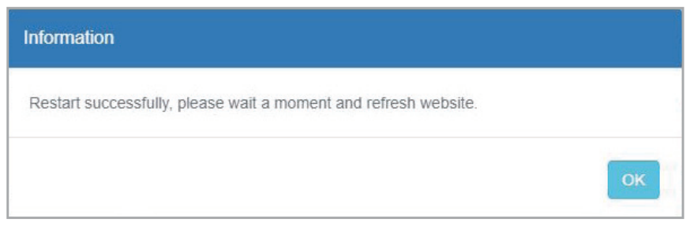

# Maintenance

The **Maintenance** function allows you view the information such as the CPU, memory, and storage of the ACC VM. It also allows you to configure the power options and services running on the ACC VM remotely from the ASUS Control Center. This helps you save time when managing hypervisors, as you can control and configure them all from the ASUS Control Center.

To access **Maintenance**, click  in the left menu, then click on **Maintenance**.

## Cofiguring the power option of Hypervisors

1. Click on **Power Off** or **Reboot** to power off or reboot the hypervisor.

    

2. Enter the password of an account with a role that has Power Control enabled, then click on **Confirm** to execute your selected power option.

    > **NOTE:** For more information on Accounts and Roles, please refer to the **Account Management** chapter.

    

## Restarting the Services

Click on the restart button next to the service you wish to restart.

This will end your session and you will be logged out of ASUS Control Center. Please login again once the restoration is complete.

