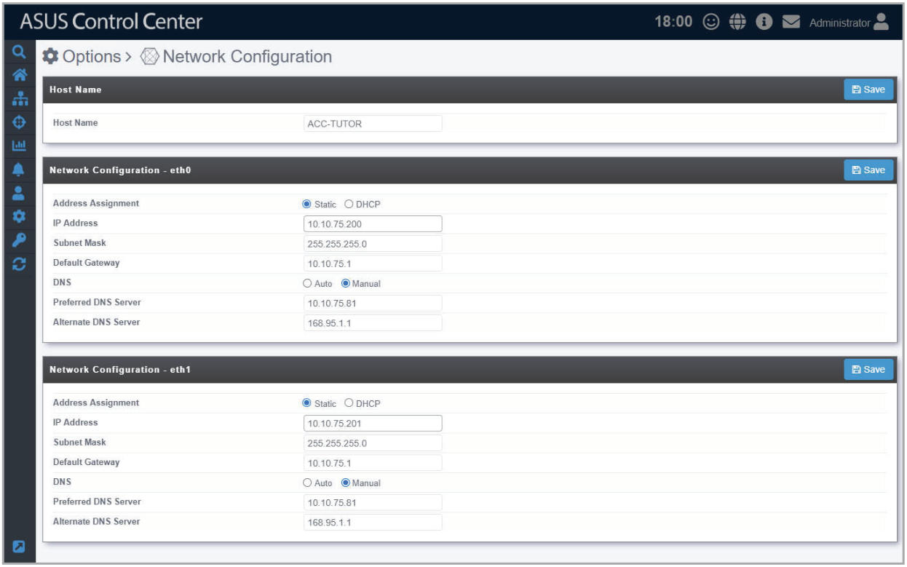

# Network Configuration

The **Network Configuration** allows you to configure the network for the ASUS Control Center main server. When the device with ASUS Control Center or a hypervisor features multiple network cards, you can configure multiple networks to allow ASUS Control Center to manage different network segments.

To access **Network Configuration**, click  in the left menu, then click on **Network Configuration**.

## Adjusting the Network configurations

Configure the items in the **Host Name** block and **Network Configuration** block then click on **Save** to save the changes made. For more details on the different configuration options available, please refer to the tables below:

### Host Name

| Item | Description |
| --- | --- |
| **Host Name** | The name of the ASUS Control Center main server. **\* You will need to refer to the Host Name set here when manually installing Windows agents to devices.** |

### Network Configuration

| Item | Description |
| --- | --- |
| **Address Assignment** | Select **DHCP** to automatically set the **IP address** and **Subnet Mask**. Select **Static** to enter the **IP address** and **Subnet Mask** manually. |
| **IP Address** | Enter the IP adress for this network card. **\* You can only set the IP Address manually if you selected Static in the Address Assignment field.** |
| **Subnet Mask** | Enter the Subnet Mask for this network card. **\* You can only set the Subnet Mask manually if you selected Static in the Address Assignment field.** |
| **Default Gateway** | Enter the default gateway for this network card. |
| **DNS** | Select **Auto** to automatically set the **DNS Server**, or select **Manual** to manually configure the **DNS Server**. |
| **Preferred DNS Server** | Enter the Preferred DNS Server for this network card. **\* You can only set the Preferred DNS Server manually if you selected Manual in the DNS field.** |
| **Alternate DNS Server** | Enter the Alternate DNS Server for this network card. **\* You can only set the Alternate DNS Server manually if you selected Manual in the DNS field.** |

> **NOTE:**
>
> - The amount of **Network Configuration** blocks available will depend on the amount of network cards available.
> - You will be logged out of ASUS Control Center when you save the changes made to the **Network Configuration** block(s). If you changed the IP address, you will need to enter the new IP address when logging in.
