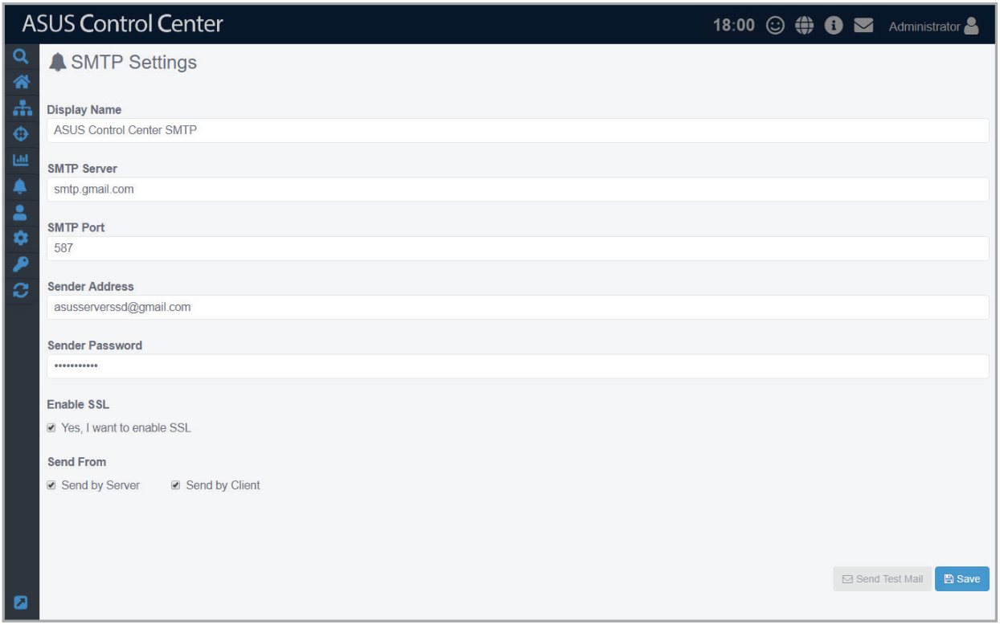
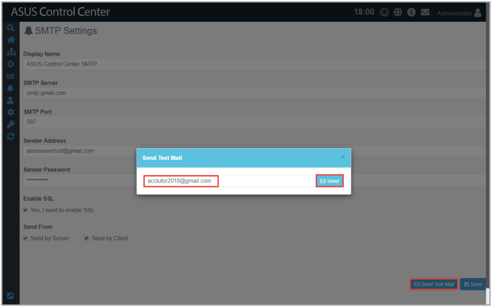
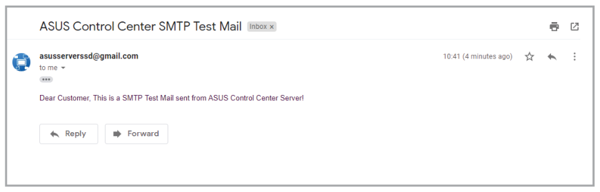
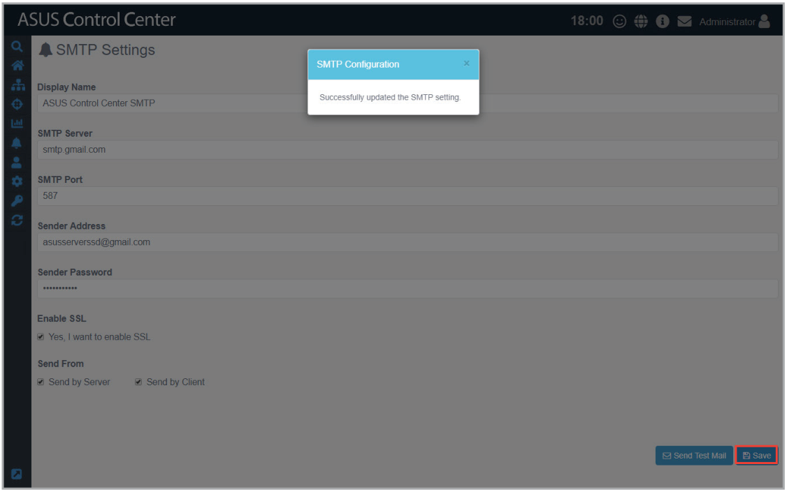

# SMTP Settings

> **NOTE:** The information entered in this section is for reference only.

Set up the SMTP (Simple Mail Transfer Protocol) for ASUS Control Center to allow feedback on system failures and alerts to be sent via email to the system administrator.

To access **Software Report**, click  in the left menu, then click on **SMTP Settings**.

## To set up the SMTP Server:

1. Fill in or check the following fields:

    | Item | Description |
    | --- | --- |
    | **Display Name** | The name of this SMTP setting. The display name will not appear on sent emails. |
    | **SMTP Server** | The SMTP server responsible for collecting and sending emails |
    | **SMTP Port** | Service port for SMTP. Common ports used are 25 (SMTP former default port), 465 (encrypted SMTP), and 587 (new SMTP default) |
    | **Sender Address** | The email of the ACC notification sender. This email address must exist within the SMTP Server service |
    | **Sender Password** | The password for the ACC notification email sender |
    | **Enable SSL** | Enables mail sent or forwarded through this SMTP server are SSL encrypted |
    | **Send by Server**\* | When there are issues with managed devices whilst within the same domain as ACC, ACC will send emails using the SMTP server |
    | **Send by Client**\* | When there are issues with managed devices whilst not in the same domain as ACC, the managed device will send emails using the SMTP server |

    > **NOTE:** Refer to the flow chart for more details on the difference between Send by Server and Send by Client.

    

2. (optional) Click on **Send Test Mail**, then enter an email and click **Send** to receive the test mail to check the status of the SMTP. If the SMTP is functioning properly, you should receive an email.

    

    

3. Click **Save** to save the changes made.

    
