# Security Configuration

> **NOTE:** This function is only available for Windows® OS managed devices.

The **Security Configuration** allows you to set a password as a method to prevent users from removing the agents themselves. This enables a more centralized control over all managed Windows® devices.

This password is separate from the agent uninstall password on individual devices (**Device Information** > **Configuration**), and setting this password will not override the individual agent uninstall passwords.

To access **Security Configuration**, click  in the left menu, then click on **Security Configuration**.

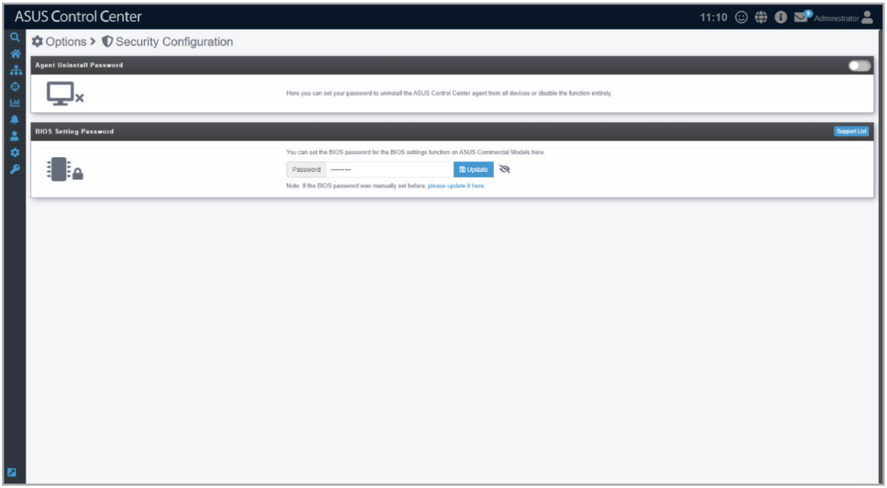

## Agent Uninstall Password

### Setting a new password

1. Toggle the slider to bring up the pop-up window to set the Administrator’s Agent Uninstall Password.

    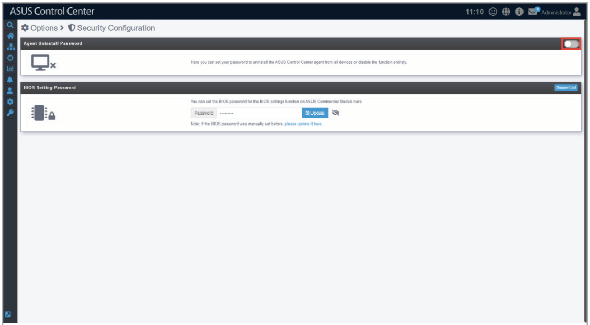

2. Enter the password you wish to set as the Administrator’s Agent Uninstall Password, then click **Save** to set the new password.

    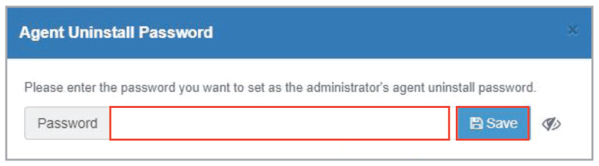

### Editing the password

Click on the **Update** button, then re-enter your new password and click on **Save** to save your new password.

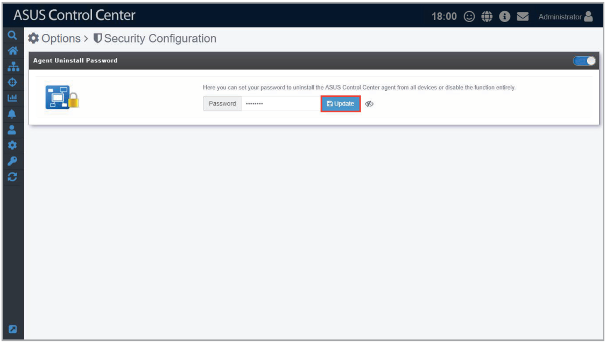

### Disabling the password

Click on the button located at the top right to disable the Administrator’s Agent Uninstall Password.

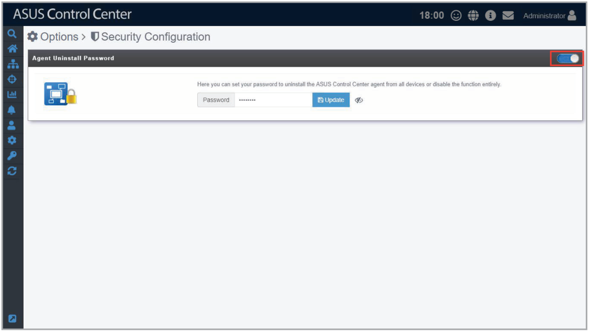

## BIOS Setting Password

When an agent is installed onto a device without a BIOS password, ASUS Control Center will automatically enable BIOS Password Protection and set a BIOS password that meets complexity requirements. In such cases, the client’s BIOS password protection status will be defined as “ACC Protected”.

BIOS Password Protection cannot be automatically enabled if the device has an existing BIOS password. In such cases, the client’s BIOS password protection status will be defined as “Manually Protected”.

### Viewing the BIOS password protection status

Click **Support List** to view the BIOS password protection status for all devices.

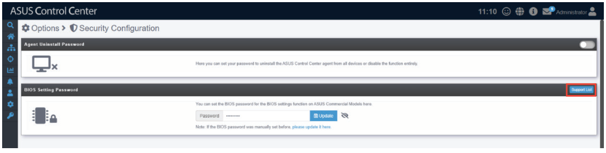

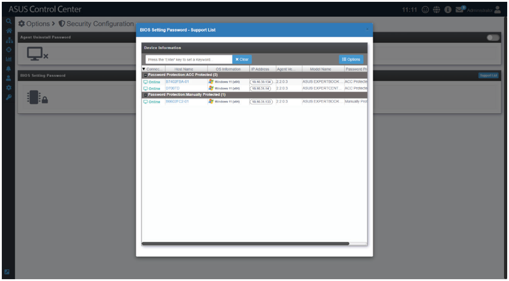

### Updating ACC Protected BIOS passwords

Click on the **Update** button to open a list of ACC Protected devices, then click **Update** in the popup window to update the BIOS password.

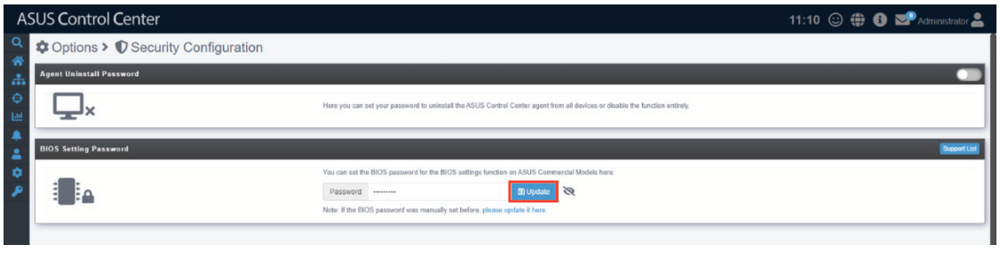

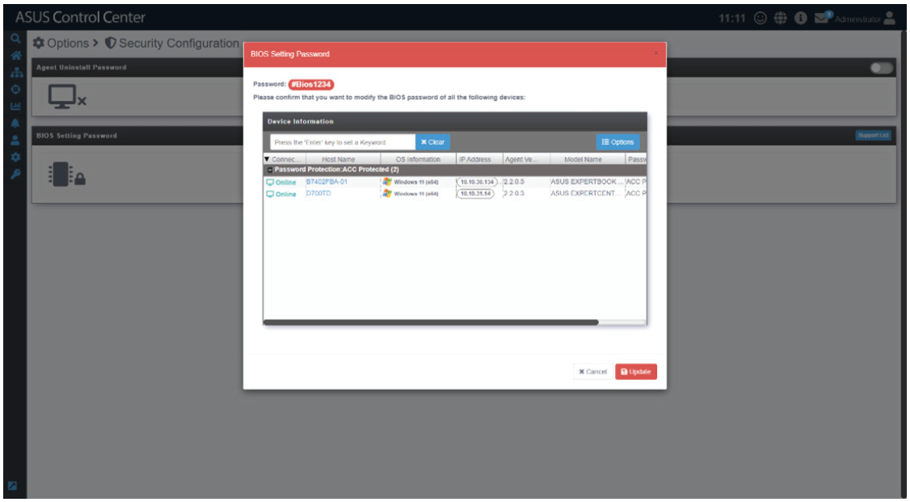

### Updating manually protected BIOS passwords

1. Click **Please update it here** to open a list of manually protected devices.

    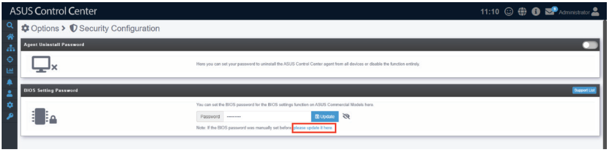

2. Enter the device’s existing BIOS password, then click **Update** to update the BIOS password. BIOS Password Protection will automatically be enabled and the device’s status will change to “ACC Protected”.

    > **NOTE:** For security reasons, the existing BIOS password is required to make any changes. This protects the client devices from malicious attacks that may compromise the BIOS.

    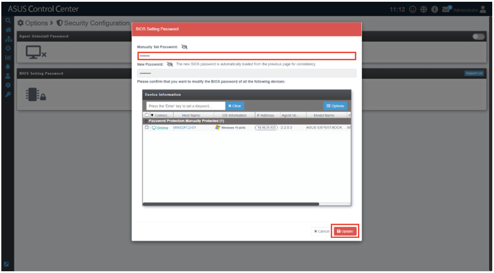
