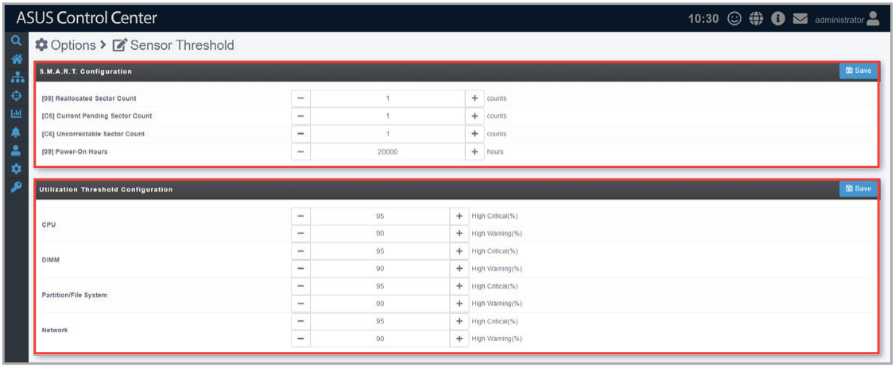

# Sensor Threshold

The **Sensor Threshold** allows you to centrally configure the threshold values of all managed devices, providing you with an effortless method of setting threshold values of all managed devices, instead of having to configure each device’s threshold values individually.

To access **Sensor Threshold**, click  in the left menu, then click **Sensor Threshold**.

## Adjusting the Disk S.M.A.R.T. status configurations

Adjust the disk S.M.A.R.T. status configurations, then click **Save** to save and apply the changes made to all managed devices.

## Adjusting the Utilization Threshold configurations

Adjust the threshold at which warnings and critical warnings will be shown, then click **Save** to save and apply the changes made to all managed devices.

> **NOTE:** To adjust the threshold for a single managed device, refer to **Utilization** under the **Device Information** section.
