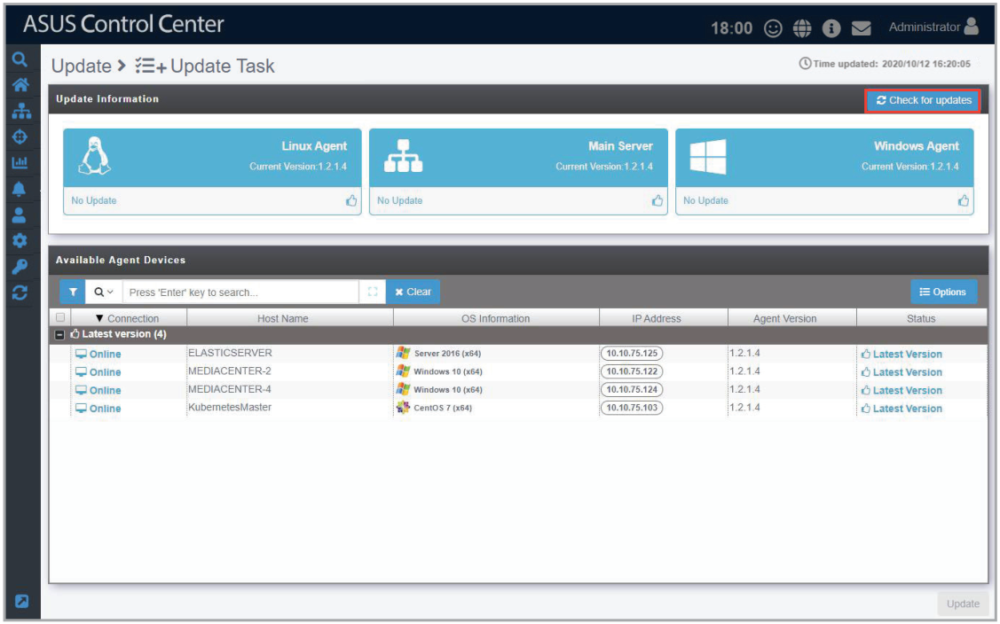
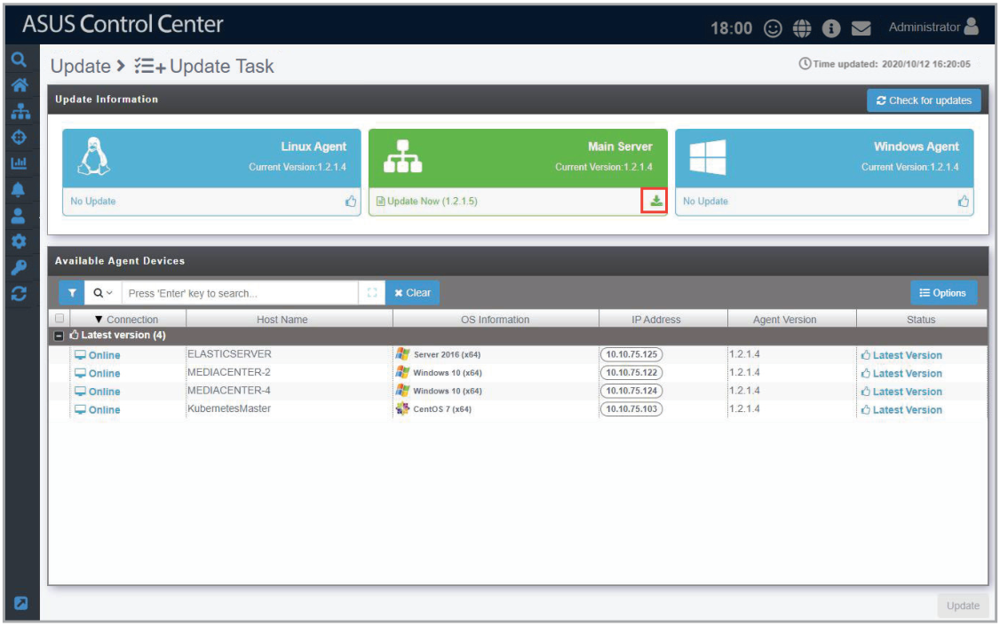
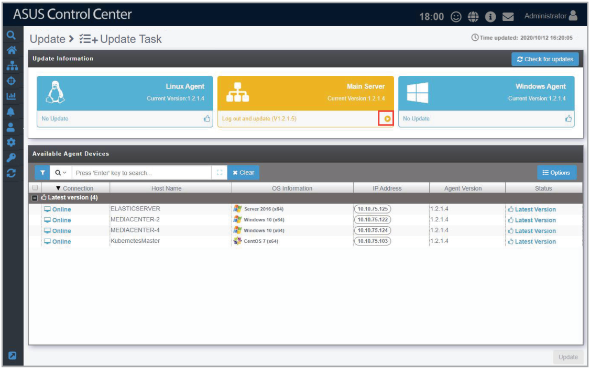
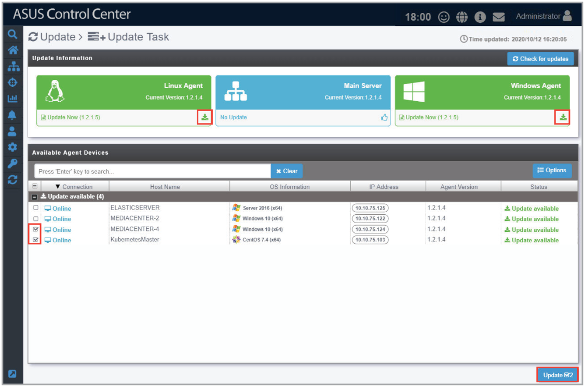
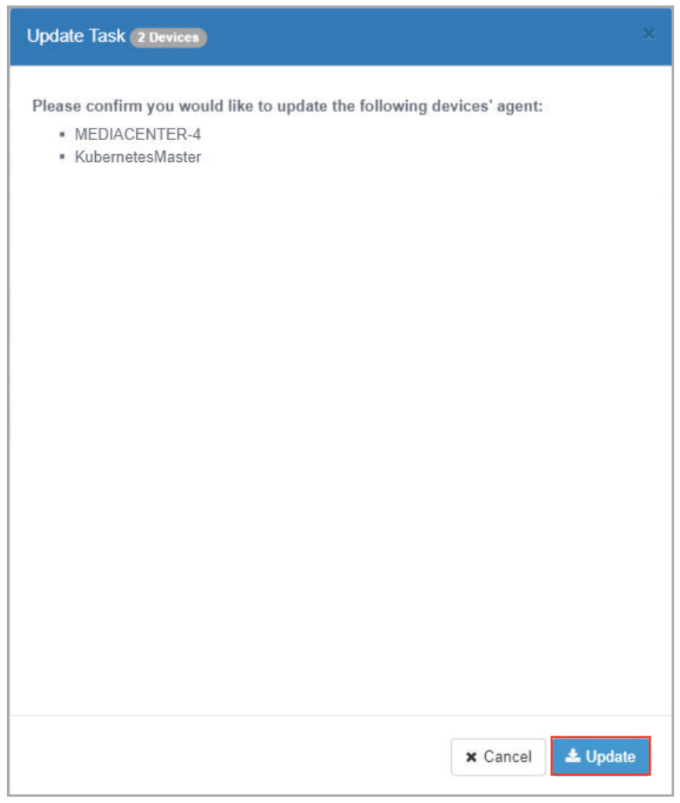
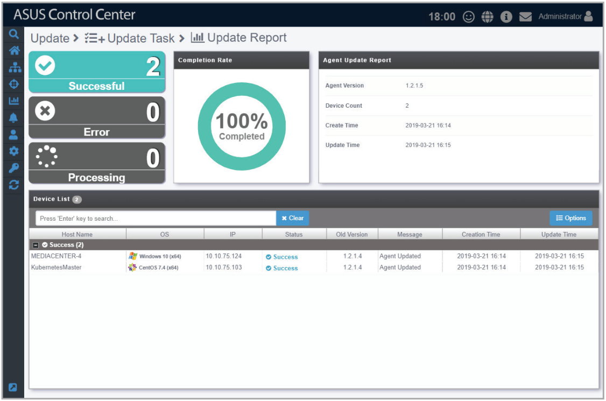

# Update

The **Update Task** screen will display available updates for the Linux Agent, Windows Agent, and Main Server, you may manually refresh the updates screen by clicking on **Check for updates**.

> **NOTE:**
>
> - Ensure to add asuscontrolcenter.asus.com/* to your firewall exceptions list to enable update checks.
> - Ensure you have a stable Internet connection.

## Updating ASUS Control Center main server

1. When an update is available for the main server, it will be displayed under **Update Information** and the **Main Server** block will be displayed in green. Click on  in the **Main Server** block to download the update files.

    

2. Once the update files are successfully downloaded, the **Main Server** block should be displayed in orange. Now click on  to update the ASUS Control Center main server. You will also be logged out of ASUS Control Center when the main server is updating.

    

3. Log into ASUS Control Center again after the update is completed.

## Updating Windows and Linux agents

1. When an update is available for Linux and/or Windows Agents it will be displayed under **Update Information**, and the **Linux Agent** and/or **Windows Agent** block will be displayed in green.
2. Click on  in the **Linux Agent** and/or **Windows Agent** block to download the agent. Once the download is complete, the **Linux Agent** and/or **Windows Agent** block will be displayed in blue.
3. Select the device(s) you wish to update agents for in the **Available Agent Devices** list.
4. Click on **Update**.

    

5. Click **Update** on the confirmation pop-up window to start the update process.

    > **NOTE:** You do not need to uninstall the agents on the selected devices before updating.

    

6. After the agent updates have been completed, you will be redirected to the Agent Update Report screen.

    > **NOTE:** For more details on the Agent Update Report, refer to the **Agent Update Report** section.

    
