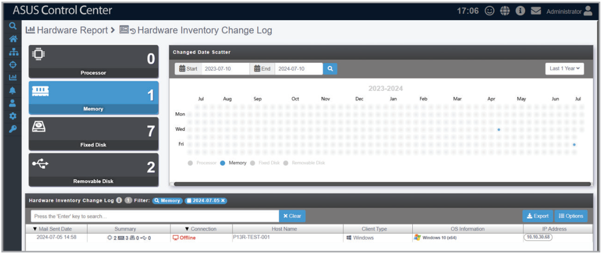
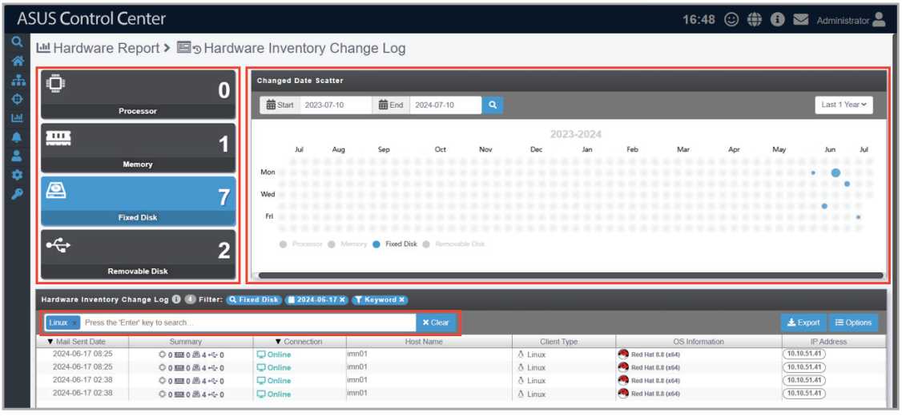
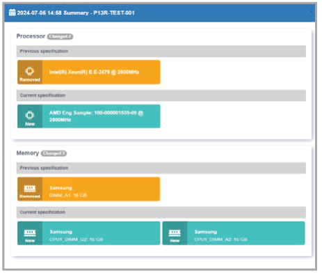
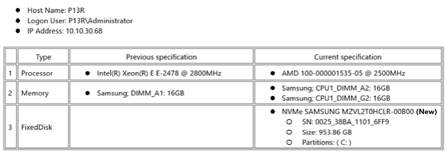

# Hardware Inventory Change Log

This page allows you to view the hardware inventory change log.

> **NOTE:** Before using this function, ensure that hardware inventory change notifications and SMTP settings are properly configured. For more information, refer to the **Hardware Asset** section of the **Notification** chapter and the **SMTP Settings** section of the **Options** chapter.

1. Filter the hardware inventory change log by hardware type, date, or keyword.

    

2. Click an entry to view detailed information about the hardware inventory change.

    

    
