# Hardware Inventory

**Hardware Inventory** allows you to view the count for models, displays, processor, memory, or storage hardware components of all managed devices or filter through managed devices or hardware component.

Checking a component, then clicking on the **Show Device** button will display devices which have the selected components in the **Devices List**, allowing you to quickly locate managed devices with expensive hardware components or components which need to be replaced.

> **NOTE:** To export the information of a block click the **Export** button in that block, enter a filename, then click **OK**.

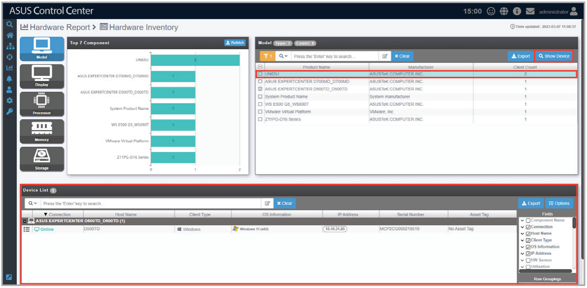

## View Model component type and count

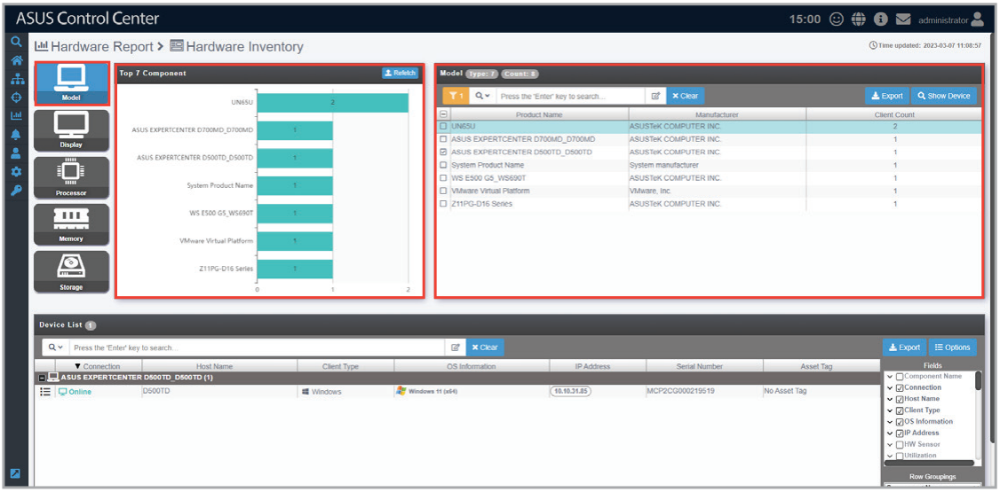

## View Display component type and count

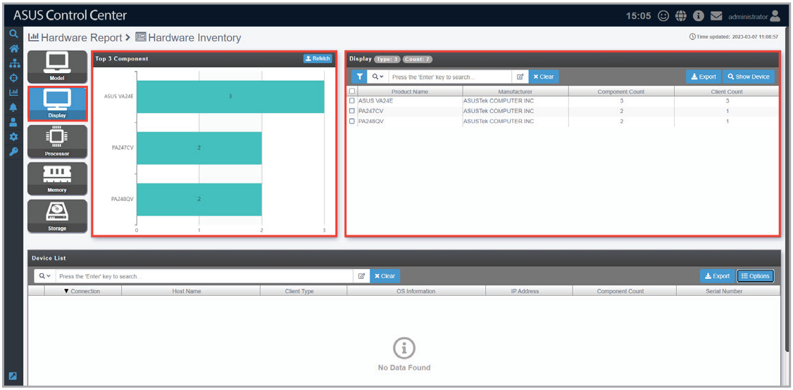

## View Processor component type and count

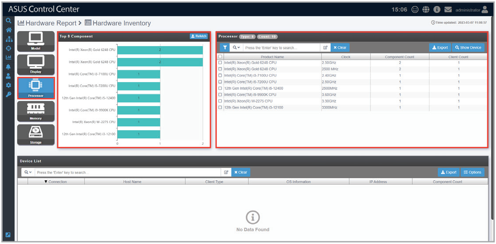

## View Memory component type and count

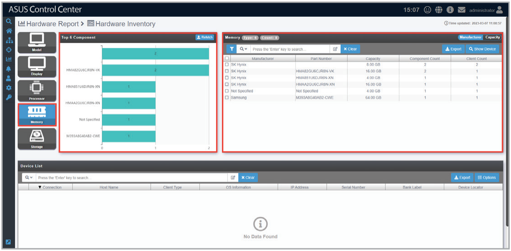

## View Storage component type and count

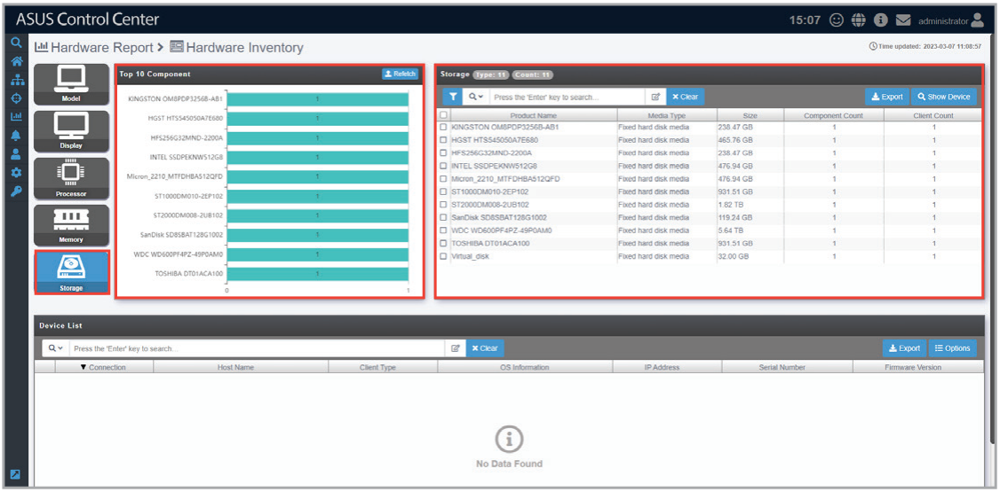

## Refetch hardware component

Click on **Refetch** to request agents to return an immediate update the list of Model, Processor, Memory, or Storage components of all managed devices depending on the component category selected, making sure all hardware components, including newly added hardware components are counted for.

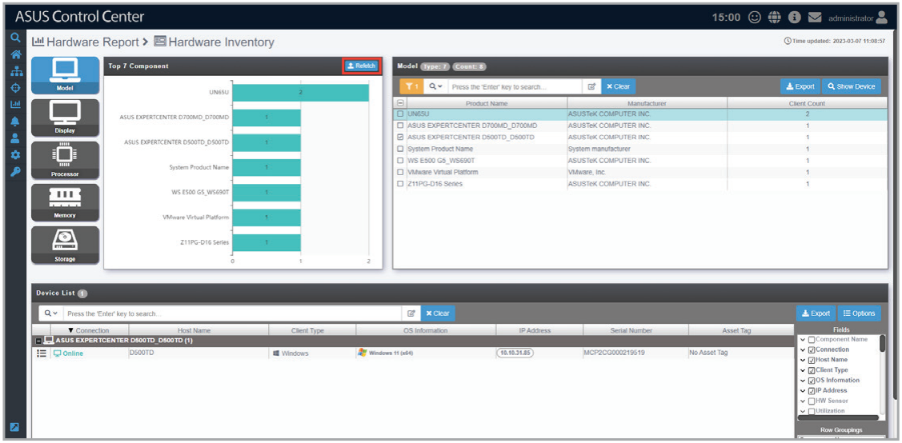

## Filter by component name

You can filter the components by the selected components.

1. Check the components you want to filter by then click on .

    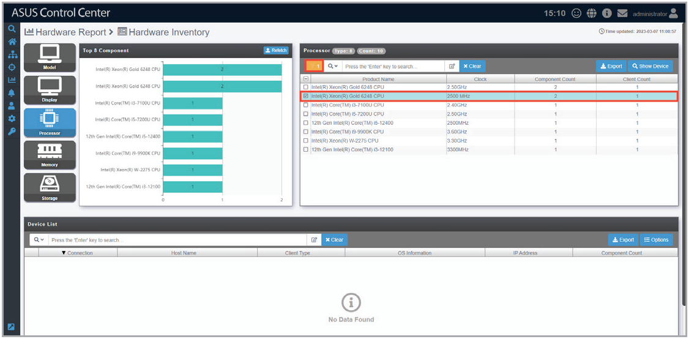

2. Confirm that the components displayed match the ones you checked, then click **Update**.

    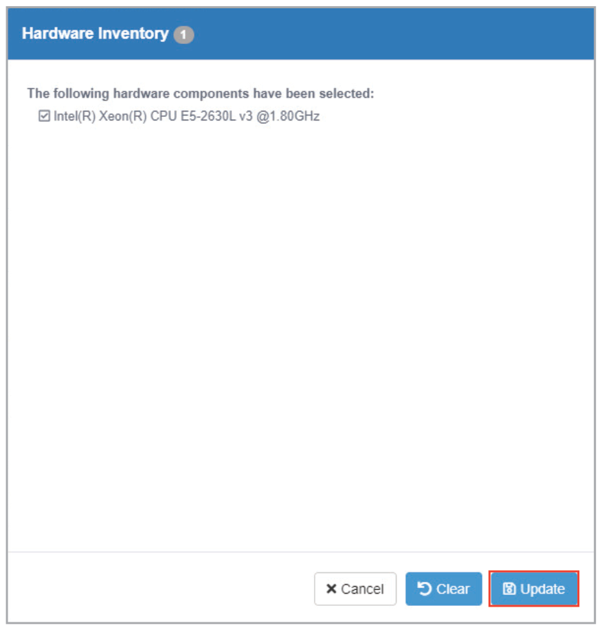

3. The component list should only display the selected components.

## Search for components using keywords

Entering keywords into the search bar will display all components which contain the keywords entered, allowing you to pinpoint certain hardware components and help you keep track of the amount of devices these hardware components are installed on.

1. Enter the keywords you wish to search for using the following methods:

    - Directly entering the keywords

        Enter the keyword(s) you wish to search with into the search bar and press `<Enter>`. Click on  to toggle between searching with **Search with 'AND' operator** or **Search with 'OR' operator**. **Search with 'AND' operator** will search for items which contain all keywords entered, whilst **Search with 'OR' operator** will search for items which contain at least one of the keywords entered.

        Checking the **Full string compare** option will only return search results of items which have a string with an exact match to the keywords, and can be applied to any of the above search operators selected.

        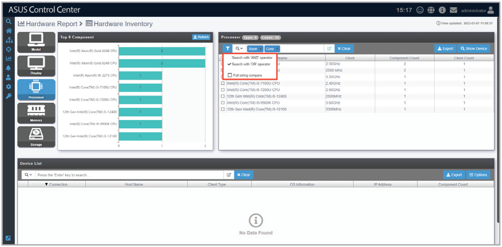

    - Importing multiple keywords from a .csv file

        - **a.** Click on  to bring up the search condition pop-up window.

            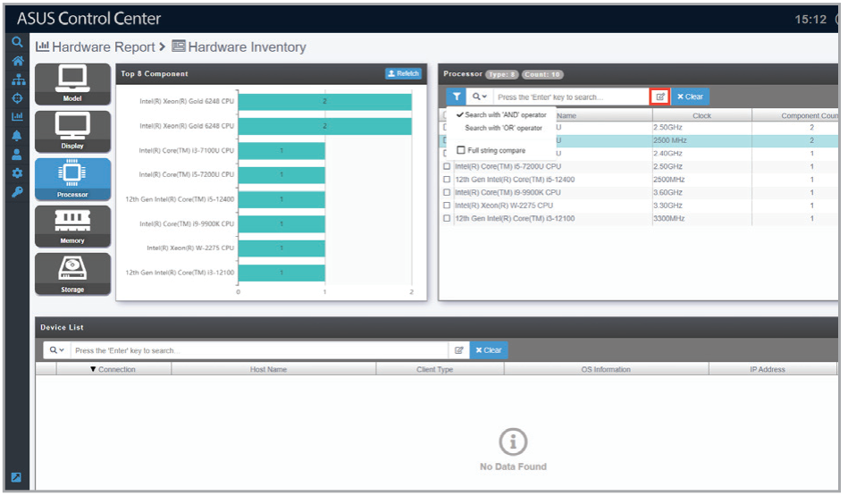

        - **b.** Select the operator you wish to use. **AND** will search for items which contain all the keywords entered, whilst **OR** will search for items which contain at least one of the keywords entered.

            Enabling the **Full string compare** option will only return search results of items which have a string with an exact match to the keywords, and can be applied to any of the above search operators selected.

            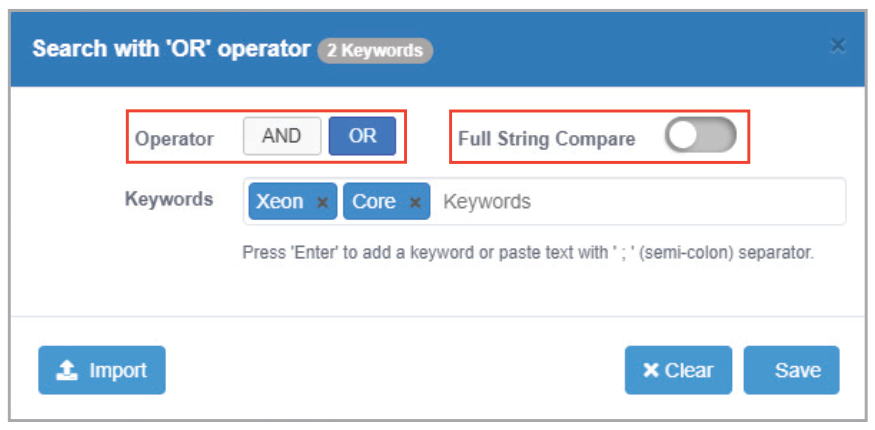

        - **c.** Enter the keyword(s) you wish to search with into the **Keywords** field and press `<Enter>`. You may also Import multiple keywords using a .csv file by clicking on **Import**, selecting the .csv file you wish to import, and then selecting the field in the .csv file you would like to import.

            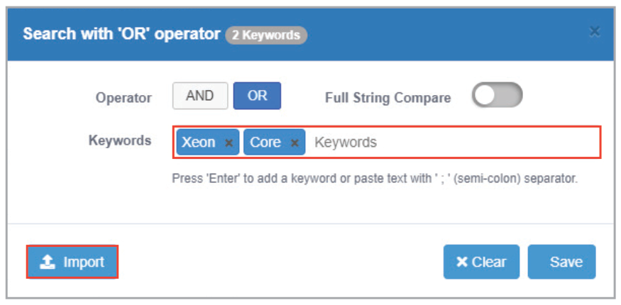

            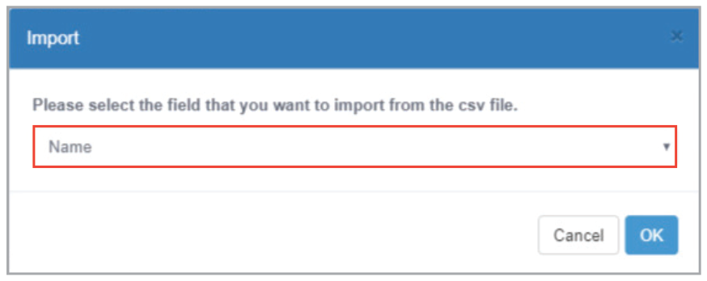

        - **d.** Click on **Save** once you have finished setting the search conditions.

            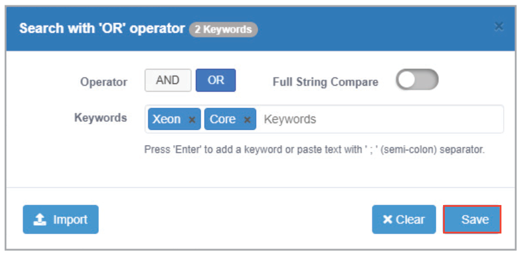

2. If you wish to view the devices a hardware component is installed on, check the application, then click on **Show Device**. The list of devices the selected application is installed on should be displayed in the **Device List** window

    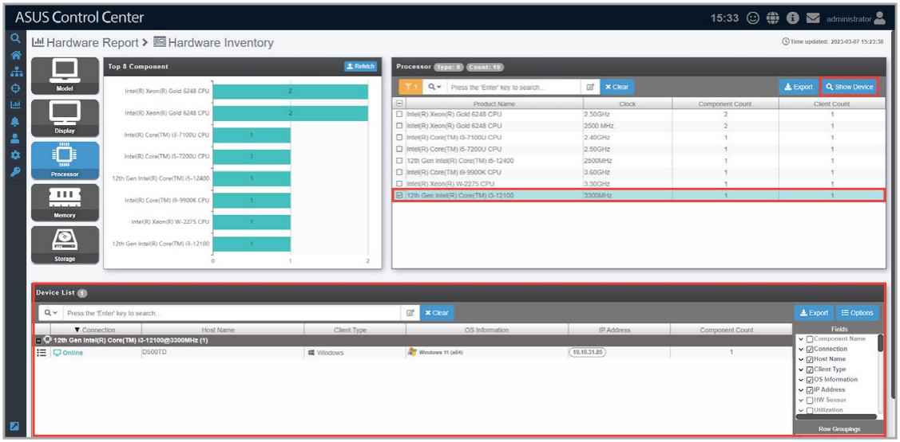

3. (optional) Clicking on  next to each device in the **Device List** will allow you to view the Device Information.

    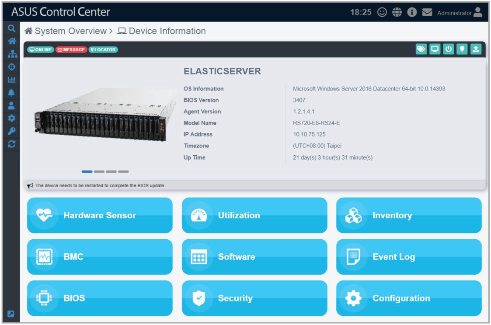
