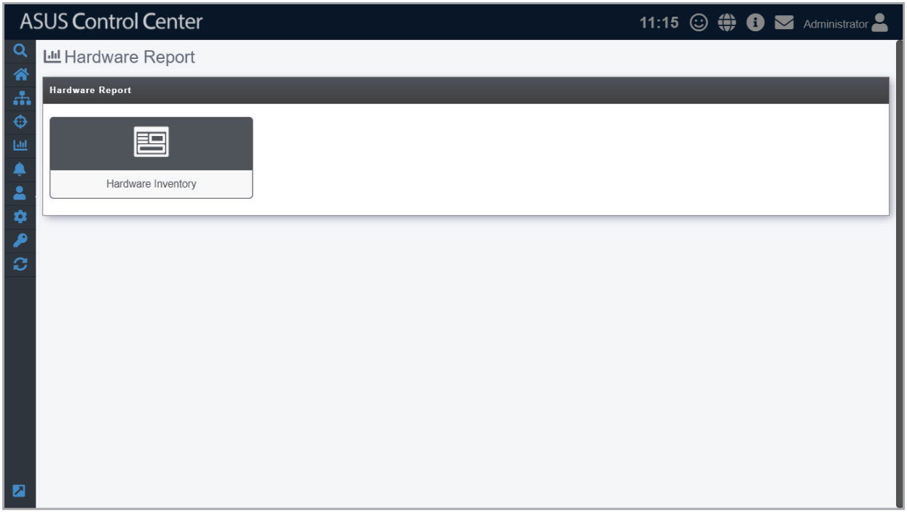

# Hardware Report

> **NOTE:** The information entered in this section is for reference only.

Hardware Report allows you to view a count of system models or hardware components of all managed devices, as well as rankings for each of these categories. For example you can view the top three storage components used in all managed devices.

To access **Hardware Report**, click  in the left menu, then click on **Hardware Report**.

**Using the search bar and search options**

Refer to the **Search Options** and **Search and Filter Devices** sections of the **Monitor** chapter for more information.
