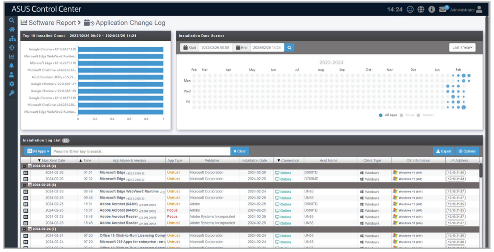
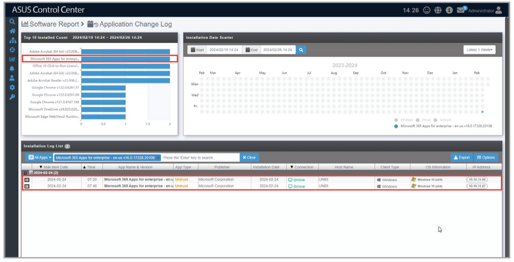
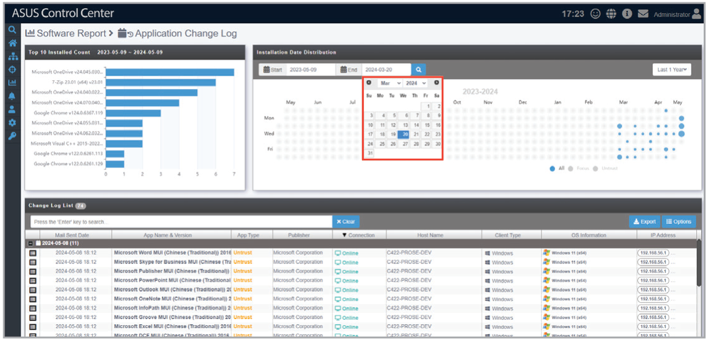
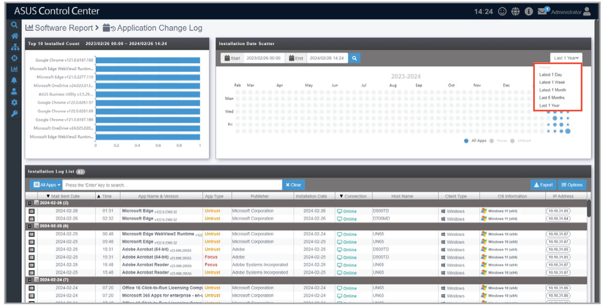
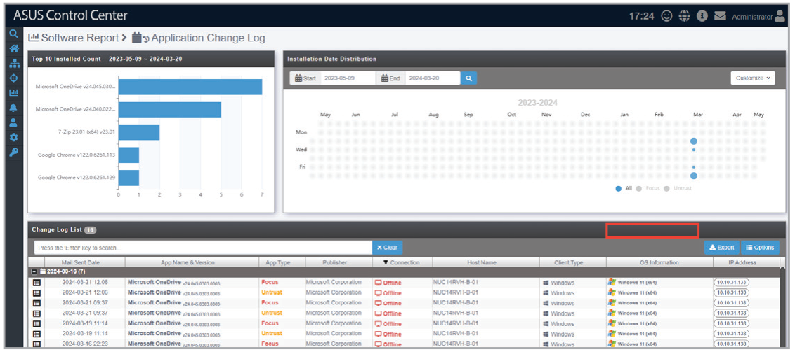
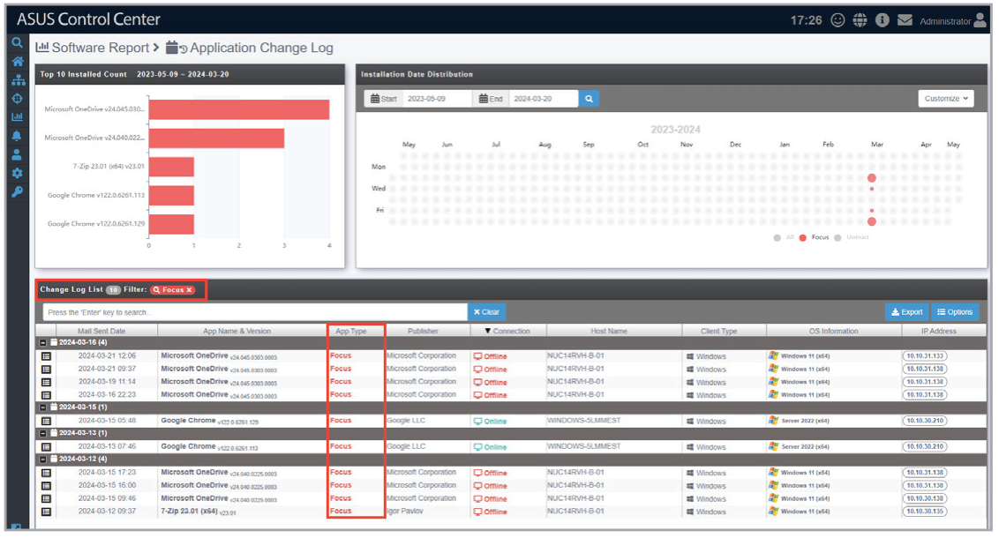

# Application Change Log

**Application Change Log** allows you to view application installation information for all managed devices.

> **NOTE:** To export the information of a block click the **Export** button in that block, enter a filename, then click **OK**.

## Filtering by application

Click an application in the **Top 10 Installed Count** block to only show devices with the specified application installed.

## Filtering by time period

Select a time period using the **Start** and **End** fields to only show records within the specified time period.

Select a time period from the **Period** drop down menu to only show records within the specified time period.

## Filtering by App Type

Select All Apps, Focus, or Untrust to only show records matching the specified app type.

