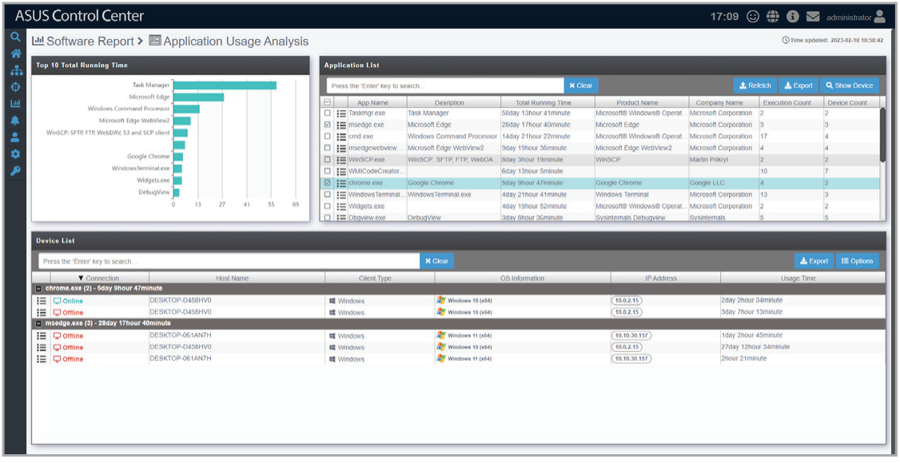

# Application Usage Analysis

**Application Usage Analysis** allows you to view the top ten most used applications, the execution count of each application, and other application usage information for all managed devices.

> **NOTE:** To export the information of a block click the **Export** button in that block, enter a filename, then click **OK**.

## Viewing application hash values

Click on  next to a selected application in the Application List to view more information about the application, such as the hash value. If there are multiple versions of an application, the hash value for each version will be shown.

## Viewing devices that have used a specified application

Select one or more application(s) in the Application List, then click  to display a list of all the managed devices that have used the selected application(s) and allows you to view additional information for each device.

Click  next to a selected device to view more information about the device.

## Refetching application usage information

Click on  to request agents to immediately return updated application usage information for all managed devices, making sure all the information displayed is up to date.
