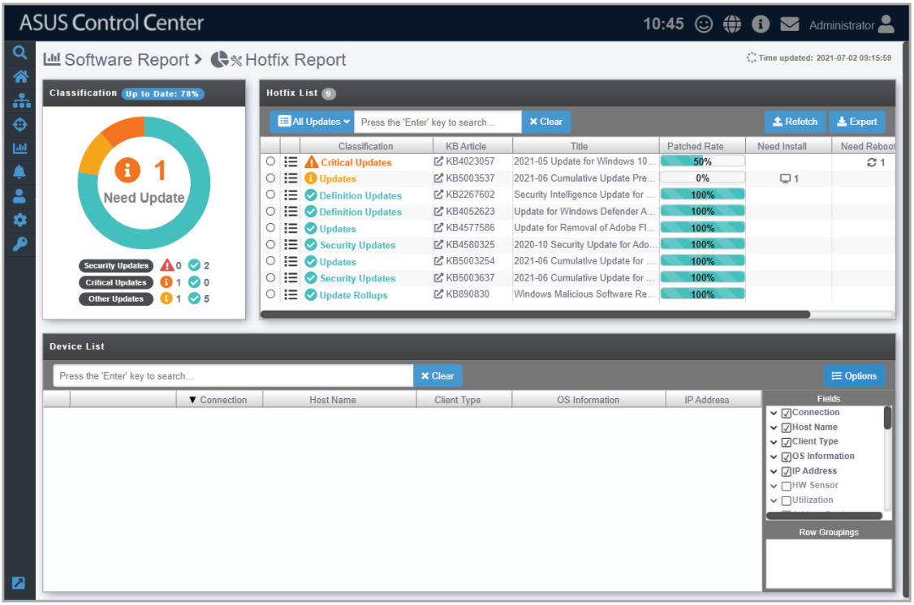
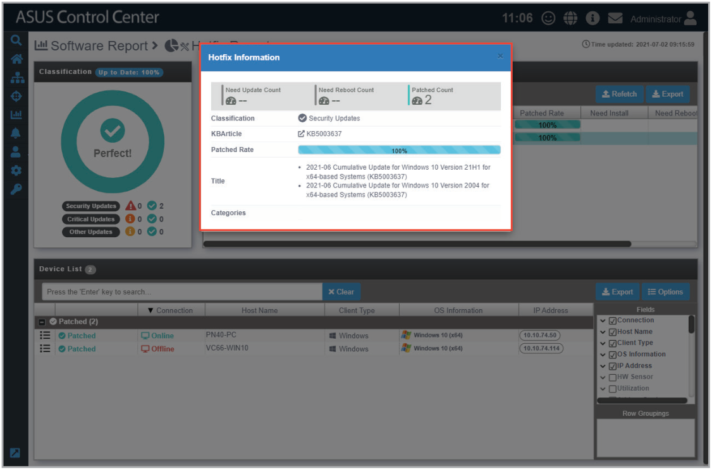
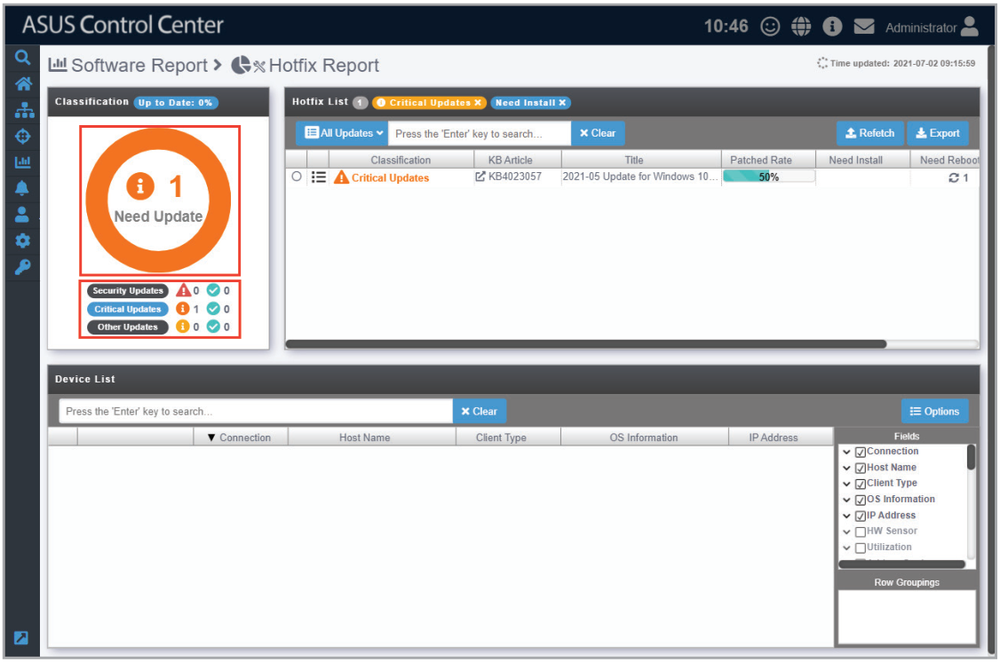
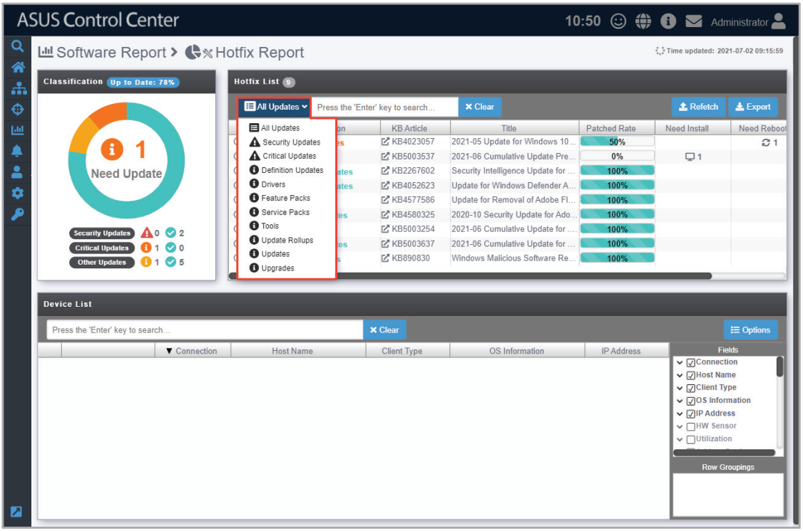
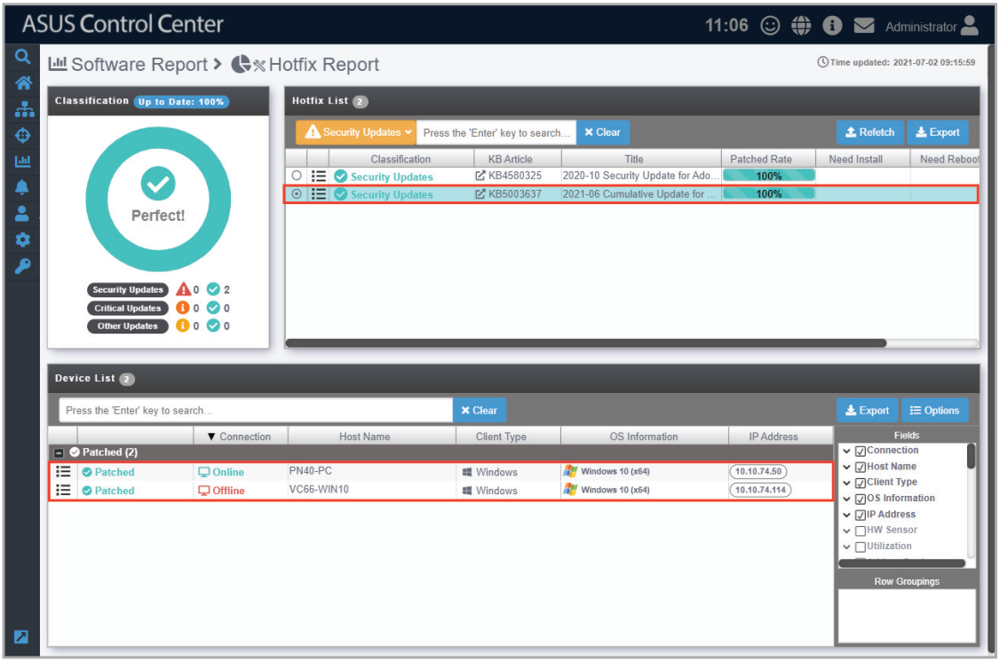
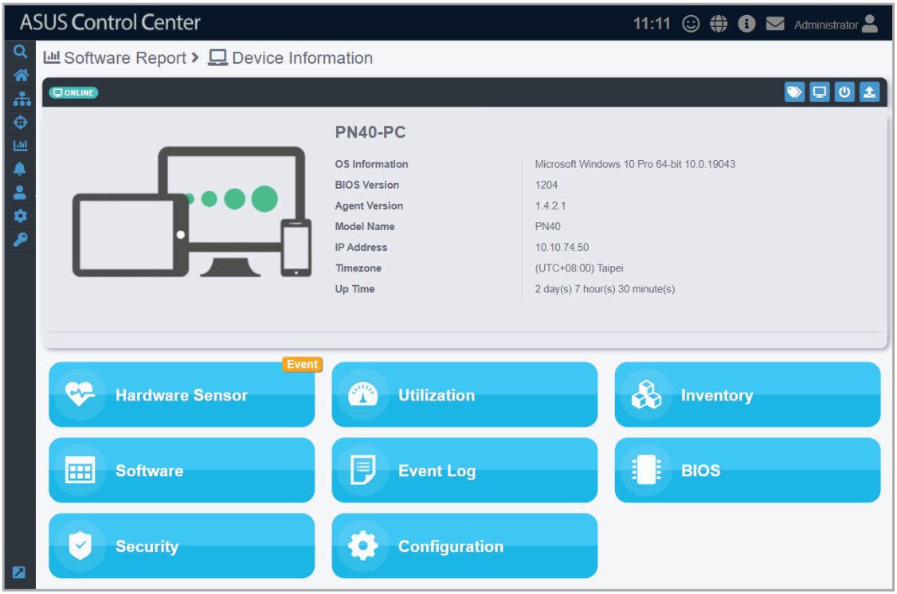

# Hotfix Report (Windows only)

**Hotfix Report** allows you to view or filter through hotfix updates on all managed Windows devices, helping you pinpoint managed Windows devices that require an immediate hotfix update.

> **NOTE:** To export the information of a block click the **Export** button in that block, enter a filename, then click **OK**.

Clicking on  next to a hotfix update in the Hotfix List will allow you to view more details on the hotfix.

## Filtering hotfixes using Classification

You can quickly filter hotfixes according to **Security Updates**, **Critical Updates**, or **Other Updates** by clicking on the respective item in the **Classification** block. This allows you to view the update statuses for the selected classification at a glance and give your attention to the hotfixes that still need to be updated. Alternatively, you can also filter the hotfixes by clicking on the overview circle allowing you to filter by hotfix updates successfully installed and those that still require your attention.

To clear the filter results, click on **Clear** in the Hotfix List block.

## Filtering hotfixes using Hotfix List

You can filter the Hotfix List according to the different categories provided in the drop down menu. To select a filter, click on the **All Updates** drop down menu, then select a category to filter by.

To clear the filter results, click on **Clear** in the Hotfix List block.

## Viewing devices the hotfix was applied to

Clicking on a hotfix update in the Hotfix List will list the managed devices the hotfix was applied to in the Device List below. This will allow you to better manage hotfix updates, and also manage issues with hotfix updates on managed devices, such as unsuccessful or pending hotfixes for individual devices.

You may also click on  next to each device in the **Device List** to view the Device Information.

