# Software Inventory

Through **Software Inventory** you may view all the installed applications on all managed devices or filter through the applications installed on managed devices, providing you with a quick way to periodically keep track of new applications installed and the devices they are installed on.

> **NOTE:** To export the information of a block click the **Export** button in that block, enter a filename, then click **OK**.

## Refetch Application

Click on **Refetch** to request agents to return an immediate update the list of installed applications on all managed devices, making sure all the information displayed is up to date.

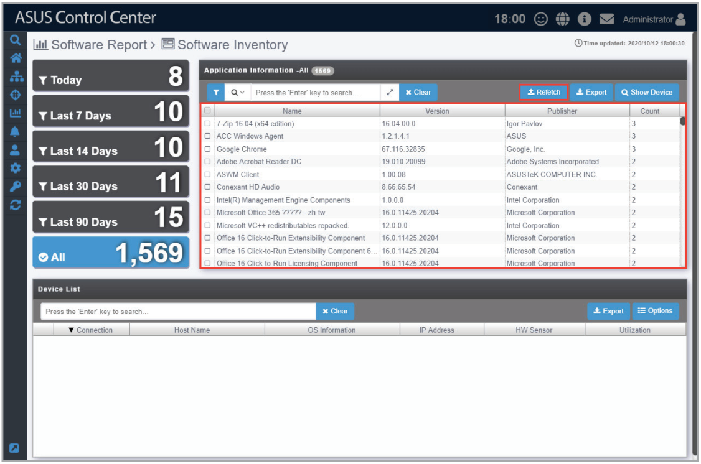

## Filter newly installed applications

To quickly filter newly installed applications within a time period, click on the **Today**, **Last 7 Days**, **Last 14 Days**, **Last 30 Days**, **Last 90 Days** or **All** time period filters located on the left of the screen. This will help you in periodically reviewing the applications installed within a selected time period.

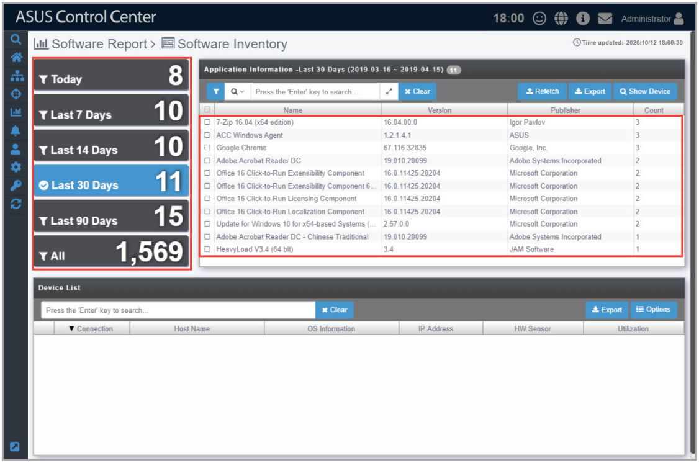

## Search for applications using keywords

Entering keywords into the search bar will display all installed applications which contain the keywords entered, allowing you to pinpoint certain applications and help you keep track of the amount of devices these applications are installed on as well as view which devices the applications are installed on. You may also view the device information as well as view all applications on the device to make sure your application information is correct.

1. Enter the keywords you wish to search for using the following methods:

    - Directly entering the keywords

        Enter the keyword(s) you wish to search with into the search bar and press `<Enter>`. Click on  to toggle between searching with the **AND** operator or **OR** operator. Searching using **AND** will search for items which contain all keywords entered, whilst searching using **OR** will search for items which contain at least one of the keywords entered.

        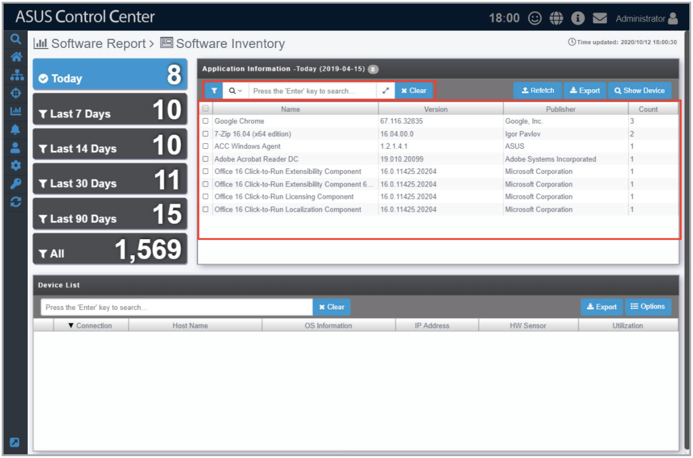

    - Importing multiple keywords from a .csv file

        - **a.** Click on 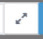 to bring up the search condition pop-up window.

            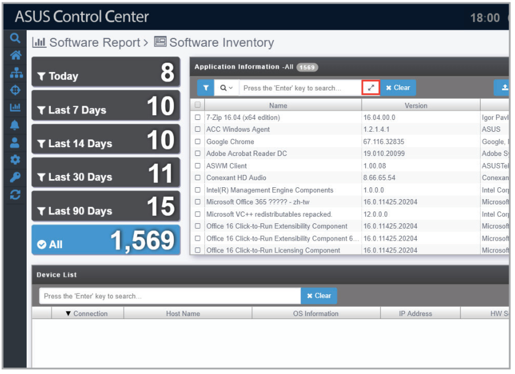

        - **b.** Select the operator you wish to use. **AND** will search for items which contain all the keywords entered, whilst **OR** will search for items which contain at least one of the keywords entered.

            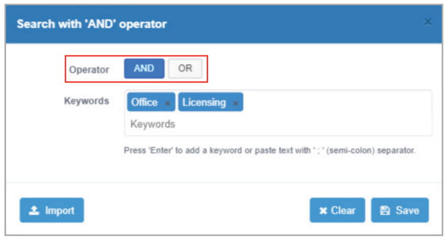

        - **c.** Enter the keyword(s) you wish to search with into the **Keywords** field and press `<Enter>`.

            

            Import multiple keywords using a .csv file by click on **Import**, selecting the .csv file you wish to import, and then selecting the column in the .csv file you would like to import.

            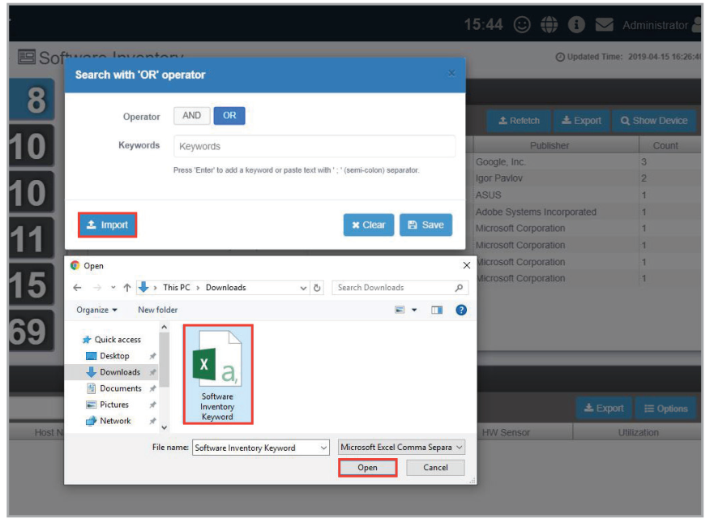

            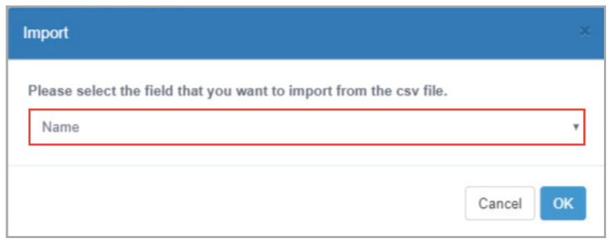

        - **d.** Click on **Save** once you have finished setting the search conditions.

            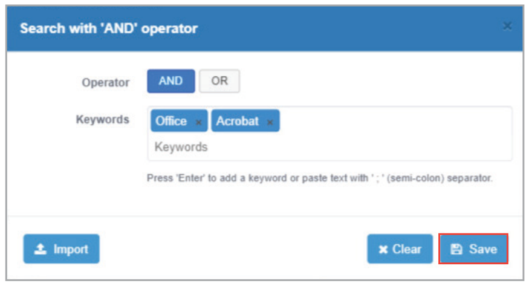

2. If you wish to view the devices an application is installed on, check the application, then click on **Show Device**. The list of devices the selected application is installed on should be displayed in the **Device List** window

    

3. (optional) Clicking on  next to each device in the **Device List** will allow you to view the Device Information.

    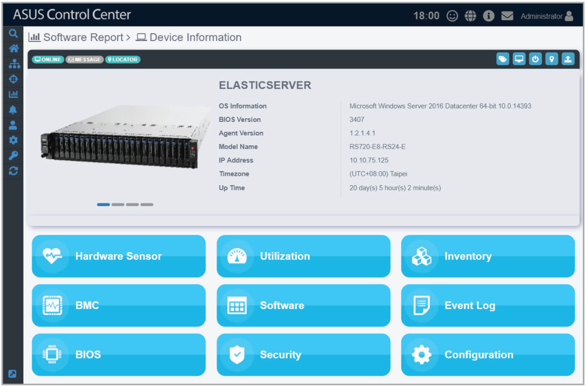

4. (optional) Clicking on the device will display all applications on the selected device.

    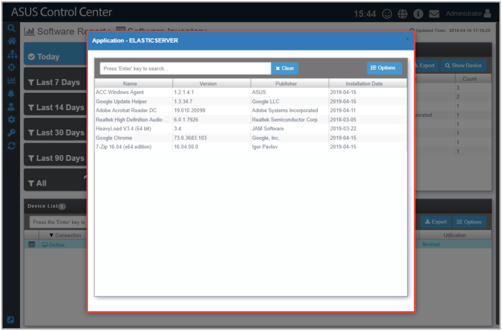
