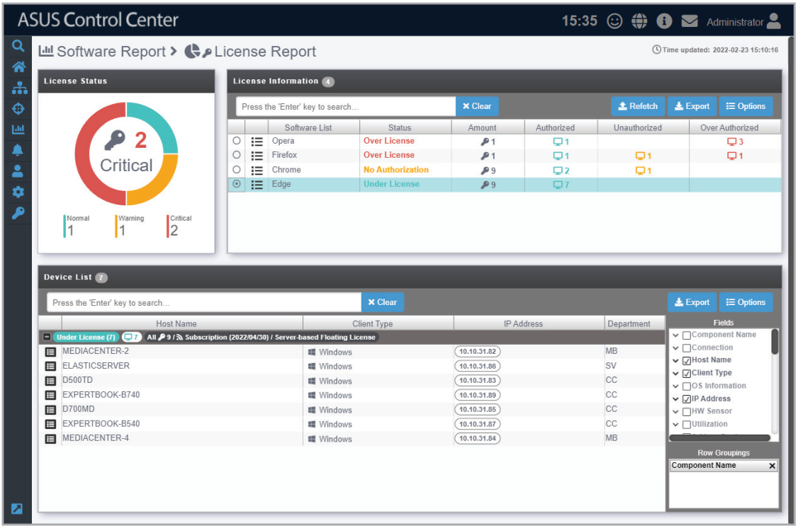
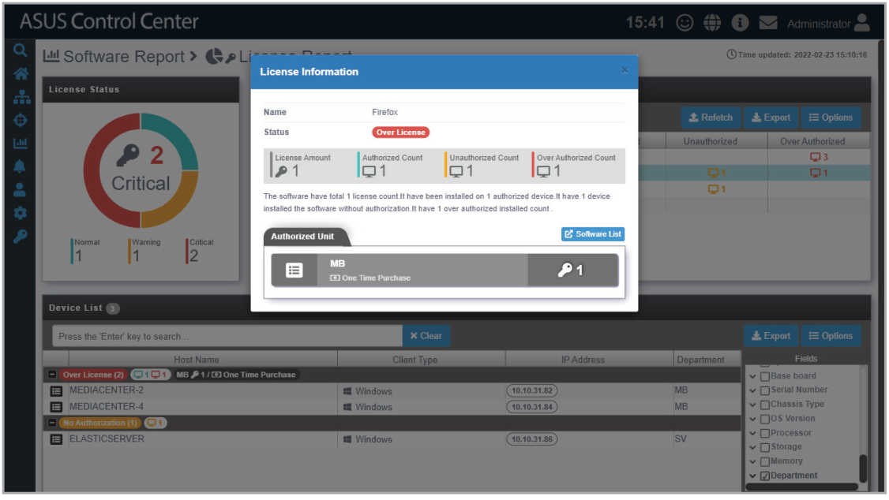
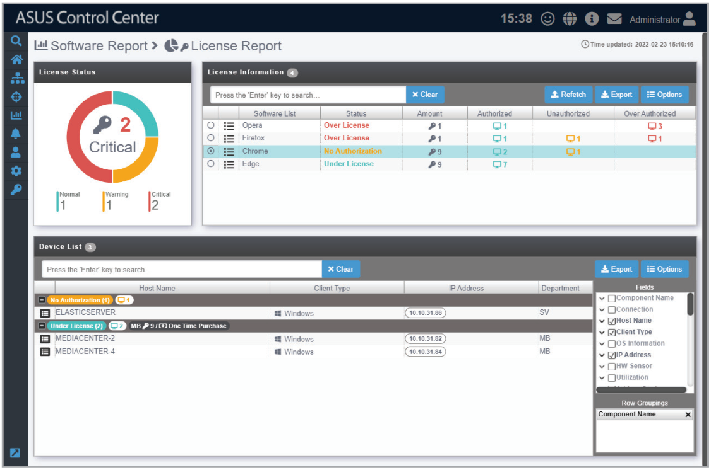
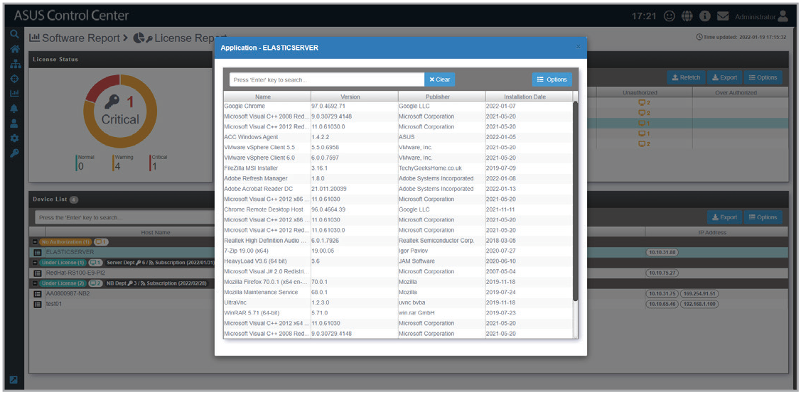

# License Report

**License Report** allows you to view the total amount of licenses for each software and on which managed devices they are installed on. This allows you to compare and ensure that the number of licenses authorized and the amount of total licenses match up.

> **NOTE:** To export the information of a block click the **Export** button in that block, enter a filename, then click **OK**.

## Viewing information on the license

Click on  next to a selected license to view more information about the license.

## Viewing devices the software was installed on

Clicking on a software in the License Information list will display all the managed devices the software is installed on, and also allows you to check which managed devices have the software installed without authorization, as well as the managed devices which have the appropriate license for the software.

> **NOTE:**
>
> - **Under License:** Sufficient licenses available and all software uses are authorized.
> - **No Authorization:** Sufficient licenses available but some software uses are unauthorized.
> - **Over License:** Insufficient licenses and some software uses are unauthorized.

You may also click on  next to each device in the **Device List** to view all the softwares installed on the selected device.

