# Service Report

**Service Report** allows you to view the services currently running on all managed devices, and also allows you to view the managed devices running a specific service.

> **NOTE:** To export the information of a block click the **Export** button in that block, enter a filename, then click **OK**.

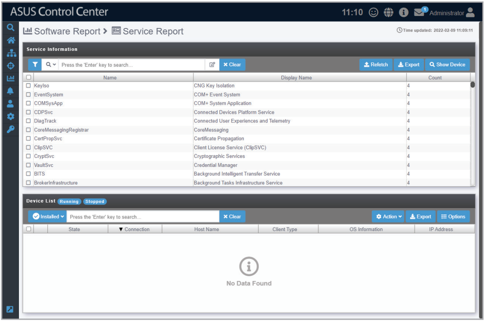

## Search for services using keywords

Entering keywords into the search bar will display all services which contain the keywords entered, allowing you to pinpoint certain services and help you keep track of the amount of devices these services are available on as well as view these devices.

1. Enter the keywords you wish to search for using the following methods:

    - Directly entering the keywords

        Enter the keyword(s) you wish to search with into the search bar and press `<Enter>`. Click on  to toggle between searching with the **AND** operator or **OR** operator. Searching using **AND** will search for items which contain all keywords entered, whilst searching using **OR** will search for items which contain at least one of the keywords entered.

        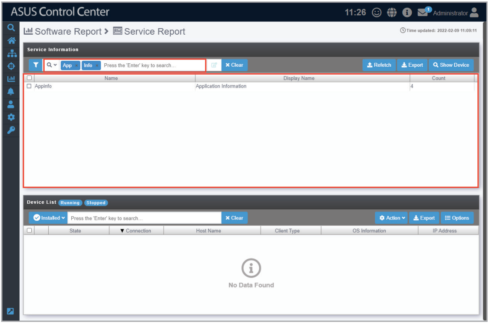

    - Importing multiple keywords from a .csv file

        - **a.** Click on  to bring up the search condition pop-up window.

            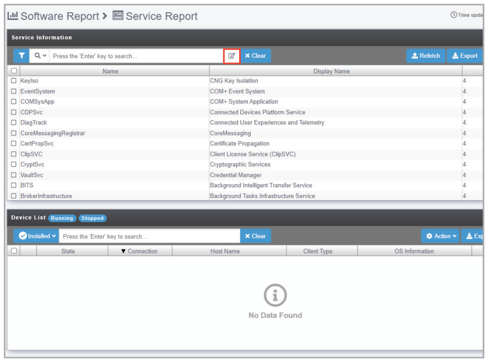

        - **b.** Select the operator you wish to use. **AND** will search for items which contain all the keywords entered, whilst **OR** will search for items which contain at least one of the keywords entered.

            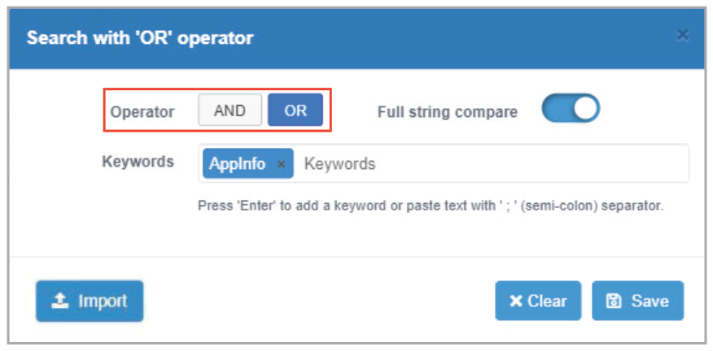

        - **c.** Enter the keyword(s) you wish to search with into the **Keywords** field and press `<Enter>`.

            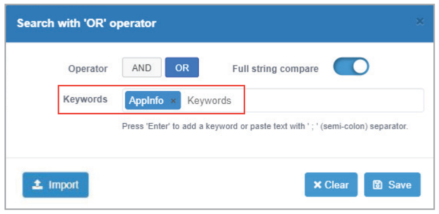

            Import multiple keywords using a .csv file by click on **Import**, selecting the .csv file you wish to import, and then selecting the column in the .csv file you would like to import.

            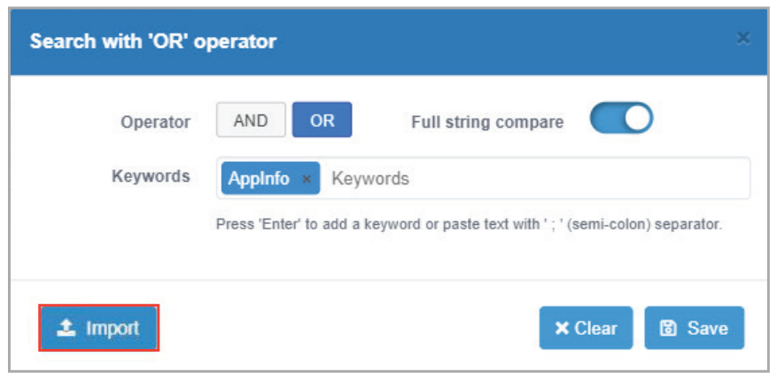

            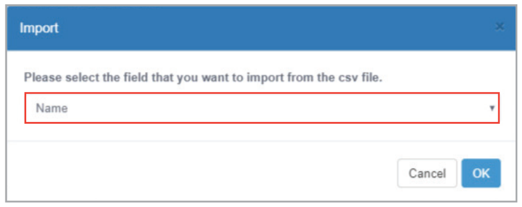

        - **d.** Click on **Save** once you have finished setting the search conditions.

            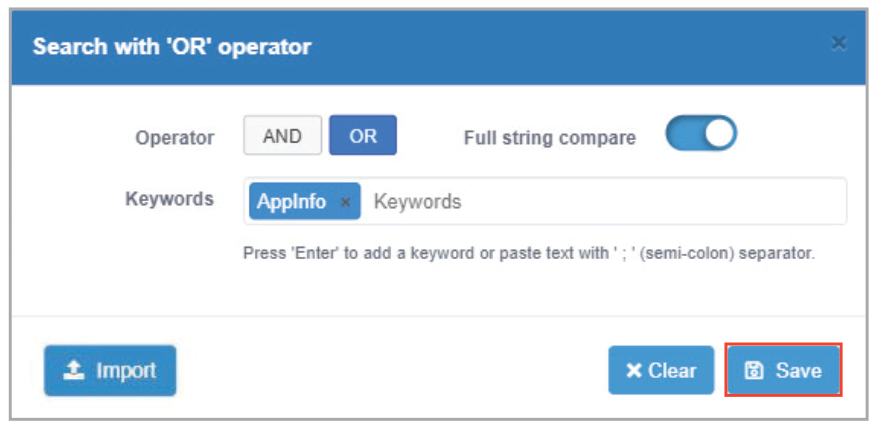

2. If you wish to view the devices a service is available on, check the service, then click on **Show Device**. The list of devices the selected service is available on should be displayed in the **Device List** window.

    > **NOTE:** You can also click on  to quickly deselect services already selected.

    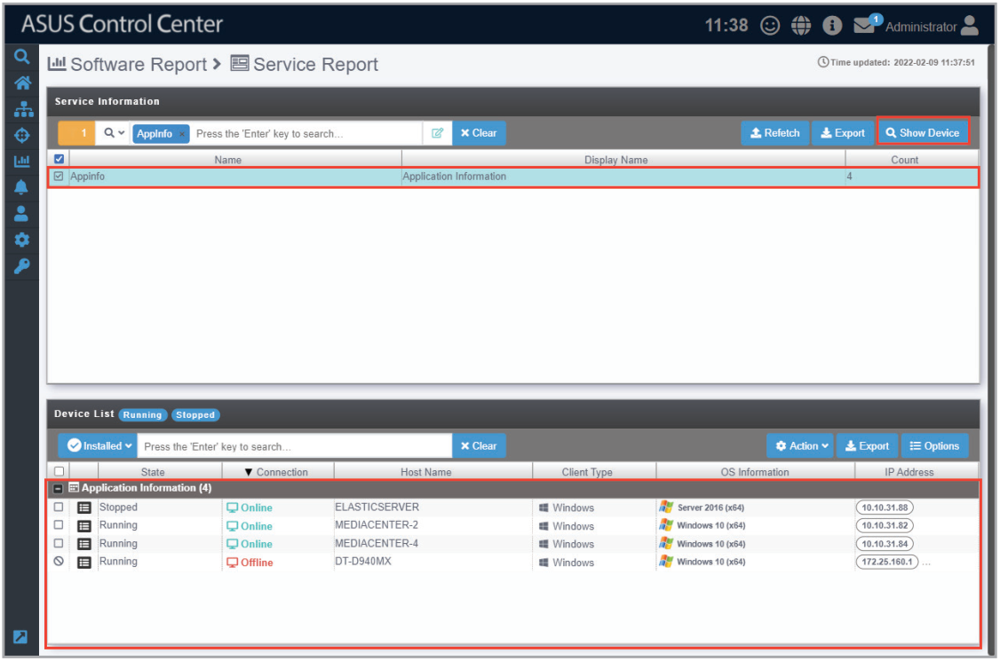

3. (optional) You may filter through the devices by clicking on the tags next to the Device List title, or filter by **Installed** or **Not Installed** by clicking on the drop down menu next to the search bar.

    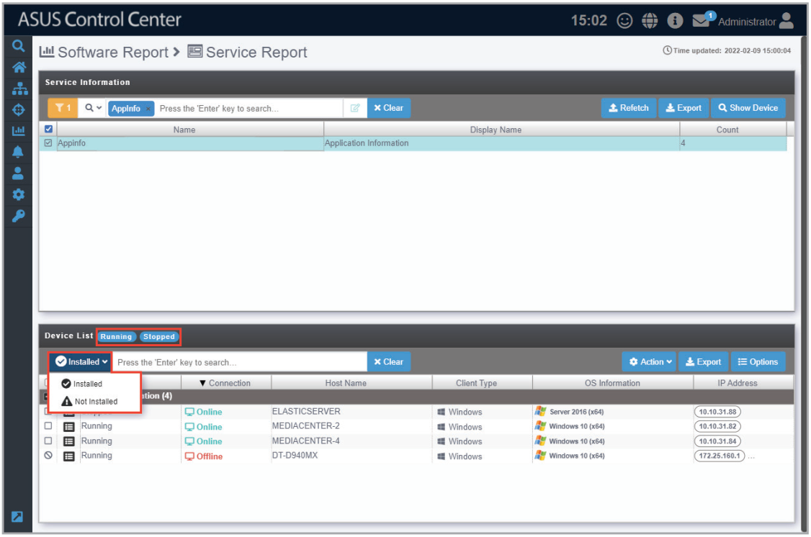

4. (optional) Clicking on  next to each device in the **Device List** will allow you to view all services on the selected device.

    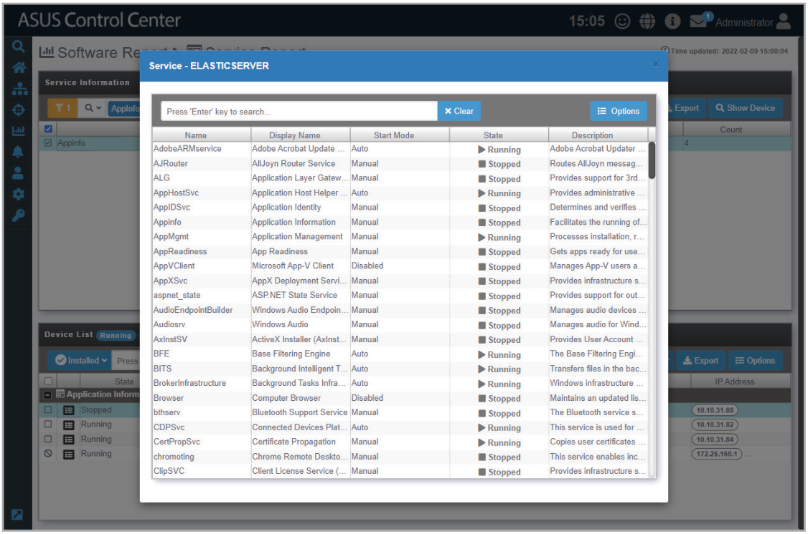

## Starting, stopping or restarting a service

You can start, stop, or restart a selected service on a device by selecting the device in the Device List and clicking on the **Action** drop down menu to select your action.

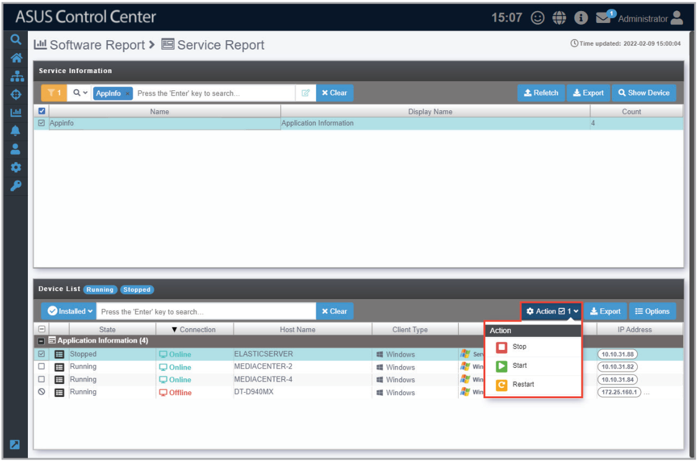

Starting, stopping or restarting the service may take up to two minutes to be completed. Once the process is completed, check if the count is correct, if not, you can click the **Refetch** button to refetch the service information.
