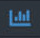
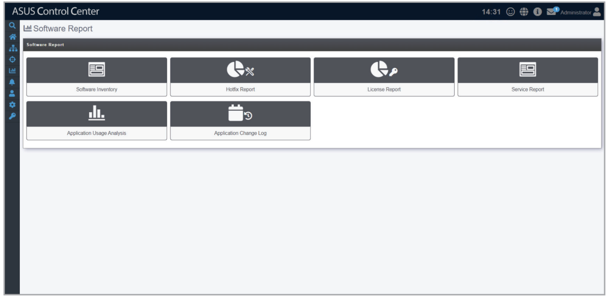

# Software Report

> **NOTE:** The information entered in this section is for reference only.

Software Report allows you to manage your report subscriptions on the applications installed on added devices. You may also customize which applications to receive reports on, as well as pinpoint applications which meet the rules you set, allowing you to efficiently manage high-priority applications and ignore applications which may not require much maintenance.

To access **Software Report**, click  in the left menu, then click on **Software Report**.

**Using the search bar and search options**

Refer to the **Search Options** and **Search and Filter Devices** sections of the **Monitor** chapter for more information.
