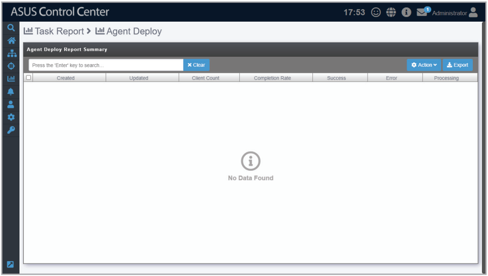

# Agent Deploy Report

The **Agent Deploy Report** will display information on each time agent(s) are deployed onto managed devices. The list of agent deployment results are grouped be each batch of agent deployments. You can refer to the **Agent Deploy Report** section for more details.

> **NOTE:** To export the information of a block click the **Export** button in that block, enter a filename, then click **OK**.

