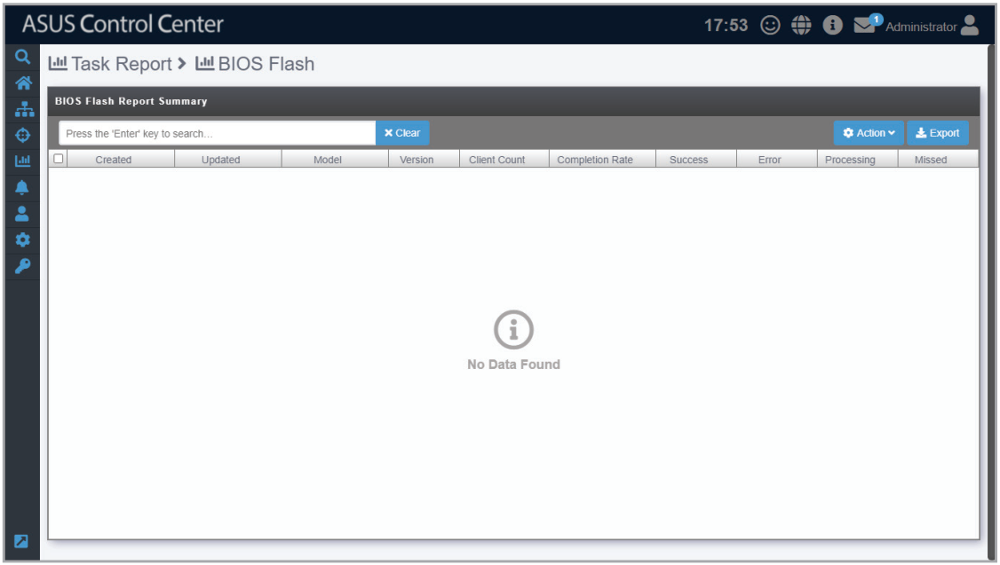

# BIOS Flash Report

The **BIOS Flash Report** will display a history of BIOS flashes performed using ASUS Control Center. Each item will display the information on the BIOS, the device flashed, and status of the BIOS flash. You can refer to the **BIOS Flash Task Report** section for more details.

> **NOTE:** To export the information of a block click the **Export** button in that block, enter a filename, then click **OK**.

