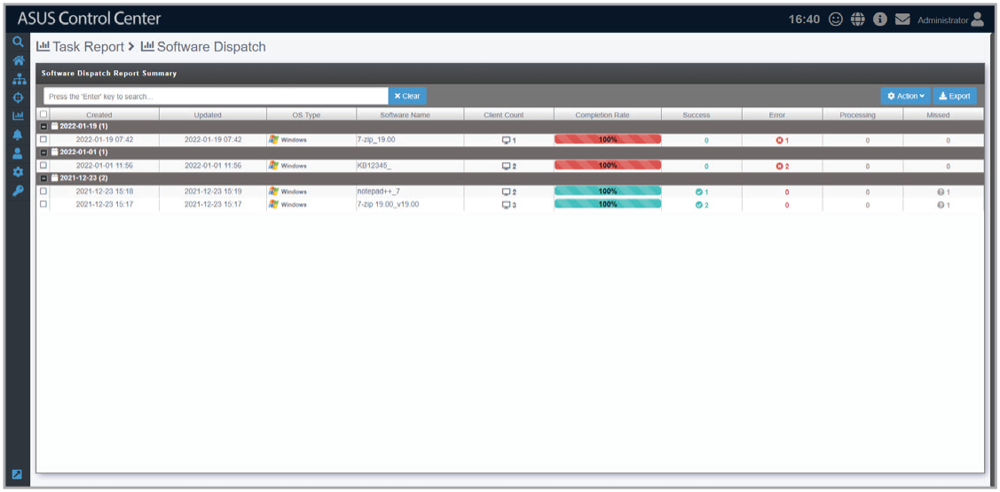

# Software Dispatch Report

The **Software Dispatch Report** gives you an overview of all activities of application deployment. On the Software Dispatch report screen you can view information such as the date an application was dispatched, the last time its status was updated, the completion rate, how many clients the application was dispatched to, and also the status of the dispatch. You can refer to the **Software Dispatch Task Report** section for more details.

> **NOTE:** To export the information of a block click the **Export** button in that block, enter a filename, then click **OK**.

