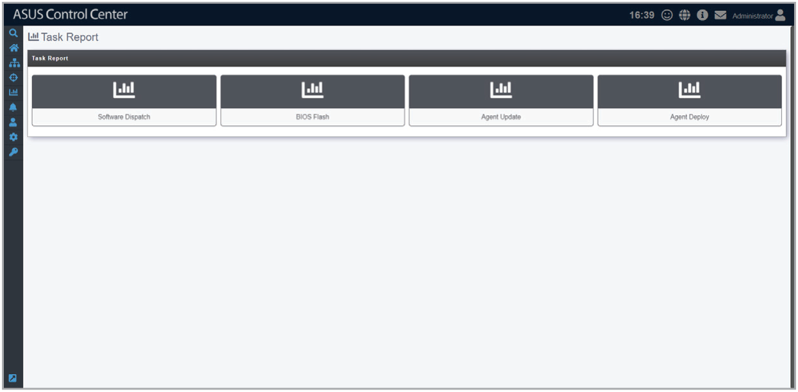

# Task Report

> **NOTE:** The information entered in this section is for reference only.

**Task Report** provides you with information on **Software Dispatch**, **BIOS Flash**, **Agent Update**, and **Agent Deploy**. These reports allow you to view when applications, BIOS, or agents were deployed, where they were deployed and their process statuses, helping you track all application, BIOS, and agent activity.

To access **Task Report**, click  > **Task Report** in the left menu.

**Using the search bar and search options**

Refer to the **Search Options** and **Search and Filter Devices** sections of the **Monitor** chapter for more information.
