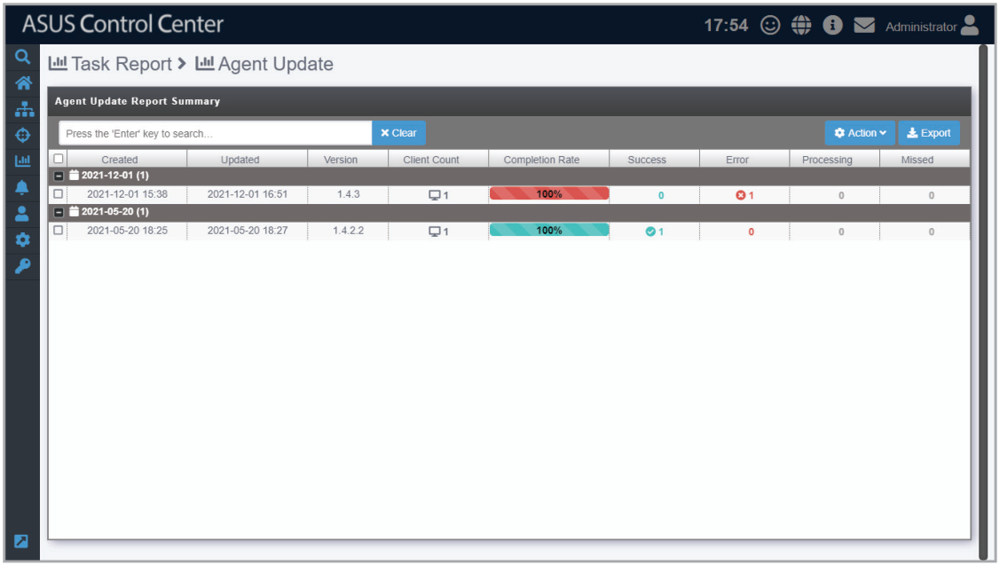

# Agent Update Report

The **Agent Update Report** displays information on each upgrade to the deployed Windows and Linux agents. Each item showed on the Agent Update Report represents a single batch of agent updates. You can refer to the **Agent Update Report** section for more details.

> **NOTE:** To export the information of a block click the **Export** button in that block, enter a filename, then click **OK**.

